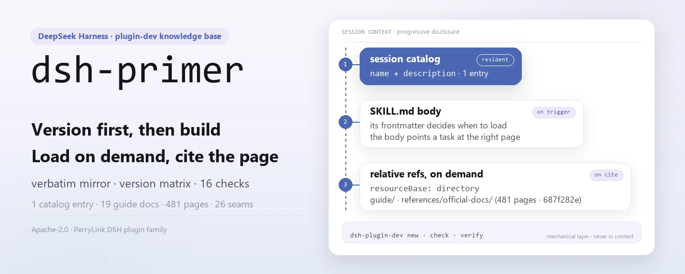
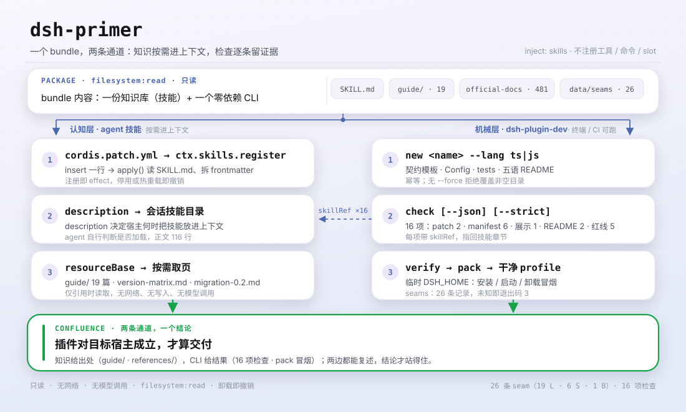

<div align="center">

<picture>
  <source media="(prefers-color-scheme: dark)" srcset="docs/assets/dsh-primer-hero-en-dark.webp">
  
</picture>

# dsh-primer

**Ask which version you are targeting before you write code — make the agent build against the host line, not against a remembered API.**

The DeepSeek Harness plugin-development knowledge base: an offline verbatim docs mirror, a version-compatibility matrix, migration seams and battle-tested pitfalls, installed as an on-demand agent skill — plus the `dsh-plugin-dev new / check / verify` scaffolder and checker CLI.

[Install](#three-step-setup) · [Configuration](#configuration) · [FAQ](#faq) · [简体中文](README.md) · [English](README.en.md) · [Español](README.es.md) · [Português](README.pt.md) · [हिन्दी](README.hi.md)

[](LICENSE)
[](#compatibility)
[](https://www.npmjs.com/package/dsh-primer)
[](https://github.com/PerryLink/dsh-primer/actions/workflows/verify.yml)
[](#compatibility)

[](https://github.com/PerryLink/dsh-primer/stargazers)
[](https://www.npmjs.com/package/dsh-primer)
[](https://dshfind.com/plugins/PerryLink/dsh-primer?ref=badge)
[](https://securityscorecards.dev/viewer/?uri=github.com/PerryLink/dsh-primer)
[](https://dsh.market/)

```sh
dsh plugin --profile <name> add dsh-primer
```

</div>

<sub>Community plugin, not affiliated with DeepSeek. Canonical repository: <https://github.com/PerryLink/dsh-primer>.</sub>

## What it is

`dsh-primer` packs everything DSH plugin development needs into one installable bundle: a knowledge base registered as the `dsh-primer` agent skill (visible in every session catalog, loading workflow steps, official docs and community deep-dives into context on demand), plus the zero-runtime-dependency `dsh-plugin-dev` CLI, which adds three mechanical layers on top of that knowledge.

Community-maintained, **not** an official DeepSeek product. DeepSeek Harness is in developer preview and keeps shipping breaking changes; when in doubt, the official docs in `references/official-docs/` are the source of truth.

Why not just read the official docs? Because they are written for someone who already knows which page to open, and DSH ships a prerelease every 1.7–2.8 days with breaking changes. This plugin closes the three gaps that cost authors the most time:

| Gap | What this plugin adds |
|---|---|
| **"Which DSH am I even targeting?"** | A [version matrix](guide/version-matrix.md): the five different values that all call themselves "latest", the frozen sub-package `latest` tags, the breaking-change seams, and how to pick a `peerDependencies` range. **There is no stable line.** |
| **"What does this break?"** | A [migration guide](guide/migration-0.2.md) covering `0.1.6-alpha.2` → `0.2.1-alpha.2` as citable seams with symptom *and* fix, each with its official source — including a data-loss hazard and a change that makes prompts fail before a model request is built. |
| **"Is my plugin actually correct?"** | A [zero-dependency CLI](SKILL.md) (`dsh-plugin-dev new / check / verify`) plus an [offline verbatim mirror](references/official-docs/) of the official docs, so your agent can cite the exact page instead of guessing. |

<picture>
  <source media="(prefers-color-scheme: dark)" srcset="docs/assets/dsh-primer-flow-v5-dark.svg">
  
</picture>

## Three-step setup

1. **Install** (one of three channels):

   ```sh
   # npm channel (published releases — start here)
   dsh plugin --profile web add dsh-primer
   # git channel (latest main): dist/ is not committed, so pnpm needs this package's prepare build allowlisted
   dsh plugin --profile web add github:PerryLink/dsh-primer#<sha>
   # tarball channel: after pnpm pack in this repository
   dsh plugin --profile web add ./dsh-primer-<version>.tgz
   ```

2. **Restart and confirm the row mounted**:

   ```sh
   dsh --profile web --dump-config | grep -A3 'id: dsh-primer'
   ```

   ```text
   - id: dsh-primer
     name: dsh-primer
   ```

   The session skill catalog should now list `dsh-primer`; the skill body is the packaged `SKILL.md`, and its relative references resolve through a directory `resourceBase` into `guide/` and `references/`.

3. **Prove it works in 60 seconds** (or just ask your agent: *"Use the dsh-primer skill to build me a … plugin."*):

   ```sh
   npx dsh-primer new hello-plugin                  # scaffold a TS plugin repo
   cd hello-plugin && npx dsh-primer check --json   # 16 static checks
   npx dsh-primer verify                            # pack + clean-profile smoke
   ```

**Uninstall**: `dsh plugin --profile web remove dsh-primer` (or delete the row from the profile patch). Registration is a Cordis effect, so removal undoes it with no residue.

> Use the npm channel for a first install. The git channel pulls source and `dist/` is not committed, so pnpm has to run this package's `prepare` build — which requires allowlisting the package in the profile's `allowBuilds`. That is a documented cost of git installs, not a defect, but it makes a poor first experience.

<details>
<summary>Install from the DSH Desktop Market</summary>

All PerryLink plugins are browsable in the built-in DSH Desktop Market: **Market → Sources → add source → paste** `https://perrylink-dsh-catalog.perrylink.workers.dev/catalog-source.json` **→ select it**. Installation still goes through the Market's npm-identity verification and your confirmation. On the 1024 store channel: `npm i -g dsh1024`, then `dsh1024 plugin --profile web add dsh-primer`.

</details>

## Core capabilities

`dsh-primer` is the DSH plugin-development knowledge base plus a CLI toolchain, packaged as one installable bundle. The knowledge base registers as the `dsh-primer` agent skill (visible in every session catalog, loading workflow steps, official docs and community deep-dives on demand); the `dsh-plugin-dev` CLI adds three mechanical layers on top of it.

- **Plugin contract and hard rules** — effects/disposers, waterfall listeners that must call `next()`, host-owned session events, model-visible ⟺ logged, Schemastery config, UI and performance rules.
- **Official docs mirror** — `references/official-docs/`: a verbatim copy of the official repo docs (EN + ZH), byte-identical to upstream at the last verified snapshot, including the pages that never reach the documentation site.
- **Version-adaptivity matrix** — [guide/version-matrix.md](guide/version-matrix.md): the five different "latest" values, the frozen sub-package `latest` tags, the four breaking-change seams, how to pick a peer range, the session-format lineage V0→V4, and the 19 breaking changes that landed in `0.2.1-alpha.2`.
- **Migration guide** — [guide/migration-0.2.md](guide/migration-0.2.md): every breaking change from `0.1.6-alpha.2` to `0.2.1-alpha.1` (session format V4, the settings rebuild, invariant removal, `readBytes`, new slots, the retired `plugin` message source), each with its official source and a 12-item checklist.
- **Cordis primer and the official skill, distilled** — the five Cordis concepts and the mechanism timeline; [references/official-plugin-dev-skill.md](references/official-plugin-dev-skill.md) distils the harness's own `cordis-plugin-development` prohibitions, display-metadata checklist, and UI/performance rules.
- **Verified issue index** — [guide/unfixed-issues.md](guide/unfixed-issues.md): 22 unfixed + 11 newly verified items with `path:line`, workarounds and fixing commits, plus a design-vs-bug table and an explicit "unreproducible" section.
- **30+ real-world pitfalls** with root cause and fix (cordis dual copies, the tsconfig trio, multi-frame zstd sessions, Windows junctions, stale npm `latest`, `file:` installs loading a copy, live patch writes, …).
- **Community deep-dives** — 114 community repositories archived (15 deep-dived), plus a full source index where every fact links to its origin.
- **CLI toolchain** — `dsh-plugin-dev new / check / verify`: scaffold, static-check (including display metadata and multi-patch manifests) and pack-verify DSH plugins; every check links back to the skill section it enforces.
- **Family toolchain routing and mirror-scope decision** — [guide/family-toolchain.md](guide/family-toolchain.md) says which tool owns which question, with the full `dsh-plugin-doctor` 33-check table cross-referenced against this repo's 16 checks; [references/mirror-scope-decision.md](references/mirror-scope-decision.md) records why "delete zero-reference content to save 80% of the size" did not survive re-measurement.
- **Adoption levels (non-official)** — [guide/standards.md](guide/standards.md): the DSH-ENTRY / DSH-FLOW / DSH-BOOST model, the depth × evidence table, what each level does *not* claim, and how to move up. The GB / GB-T / GB-Z comparison is an analogy only; certification grades A–D are orthogonal.

### Surfaces

| Surface | Kind | Notes |
|---|---|---|
| `dsh-primer` | skill | Registered through `ctx.skills`; loads `SKILL.md` + `./guide/` + `./references/` on demand |
| `dsh-plugin-dev` | bin (CLI) | `new` / `check` / `verify` subcommands; not a DSH plugin row |

## Knowledge-base map

| Path | What it is |
|---|---|
| `SKILL.md` | The `dsh-primer` agent skill: hard rules + task-based development paths |
| `package.json` · `cordis.patch.yml` · `index.js` · `locale/` · `icon.svg` | The installable DSH bundle: `dsh.bundle.patch` manifest, entry point that registers the skill, and the display metadata Plugin Manager reads |
| `guide/plugin-dev-guide.md` | The complete development guide (10 chapters) |
| `guide/version-matrix.md` | Version-adaptivity matrix: the five "latest" values, frozen sub-package `latest` tags, breaking-change seams, peer-range selection, session-format lineage, the 19 changes in `0.2.1-alpha.2` |
| `guide/migration-0.2.md` | Breaking-change migration guide for the 0.2 generation (§0–§12 up to `0.2.1-alpha.1`, §13 covering the 19 seams of `0.2.1-alpha.2`) |
| `guide/unfixed-issues.md` | Source-verified bug index + fixed-on-master list + design-vs-bug table |
| `guide/quick-reference.md` | One-page cheat sheet (5 languages) |
| `guide/links.md` | Curated URL index: official dev docs (site ↔ local copies) + community doc links + repo-only pages |
| `guide/when-to-retire-a-plugin.md` | Retiring and freezing plugins: the criteria and the measured data behind a portfolio audit (EN + ZH) |
| `guide/choosing-a-plugin.md` | Choosing a plugin: who leads each capability surface, with the measured numbers and verification caveats (EN + ZH) |
| `guide/family-toolchain.md` | Family toolchain routing: question → owner → citable artifact; the full `dsh-plugin-doctor` 33-check table cross-referenced against this repo's 16 checks |
| `guide/standards.md` | Adoption levels (non-official): the DSH-ENTRY / DSH-FLOW / DSH-BOOST model and the two-axis table (EN + ZH) |
| `references/official-docs/` | Verbatim copy of the official repo docs (EN + ZH); the freshness stamp lives in `SNAPSHOT.md` |
| `references/official-plugin-dev-skill.md` | Distilled official in-repo plugin-development skill |
| `references/mirror-scope-decision.md` | Mirror-scope decision record: why the mirror is not trimmed by "zero references" (with a re-runnable measurement script) |
| `references/*.md` | Research reports: repo docs, website, Cordis, the paper, community ecosystem, the 114-repo archive (15 deep-dived) |
| `scripts/` | Idempotent download scripts + integrity checker + topic snapshot generator + this README's asset generator |
| `bin/` · `src/cli/` · `dist/` | The `dsh-plugin-dev` CLI: scaffolder, checker, verifier (TypeScript, tsdown-bundled) |
| `templates/` | TS + JS scaffold skeletons: contract template, Config, tests, `cordis.patch.yml`, locale metadata, icon, five-language READMEs |
| `downloads/` | Raw snapshots — generated by `scripts/`, not committed |
| `data/` | `facts.json` (the single home for self-stated numbers), `seams/index.json` (the queryable seam index), `standards.json` |

## CLI toolchain

The bundle ships the zero-runtime-dependency `dsh-plugin-dev` CLI (`bin/` → tsdown-bundled `dist/dsh-plugin-dev.js`). Each check cites the skill section it enforces, so an agent can keep auditing manually.

```sh
dsh-plugin-dev new <name> [--lang ts|js] [--dir <path>] [--force] [--git]
dsh-plugin-dev check [--cwd <dir>] [--json] [--strict]
dsh-plugin-dev verify [--cwd <dir>] [--dsh <bin>] [--pnpm <bin>]
dsh-plugin-dev seams <query> | --since <version>   # is this API in my target host?
```

| Subcommand | What it does |
|---|---|
| `new <name>` | Scaffolds a TS or JS plugin repo: `src/index.ts` contract template, Schemastery Config, tests, tsdown/vitest, commented `cordis.patch.yml`, five-language READMEs. Idempotent; refuses non-empty targets without `--force`. |
| `check` | Static checks: `cordis.patch.yml` validity, `package.json` metadata (`dsh.bundle.patch` pointer, peer deps, engines, files whitelist), five-language README consistency, engineering red-line patterns. Emits CI-consumable JSON. |
| `verify` | `pnpm pack`, then install/start/uninstall the bundle in a clean mkdtemp `DSH_HOME` profile (aligned with `verify:self-contained`). Failures report the log tail plus suggestions. |

### Upstream roadmap

`dsh-plugin-dev` is an upstream candidate for the official plugin-development CLI (planned item C12): the scaffolder/checker/verifier are the mechanical layers, while `SKILL.md` + `guide/` stay the cognitive layer.

## Examples

These are the plugin's real entry points; install once, then call one.

### Detailed example

**Command**

```sh
dsh-plugin-dev seams L3
```

**Output**

```text
1 seam(s):

L3  webRuntime service replaced by webStartup
    kind        service-renamed
    lands in    0.2.1-alpha.2
    confidence  documented
    official    docs/upgrade-guide/v0.2.1-alpha.1/web-listener-trust-config/guide.md
    removed     service webRuntime; row web-runtime; ctx.webRuntime.lanAddresses; wildcard --host
    instead     webStartup (row web-startup), concrete host literals
    detectable  yes — inspect: src/**/*.ts, cordis.patch.yml
```

*Observed from `src/cli/commands/seams.ts:54; data/seams/index.json:44`*

### Failure branch

**Input**

```text
node bin/dsh-plugin-dev.js seams no-such-seam-xyz
```

**Output**

```text
no seam or capability matches "no-such-seam-xyz". This is an absence of evidence in the knowledge base, not evidence that the API is absent from your target host — check references/official-docs/ before concluding either way.
```

*Observed from `src/cli/lib/seams.ts:122-130; src/cli/commands/seams.ts:87-92; tests/seams.test.ts:88-90`*

### Brief examples

`dsh-plugin-dev check --json` · `dsh-plugin-dev seams L3`

## Configuration

The skill bundle exposes no Schemastery `Config` — it registers the knowledge base as an agent skill with no tunable keys, and `cordis.patch.yml` only inserts its own row. Every tunable lives on the `dsh-plugin-dev` CLI and is read from a flag or a `DSH_PLUGIN_DEV_*` environment variable.

| Key | Flag | Env | Default |
|---|---|---|---|
| `DSH_PLUGIN_DEV_TEMPLATES` | — | `DSH_PLUGIN_DEV_TEMPLATES` | `<package>/templates` |
| `--dsh` | `--dsh` | `DSH_PLUGIN_DEV_DSH` | `dsh` |
| `--pnpm` | `--pnpm` | `DSH_PLUGIN_DEV_PNPM` | `pnpm` |
| `--timeout` | `--timeout` | `DSH_PLUGIN_DEV_TIMEOUT` | `300000` ms |
| `--smoke-timeout` | `--smoke-timeout` | `DSH_PLUGIN_DEV_SMOKE_TIMEOUT` | `120000` ms |

To disable it: delete the row from the profile patch, or run `dsh plugin --profile web remove dsh-primer`.

<details>
<summary>Full patch file (cordis.patch.yml, 9 lines)</summary>

```yaml
# dsh-primer bundle layer: register the packaged knowledge base as an agent skill.
# This file is the `dsh.bundle.patch` layer (see package.json#dsh.bundle.patch).
# Layer semantics: a YAML array of row verbs; `insert` adds plugin rows to the
# composed config. Later layers override a row by `id` (whole-config replacement).
- insert:
    # `id`: stable row identifier used by later layers to override this row.
    - id: dsh-primer
      # `name`: the module the loader imports; resolves to this package's entry (package.json#main → index.js).
      name: dsh-primer
```

</details>

## FAQ

<details>
<summary>Will the knowledge base quietly serve me stale docs?</summary>

No. The mirror pins its source commit, source tag, sync time and page count in `references/official-docs/SNAPSHOT.md`; `.github/workflows/docs-drift.yml` compares the upstream `master` tip against that commit every week and opens an issue naming the changed files when it drifts. Refreshing stays a human action (`scripts/sync-official-docs.ps1`). `data/facts.json` is the single home for the numbers this project states about itself, and `check:facts` rejects prose that disagrees with it.

</details>

<details>
<summary>Does installing it change my profile or other plugins?</summary>

No. The bundle patch only `insert`s its own row (`id: dsh-primer`) and never overwrites a built-in row's `config`. In `apply()` the plugin only registers one skill through `ctx.skills`, wrapped in `ctx.effect()`, so stopping or hot-reloading undoes it. It registers no tools, commands, client slot keys or `webServer` prefixes, and it listens to no order-sensitive event such as `agent/pre-step`.

</details>

<details>
<summary>Does it make network requests or call a model?</summary>

No. At runtime it only reads its own packaged `guide/` and `references/`: no network requests, no writes, no model calls, and `package.json#dshWorkshop.permissions` declares `filesystem:read` only. The only networking is you running `scripts/download-*.ps1` to generate the raw snapshots under `downloads/`.

</details>

<details>
<summary>How do the five READMEs and the knowledge-base numbers stay in sync?</summary>

Four gates run in CI: `check:readmes` compares the section structure and config keys across the five languages, `check:parity` compares per-section block counts, `check:facts` validates self-stated numbers against `data/facts.json`, and `check:ps1-bom` keeps the PowerShell scripts' UTF-8 BOM. `scripts/verify-kit.ps1` adds a critical-path and relative-link scan.

</details>

## Security boundaries

- **Read-only knowledge base.** The bundle only reads its own files; it never writes, never calls the network, and never invokes a model.
- **Official docs are verbatim copies.** `references/official-docs/` is never edited here; report issues upstream and re-sync only with `scripts/sync-official-docs.ps1`.
- **Distribution boundaries.** Bundled third-party content keeps its upstream license; see [NOTICE.md](NOTICE.md) (for example `downloads/` is local-only and `awesome-dsh-plugins` must not be redistributed).

## Permissions & data

- **Permissions**: `package.json#dshWorkshop.permissions` declares `filesystem:read` only; `apply()` reads the packaged `SKILL.md`, and the skill body's relative references resolve through a directory `resourceBase` into the packaged `guide/` and `references/`.
- **Data**: read-only — it writes no workspace and nothing outside the profile; it ships no telemetry and sends no data to PerryLink. Retention of the host's own sessions and logs stays under the host's control.

## Known limitations

- **Official docs are a snapshot.** Re-sync with `scripts/sync-official-docs.ps1` when upstream moves; the freshness stamp and commit hash live in `references/official-docs/SNAPSHOT.md`.
- **`downloads/` is generated, not committed.** Raw snapshots (community repo archives, Discussions, articles) must be generated with `scripts/download-*.ps1` before use.
- **`awesome-dsh-plugins` content is local-only.** Its upstream declares an internal-use constraint, so it is not redistributed with the repo.

## Interoperability with other DSH plugins

This plugin does **not** interfere with other plugins:

- **Its only dependency is the `skills` service.** It registers one skill through `ctx.skills`, imports no host implementation, and provides no service key.
- **No tool or command collision.** It registers no tools and no commands, so it owns no bare name.
- **No slot or HTTP route collision.** It registers no client slot key and no `webServer` prefix.
- **No patch-layer collision.** The bundle patch only `insert`s its own row and never overwrites a built-in row's `config`.
- **No shared event listeners.** It listens to no order-sensitive event, so there is no waterfall chain it could short-circuit.
- **Registration is an effect.** `ctx.effect(() => ctx.skills.register(...))` contributes everything and stopping or hot-reloading undoes it.

## Compatibility

| Surface | Status |
|---|---|
| Harness | `engines.dsh` = `>=0.2.1-0 <0.3.0`. Current host line: npm `latest` = `next` = `0.2.1-rc.2`, `alpha` = `0.2.1-alpha.5`, newest tag = `dsh-v0.2.1-rc.2`; **there is no stable line** — all 31 npm versions and all 26 GitHub Releases are prereleases. The official-docs mirror is pinned to the same commit (`687f282e…`, synced 2026-10-18, 481 md pages / 238 EN-ZH pairs). |
| Node | `>=24.9.0` |
| Platforms | Anywhere DSH runs (plain ESM bundle; no native code, no network) |
| Model | Any (no model interaction: the host injects the skill body into context) |

## Release channels

Every channel resolves from this repository or from npm, so one tag reaches all of them:

| Channel | Source of truth | How it updates |
|---|---|---|
| npm (`dsh-primer`) | this repo's `package.json` | `.github/workflows/release.yml` on a `v*` tag: `verify-kit` gate → CHANGELOG section check → `npm publish --provenance` (skipped when the version already exists) |
| GitHub Release | the same tag | the same workflow creates it idempotently from the tag |
| Discovery badges (npm version, dshfind, OpenSSF, DSH Market) | live lookups | nothing to publish — they read npm/the registry on each render |
| DSH Desktop Market / dsh1024 | npm | the market installs the npm package, so a published version is immediately installable; no per-version submission |

## Ecosystem & quality

- [npm package page](https://www.npmjs.com/package/dsh-primer) (published versions and download counts)
- [dshfind plugin page](https://dshfind.com/plugins/PerryLink/dsh-primer) (install counts and ranking)
- [OpenSSF Scorecard report](https://securityscorecards.dev/viewer/?uri=github.com/PerryLink/dsh-primer) (driven by [.github/workflows/scorecard.yml](.github/workflows/scorecard.yml))
- [dsh-plugin-doctor verification report](https://github.com/PerryLink/dsh-plugin-doctor#verified-徽章) (the cross-reference with this repo's 16 checks lives in [guide/family-toolchain.md](guide/family-toolchain.md))
- [DSH Market](https://dsh.market/) (listed)
- **1024 store channel**: `npm i -g dsh1024`, then `dsh1024 plugin --profile web add dsh-primer` (counts toward the [deepseek1024.com](https://deepseek1024.com) install ranking)
- [Documentation site](https://perrylink.github.io/dsh-primer/): every chapter as its own page, plus a machine-readable [llms.txt](https://perrylink.github.io/dsh-primer/llms.txt)

## Keeping it fresh

```sh
pwsh -File scripts/sync-official-docs.ps1                     # verbatim docs copy from a local checkout
pwsh -File scripts/download-sources.ps1                       # official site/docs, Cordis, paper
pwsh -File scripts/download-community-repos.ps1               # community repositories (codeload tarballs)
pwsh -File scripts/download-community-articles.ps1            # zh/en/HN community articles
pwsh -File scripts/archive-discussions.ps1                    # official Discussions (needs $env:GH_TOKEN)
pwsh -File scripts/gen-topic-snapshot.ps1 -OutDir <dir>       # dsh-plugin topic census
pwsh -File scripts/verify-kit.ps1 -Checkout <checkout>        # critical paths + link scan + docs drift
```

## Development

The skill bundle (`index.js`) is plain ESM with no build step; the `dsh-plugin-dev` CLI is TypeScript built by tsdown. Gates:

```sh
pnpm install --frozen-lockfile
pnpm run typecheck && pnpm run typecheck:ci
pnpm test
pnpm run build
pnpm run verify:artifacts        # dogfood self-check + scaffold smoke (no network)
pnpm run verify:self-contained   # pack + clean-profile install/start/uninstall smoke
pnpm run check:readmes           # five READMEs share the section structure and config keys
pnpm run check:parity            # the five READMEs have identical per-section block counts
pnpm run check:facts             # self-stated numbers match data/facts.json
pnpm run check:ps1-bom           # PowerShell scripts keep their UTF-8 BOM
pnpm pack
pwsh -File scripts/verify-kit.ps1   # critical paths + link scan (+ docs drift with -Checkout <checkout>)
```

The README art is generated by [`scripts/gen-readme-assets.py`](scripts/gen-readme-assets.py) (Pillow for the hero, hand-written SVG for the diagram); it is idempotent and rewrites `docs/assets/dsh-primer-hero-{zh,en}-{light,dark}.webp` and `docs/assets/dsh-primer-flow-v5-{light,dark}.svg`.

Topics: `dsh`, `deepseek-harness`, `dsh-plugin`, `cordis`, `agent-skill`, `plugin-development`, `knowledge-base`, `cli`, `scaffold`, `checker`

## Family & thanks

This project is part of the DeepSeek Harness plugin family from [PerryLink](https://github.com/PerryLink) (all Apache-2.0). If this plugin helps you, **give it a star** — nothing is gated behind it, but it makes the next person find it faster.

- [@PerryLink](https://github.com/PerryLink) — creator and maintainer: knowledge-base content, the installable-bundle transformation, ecosystem submissions, and community engineering.
- [@Yisa-yi](https://github.com/Yisa-yi) — **product manager**. Took part in the whole design arc: the call to ship it as an installable bundle that registers an on-demand agent skill, the information architecture of the 10-chapter guide, the "every fact links to its origin" rule, and the split between the cognitive layer (`SKILL.md` + `guide/`) and the mechanical layer (`dsh-plugin-dev new / check / verify`). Also set the evidence standard behind `guide/unfixed-issues.md` and the freeze/retire criteria in `guide/when-to-retire-a-plugin.md`.
- Day-to-day maintenance is assisted by DeepSeek Harness agents (they hold no GitHub account and are listed here for transparency, not as contributors).

<details>
<summary>Expand all plugins</summary>

| Plugin | Status |
|---|---|
| **[dsh-aqua-input-check](https://github.com/PerryLink/dsh-aqua-input-check)** |  |
| **[dsh-archive-check](https://github.com/PerryLink/dsh-archive-check)** |  |
| **[dsh-auto-review](https://github.com/PerryLink/dsh-auto-review)** |  |
| **[dsh-autotier](https://github.com/PerryLink/dsh-autotier)** | 🧊 FROZEN — see the repo README |
| **[dsh-bid-ca-precheck](https://github.com/PerryLink/dsh-bid-ca-precheck)** |  |
| **[dsh-bid-qual-check](https://github.com/PerryLink/dsh-bid-qual-check)** |  |
| **[dsh-cert-mcp](https://github.com/PerryLink/dsh-cert-mcp)** | 🧊 FROZEN — see the repo README |
| **[dsh-checkpoint-rewind](https://github.com/PerryLink/dsh-checkpoint-rewind)** |  |
| **[dsh-click](https://github.com/PerryLink/dsh-click)** |  |
| **[dsh-composer-history](https://github.com/PerryLink/dsh-composer-history)** |  |
| **[dsh-contract-stance](https://github.com/PerryLink/dsh-contract-stance)** |  |
| **[dsh-customs-doc-check](https://github.com/PerryLink/dsh-customs-doc-check)** |  |
| **[dsh-data-quality](https://github.com/PerryLink/dsh-data-quality)** | 🧊 FROZEN — see the repo README |
| **[dsh-demurrage-ledger](https://github.com/PerryLink/dsh-demurrage-ledger)** |  |
| **[dsh-doublecheck](https://github.com/PerryLink/dsh-doublecheck)** |  |
| **[dsh-drill-script-check](https://github.com/PerryLink/dsh-drill-script-check)** |  |
| **[dsh-eia-guide-check](https://github.com/PerryLink/dsh-eia-guide-check)** |  |
| **[dsh-emergency-plan](https://github.com/PerryLink/dsh-emergency-plan)** |  |
| **[dsh-essay-rubric-check](https://github.com/PerryLink/dsh-essay-rubric-check)** |  |
| **[dsh-evidence-check](https://github.com/PerryLink/dsh-evidence-check)** |  |
| **[dsh-export-ctl-check](https://github.com/PerryLink/dsh-export-ctl-check)** |  |
| **[dsh-fast](https://github.com/PerryLink/dsh-fast)** |  |
| **[dsh-fmea-table-check](https://github.com/PerryLink/dsh-fmea-table-check)** |  |
| **[dsh-forecast-penalty](https://github.com/PerryLink/dsh-forecast-penalty)** |  |
| **[dsh-fund-research](https://github.com/PerryLink/dsh-fund-research)** |  |
| **[dsh-github](https://github.com/PerryLink/dsh-github)** |  |
| **[dsh-gongwen-flow-check](https://github.com/PerryLink/dsh-gongwen-flow-check)** |  |
| **[dsh-gongwen-word-check](https://github.com/PerryLink/dsh-gongwen-word-check)** |  |
| **[dsh-guard-plan-qc](https://github.com/PerryLink/dsh-guard-plan-qc)** |  |
| **[dsh-hazchem-check](https://github.com/PerryLink/dsh-hazchem-check)** |  |
| **[dsh-hazplan-check](https://github.com/PerryLink/dsh-hazplan-check)** |  |
| **[dsh-hidden-risk-map](https://github.com/PerryLink/dsh-hidden-risk-map)** |  |
| **[dsh-hs-classify](https://github.com/PerryLink/dsh-hs-classify)** |  |
| **[dsh-icd-rule-check](https://github.com/PerryLink/dsh-icd-rule-check)** |  |
| **[dsh-industry-research](https://github.com/PerryLink/dsh-industry-research)** |  |
| **[dsh-lawcite-adapter](https://github.com/PerryLink/dsh-lawcite-adapter)** |  |
| **[dsh-laya](https://github.com/PerryLink/dsh-laya)** |  |
| **[dsh-lc-doc-check](https://github.com/PerryLink/dsh-lc-doc-check)** |  |
| **[dsh-learning-gap-check](https://github.com/PerryLink/dsh-learning-gap-check)** |  |
| **[dsh-library](https://github.com/PerryLink/dsh-library)** |  |
| **[dsh-local-ai](https://github.com/PerryLink/dsh-local-ai)** |  |
| **[dsh-lsp-actions](https://github.com/PerryLink/dsh-lsp-actions)** |  |
| **[dsh-mask](https://github.com/PerryLink/dsh-mask)** |  |
| **[dsh-mcp-panel](https://github.com/PerryLink/dsh-mcp-panel)** |  |
| **[dsh-medrec-qc](https://github.com/PerryLink/dsh-medrec-qc)** |  |
| **[dsh-memento](https://github.com/PerryLink/dsh-memento)** | 🧊 FROZEN — see the repo README |
| **[dsh-nsfc-form-check](https://github.com/PerryLink/dsh-nsfc-form-check)** |  |
| **[dsh-nurse-record-check](https://github.com/PerryLink/dsh-nurse-record-check)** |  |
| **[dsh-observe](https://github.com/PerryLink/dsh-observe)** |  |
| **[dsh-origin-rvc-check](https://github.com/PerryLink/dsh-origin-rvc-check)** |  |
| **[dsh-ota-review-check](https://github.com/PerryLink/dsh-ota-review-check)** |  |
| **[dsh-output-styles](https://github.com/PerryLink/dsh-output-styles)** |  |
| **[dsh-paper-doc-adapter](https://github.com/PerryLink/dsh-paper-doc-adapter)** |  |
| **[dsh-permission-rules](https://github.com/PerryLink/dsh-permission-rules)** |  |
| **[dsh-permit-report-check](https://github.com/PerryLink/dsh-permit-report-check)** |  |
| **[dsh-pipeline-check](https://github.com/PerryLink/dsh-pipeline-check)** |  |
| **[dsh-pleading-draft](https://github.com/PerryLink/dsh-pleading-draft)** |  |
| **[dsh-plugin-doctor](https://github.com/PerryLink/dsh-plugin-doctor)** | 🚫 RETIRED (repo archived) |
| **[dsh-primer](https://github.com/PerryLink/dsh-primer)** |  |
| **[dsh-plugin-kit](https://github.com/PerryLink/dsh-plugin-kit)** | 🚫 RETIRED (repo archived) |
| **[dsh-plugin-upgrade](https://github.com/PerryLink/dsh-plugin-upgrade)** | 🚫 RETIRED (repo archived) |
| **[dsh-policy-brief-draft](https://github.com/PerryLink/dsh-policy-brief-draft)** |  |
| **[dsh-power-loss-split](https://github.com/PerryLink/dsh-power-loss-split)** |  |
| **[dsh-power-ticket-check](https://github.com/PerryLink/dsh-power-ticket-check)** |  |
| **[dsh-ppap-check](https://github.com/PerryLink/dsh-ppap-check)** |  |
| **[dsh-protest-deadline](https://github.com/PerryLink/dsh-protest-deadline)** |  |
| **[dsh-railway-window](https://github.com/PerryLink/dsh-railway-window)** |  |
| **[dsh-repair-order-qc](https://github.com/PerryLink/dsh-repair-order-qc)** |  |
| **[dsh-research-report](https://github.com/PerryLink/dsh-research-report)** |  |
| **[dsh-review-reply-check](https://github.com/PerryLink/dsh-review-reply-check)** |  |
| **[dsh-rulefile-check](https://github.com/PerryLink/dsh-rulefile-check)** |  |
| **[dsh-safety-brief-check](https://github.com/PerryLink/dsh-safety-brief-check)** |  |
| **[dsh-score](https://github.com/PerryLink/dsh-score)** | 🧊 FROZEN — see the repo README |
| **[dsh-session-sync](https://github.com/PerryLink/dsh-session-sync)** |  |
| **[dsh-site-log-check](https://github.com/PerryLink/dsh-site-log-check)** |  |
| **[dsh-skill-pack-security](https://github.com/PerryLink/dsh-skill-pack-security)** |  |
| **[dsh-soe-decision-check](https://github.com/PerryLink/dsh-soe-decision-check)** |  |
| **[dsh-soilwater-check](https://github.com/PerryLink/dsh-soilwater-check)** |  |
| **[dsh-sop-sync-check](https://github.com/PerryLink/dsh-sop-sync-check)** |  |
| **[dsh-spc-gbt-adapter](https://github.com/PerryLink/dsh-spc-gbt-adapter)** |  |
| **[dsh-talk](https://github.com/PerryLink/dsh-talk)** |  |
| **[dsh-tender-extract](https://github.com/PerryLink/dsh-tender-extract)** |  |
| **[dsh-tender-matrix](https://github.com/PerryLink/dsh-tender-matrix)** |  |
| **[dsh-test-drive](https://github.com/PerryLink/dsh-test-drive)** |  |
| **[dsh-ticktick](https://github.com/PerryLink/dsh-ticktick)** | 🚫 RETIRED (repo archived) |
| **[dsh-translate](https://github.com/PerryLink/dsh-translate)** |  |
| **[dsh-warranty-calc](https://github.com/PerryLink/dsh-warranty-calc)** |  |
| **[dsh-budget](https://github.com/PerryLink/dsh-budget)** | 🧊 FROZEN — see the repo README |
| **[dsh-claude-move](https://github.com/PerryLink/dsh-claude-move)** | 🧊 FROZEN — see the repo README |
| **[dsh-defend](https://github.com/PerryLink/dsh-defend)** | 🧊 FROZEN — see the repo README |
| **[dsh-draw](https://github.com/PerryLink/dsh-draw)** | 🧊 FROZEN — see the repo README |
| **[dsh-reach](https://github.com/PerryLink/dsh-reach)** | 🧊 FROZEN — see the repo README |
| **[dsh-background-agents](https://github.com/PerryLink/dsh-background-agents)** | 🚫 RETIRED (repo archived) |
| **[dsh-session-pin](https://github.com/PerryLink/dsh-session-pin)** | 🚫 RETIRED (repo archived) |
| **[dsh-team-rooms](https://github.com/PerryLink/dsh-team-rooms)** | 🚫 RETIRED (repo archived) |

</details>

## License

[Apache License 2.0](LICENSE) © 2026 dsh-primer contributors — our own text (`SKILL.md`, `guide/`, `references/`, `scripts/`, this README) is Apache-2.0; bundled third-party content is documented in [NOTICE.md](NOTICE.md).

<p align="center"><sub>Apache-2.0 · Community plugin, not affiliated with DeepSeek.</sub></p>

## Toolchain and upstream (facts, 2026-11)

- This repository is the legacy development skill / CLI; current checks live in `dsh-standards`, the guide in `dsh-plugin-guide`, and the scaffolder in `dsh-plugin-start`.
- Upstream: `dsh-plugin-hub` main includes a version-aware npm metadata check ([`4f3a560`](https://github.com/dshplugin/dsh-plugin-hub/commit/4f3a560), 2026-11-09); scope is install-time npm metadata only; it does not run ENTRY and is not an endorsement.
