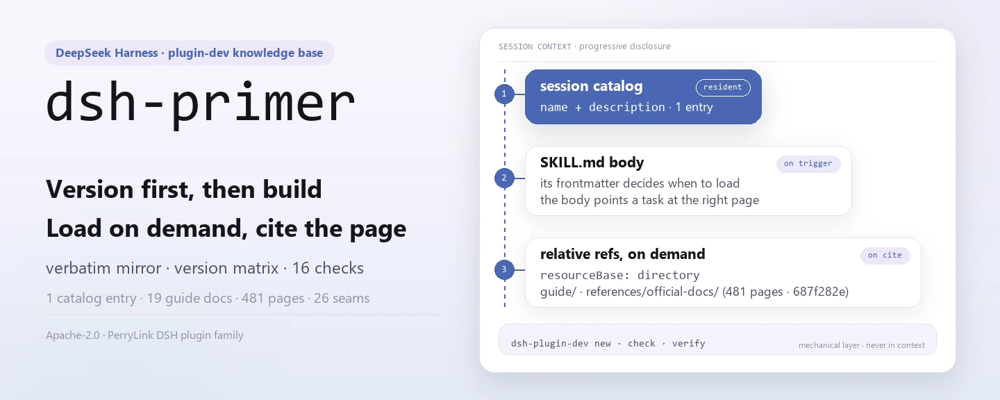
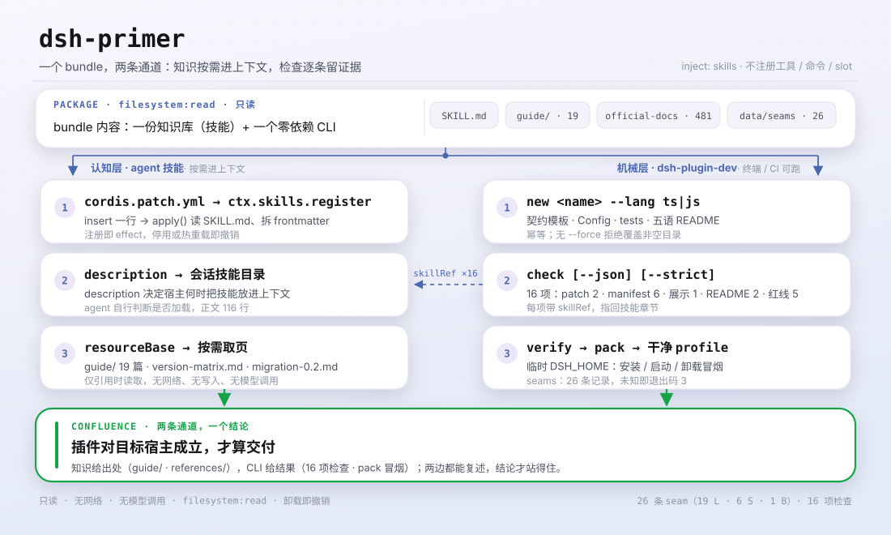

<div align="center">

<picture>
  <source media="(prefers-color-scheme: dark)" srcset="docs/assets/dsh-primer-hero-en-dark.webp">
  
</picture>

# dsh-primer

**Pregunta primero a qué versión apuntas: haz que el agente construya contra la línea del host, no contra una API recordada.**

La base de conocimiento de desarrollo de plugins para DeepSeek Harness: espejo literal de la documentación oficial, matriz de compatibilidad de versiones, seams de migración y trampas probadas, instalada como skill de agente bajo demanda; además del CLI `dsh-plugin-dev new / check / verify`.

[Instalar](#instalación-en-tres-pasos) · [Configuración](#configuración) · [FAQ](#faq) · [简体中文](README.md) · [English](README.en.md) · [Español](README.es.md) · [Português](README.pt.md) · [हिन्दी](README.hi.md)

[](LICENSE)
[](#compatibilidad)
[](https://www.npmjs.com/package/dsh-primer)
[](https://github.com/PerryLink/dsh-primer/actions/workflows/verify.yml)
[](#compatibilidad)

[](https://github.com/PerryLink/dsh-primer/stargazers)
[](https://www.npmjs.com/package/dsh-primer)
[](https://dshfind.com/plugins/PerryLink/dsh-primer?ref=badge)
[](https://securityscorecards.dev/viewer/?uri=github.com/PerryLink/dsh-primer)
[](https://dsh.market/)

```sh
dsh plugin --profile <name> add dsh-primer
```

</div>

<sub>Plugin de la comunidad, no afiliado a DeepSeek. Repositorio canónico: <https://github.com/PerryLink/dsh-primer>.</sub>

## Qué es

`dsh-primer` empaqueta todo lo necesario para desarrollar plugins de DSH en un único bundle instalable: una base de conocimiento registrada como skill de agente `dsh-primer` (visible en el catálogo de cada sesión, que carga bajo demanda los pasos de trabajo, la documentación oficial y las lecturas de la comunidad) y el CLI `dsh-plugin-dev`, sin dependencias en tiempo de ejecución, que añade tres capas mecánicas sobre ese conocimiento.

Mantenido por la comunidad, **no** es un producto oficial de DeepSeek. DeepSeek Harness está en vista previa para desarrolladores y sigue publicando cambios incompatibles; ante la duda, la documentación oficial en `references/official-docs/` es la fuente de verdad.

¿Por qué no basta con leer la documentación oficial? Porque está escrita para quien ya sabe qué página abrir, y DSH publica un prerelease cada 1,7–2,8 días con cambios incompatibles. Este plugin cubre las tres brechas que más tiempo cuestan:

| Brecha | Qué añade este plugin |
|---|---|
| **"¿Contra qué versión de DSH estoy desarrollando?"** | Una [matriz de versiones](guide/version-matrix.md): los cinco valores que se llaman "latest", las etiquetas `latest` congeladas de los subpaquetes, los seams de cambio incompatible y cómo elegir un rango de `peerDependencies`. **No existe línea estable.** |
| **"¿Qué rompe esta versión?"** | Una [guía de migración](guide/migration-0.2.md) que ordena `0.1.6-alpha.2` → `0.2.1-alpha.2` como seams citables, cada uno con síntoma *y* arreglo y su fuente oficial, incluido un riesgo de pérdida de datos y un cambio que hace fallar los prompts antes de construir la petición al modelo. |
| **"¿Mi plugin es realmente correcto?"** | Un [CLI sin dependencias](SKILL.md) (`dsh-plugin-dev new / check / verify`) más un [espejo literal sin conexión](references/official-docs/) de la documentación oficial, para que el agente cite la página exacta en vez de adivinar. |

<picture>
  <source media="(prefers-color-scheme: dark)" srcset="docs/assets/dsh-primer-flow-v5-dark.svg">
  
</picture>

## Instalación en tres pasos

1. **Instalar** (uno de tres canales):

   ```sh
   # canal npm (versiones publicadas: empieza por aquí)
   dsh plugin --profile web add dsh-primer
   # canal git (último main): dist/ no está en el repo, pnpm necesita permitir el build prepare de este paquete
   dsh plugin --profile web add github:PerryLink/dsh-primer#<sha>
   # canal tarball: tras pnpm pack en este repositorio
   dsh plugin --profile web add ./dsh-primer-<version>.tgz
   ```

2. **Reiniciar y confirmar que la fila se monta**:

   ```sh
   dsh --profile web --dump-config | grep -A3 'id: dsh-primer'
   ```

   ```text
   - id: dsh-primer
     name: dsh-primer
   ```

   El catálogo de skills de la sesión debe listar `dsh-primer`; el cuerpo de la skill es el `SKILL.md` del paquete, y sus referencias relativas se resuelven mediante un `resourceBase` de directorio hacia `guide/` y `references/`.

3. **Demuéstralo en 60 segundos** (o pídeselo al agente: *"Usa la skill dsh-primer para construirme un plugin de …"*):

   ```sh
   npx dsh-primer new hello-plugin                  # genera un repo de plugin TS
   cd hello-plugin && npx dsh-primer check --json   # 16 comprobaciones estáticas
   npx dsh-primer verify                            # empaquetado + humo en perfil limpio
   ```

**Desinstalar**: `dsh plugin --profile web remove dsh-primer` (o borra la fila del patch del perfil). El registro es un efecto de Cordis, así que al desinstalar se revierte sin residuos.

> Para la primera instalación usa el canal npm. El canal git trae el código fuente y `dist/` no está en el repositorio, así que pnpm debe ejecutar el build `prepare` de este paquete, lo que exige permitir el paquete en `allowBuilds` del perfil. Es un coste documentado de las instalaciones git, no un defecto, pero da una mala primera experiencia.

<details>
<summary>Instalar desde el mercado de DSH Desktop</summary>

Todos los plugins de PerryLink se pueden explorar en el mercado integrado de DSH Desktop: **Mercado → Fuentes → añadir fuente → pegar** `https://perrylink-dsh-catalog.perrylink.workers.dev/catalog-source.json` **→ seleccionar**. La instalación sigue pasando por la verificación de identidad npm del mercado y tu confirmación. En el canal de la tienda 1024: `npm i -g dsh1024` y luego `dsh1024 plugin --profile web add dsh-primer`.

</details>

## Capacidades clave

`dsh-primer` es la base de conocimiento de desarrollo de plugins de DSH más una cadena de herramientas CLI, empaquetada como un único bundle instalable. La base se registra como skill de agente `dsh-primer` (visible en el catálogo de cada sesión, cargando bajo demanda los pasos de trabajo, la documentación oficial y las lecturas de la comunidad); el CLI `dsh-plugin-dev` añade tres capas mecánicas encima.

- **Contrato de plugin y reglas duras** — effects/disposers, listeners waterfall que deben llamar a `next()`, eventos de sesión propiedad del host, visible-para-el-modelo ⟺ registrado, configuración Schemastery, reglas de UI y rendimiento.
- **Espejo literal de la documentación oficial** — `references/official-docs/`: copia byte a byte de los documentos del repositorio oficial (EN + ZH), idéntica a upstream en la última instantánea verificada, incluidas las páginas que nunca llegan al sitio de documentación.
- **Matriz de adaptación de versiones** — [guide/version-matrix.md](guide/version-matrix.md): los cinco valores "latest", las etiquetas `latest` congeladas de los subpaquetes, los cuatro seams de cambio incompatible, cómo elegir el rango peer, el linaje del formato de sesión V0→V4 y los 19 cambios incompatibles de `0.2.1-alpha.2`.
- **Guía de migración** — [guide/migration-0.2.md](guide/migration-0.2.md): cada cambio incompatible de `0.1.6-alpha.2` a `0.2.1-alpha.1` (formato de sesión V4, reconstrucción de settings, retirada de invariantes, `readBytes`, slots nuevos, la fuente de mensaje `plugin` retirada), cada uno con su fuente oficial y una lista de 12 comprobaciones.
- **Primer de Cordis y la skill oficial, destilada** — los cinco conceptos de Cordis y la línea temporal de mecanismos; [references/official-plugin-dev-skill.md](references/official-plugin-dev-skill.md) destila las prohibiciones de `cordis-plugin-development`, la lista de metadatos de presentación y las reglas de UI/rendimiento.
- **Índice de bugs verificados** — [guide/unfixed-issues.md](guide/unfixed-issues.md): 22 sin arreglar + 11 recién verificados, cada uno con `path:line`, workaround y commit de arreglo, más una tabla diseño-vs-bug y una sección explícita de "no reproducible".
- **Más de 30 trampas reales** con causa raíz y arreglo (copias dobles de cordis, el trío de tsconfig, sesiones zstd multiframe, junctions de Windows, `latest` obsoleto en npm, instalaciones `file:` que cargan una copia, escrituras de patch en caliente…).
- **Lecturas de la comunidad** — 114 repositorios de la comunidad archivados (15 analizados a fondo), más un índice de fuentes donde cada dato enlaza a su origen.
- **Cadena de herramientas CLI** — `dsh-plugin-dev new / check / verify`: andamiaje, comprobación estática (incluidos metadatos de presentación y manifiestos multi-patch) y verificación de empaquetado de plugins DSH; cada comprobación enlaza a la sección de la skill que aplica.
- **Enrutado de la cadena de herramientas familiar y decisión de alcance del espejo** — [guide/family-toolchain.md](guide/family-toolchain.md) indica qué herramienta responde a cada pregunta, con la tabla completa de 33 comprobaciones de `dsh-plugin-doctor` cruzada con las 16 de este repositorio; [references/mirror-scope-decision.md](references/mirror-scope-decision.md) registra por qué "borrar el contenido sin referencias para ahorrar un 80% de tamaño" no superó la remedición.
- **Niveles de adopción (no oficiales)** — [guide/standards.md](guide/standards.md): el modelo DSH-ENTRY / DSH-FLOW / DSH-BOOST, la tabla profundidad × evidencia, qué **no** afirma cada nivel y cómo subir. La comparación GB / GB-T / GB-Z es solo una analogía; las notas de certificación A–D son ortogonales.

### Superficies

| Superficie | Tipo | Notas |
|---|---|---|
| `dsh-primer` | skill | Registrada vía `ctx.skills`; carga `SKILL.md` + `./guide/` + `./references/` bajo demanda |
| `dsh-plugin-dev` | bin (CLI) | Subcomandos `new` / `check` / `verify`; no es una fila de plugin DSH |

## Mapa de la base de conocimiento

| Ruta | Qué es |
|---|---|
| `SKILL.md` | La skill de agente `dsh-primer`: reglas duras + rutas de desarrollo por tipo de tarea |
| `package.json` · `cordis.patch.yml` · `index.js` · `locale/` · `icon.svg` | El bundle DSH instalable: manifiesto `dsh.bundle.patch`, entrada que registra la skill y metadatos de presentación que lee el Plugin Manager |
| `guide/plugin-dev-guide.md` | La guía de desarrollo completa (10 capítulos) |
| `guide/version-matrix.md` | Matriz de adaptación de versiones: los cinco "latest", etiquetas `latest` congeladas, seams de cambio incompatible, elección de rango peer, linaje del formato de sesión, los 19 cambios de `0.2.1-alpha.2` |
| `guide/migration-0.2.md` | Guía de migración de cambios incompatibles de la generación 0.2 (§0–§12 hasta `0.2.1-alpha.1`, §13 con los 19 seams de `0.2.1-alpha.2`) |
| `guide/unfixed-issues.md` | Índice de bugs verificado en fuentes + lista arreglada en master + tabla diseño-vs-bug |
| `guide/quick-reference.md` | Chuleta de una página (5 idiomas) |
| `guide/links.md` | Índice de URL curado: documentación oficial de desarrollo (sitio ↔ copias locales) + enlaces de la comunidad + páginas solo del repositorio |
| `guide/when-to-retire-a-plugin.md` | Retirar y congelar plugins: los criterios y los datos medidos de una auditoría de cartera (EN + ZH) |
| `guide/choosing-a-plugin.md` | Elegir plugin: quién lidera cada superficie de capacidad, con los números medidos y las advertencias de verificación (EN + ZH) |
| `guide/family-toolchain.md` | Enrutado de la cadena de herramientas familiar: pregunta → propietario → artefacto citable; la tabla completa de 33 comprobaciones de `dsh-plugin-doctor` cruzada con las 16 de este repositorio |
| `guide/standards.md` | Niveles de adopción (no oficiales): el modelo DSH-ENTRY / DSH-FLOW / DSH-BOOST y la tabla de dos ejes (EN + ZH) |
| `references/official-docs/` | Copia literal de los documentos del repositorio oficial (EN + ZH); el sello de frescura está en `SNAPSHOT.md` |
| `references/official-plugin-dev-skill.md` | Skill oficial de desarrollo de plugins, destilada |
| `references/mirror-scope-decision.md` | Registro de la decisión de alcance del espejo: por qué no se recorta por "cero referencias" (con un script de medición reejecutable) |
| `references/*.md` | Informes de investigación: documentos del repositorio, sitio web, Cordis, el paper, ecosistema de la comunidad, archivo de 114 repositorios (15 analizados a fondo) |
| `scripts/` | Scripts de descarga idempotentes + comprobador de integridad + generador de instantáneas de temas + el generador de imágenes de este README |
| `bin/` · `src/cli/` · `dist/` | El CLI `dsh-plugin-dev`: andamiaje, comprobador, verificador (TypeScript, empaquetado con tsdown) |
| `templates/` | Esqueletos de andamiaje TS + JS: plantilla de contrato, Config, tests, `cordis.patch.yml`, metadatos de locale, icono, README en cinco idiomas |
| `downloads/` | Instantáneas en bruto — generadas por `scripts/`, no versionadas |
| `data/` | `facts.json` (hogar único de las cifras autoafirmadas), `seams/index.json` (índice de seams consultable), `standards.json` |

## Cadena de herramientas CLI

El bundle incluye el CLI `dsh-plugin-dev`, sin dependencias en tiempo de ejecución (`bin/` → `dist/dsh-plugin-dev.js` empaquetado con tsdown). Cada comprobación cita la sección de la skill que aplica, así que un agente puede seguir auditando a mano.

```sh
dsh-plugin-dev new <name> [--lang ts|js] [--dir <path>] [--force] [--git]
dsh-plugin-dev check [--cwd <dir>] [--json] [--strict]
dsh-plugin-dev verify [--cwd <dir>] [--dsh <bin>] [--pnpm <bin>]
dsh-plugin-dev seams <query> | --since <version>   # ¿existe esta API en mi host objetivo?
```

| Subcomando | Qué hace |
|---|---|
| `new <name>` | Genera un repositorio de plugin TS o JS: plantilla de contrato `src/index.ts`, Config de Schemastery, tests, tsdown/vitest, `cordis.patch.yml` comentado y README en cinco idiomas. Idempotente; rechaza destinos no vacíos sin `--force`. |
| `check` | Comprobaciones estáticas: validez de `cordis.patch.yml`, metadatos de `package.json` (puntero `dsh.bundle.patch`, peer deps, engines, lista de ficheros), consistencia de los cinco READMEs y patrones de línea roja. Emite JSON consumible por CI. |
| `verify` | `pnpm pack` y después instala/arranca/desinstala el bundle en un perfil `DSH_HOME` limpio en mkdtemp (alineado con `verify:self-contained`). Los fallos muestran la cola del log y sugerencias. |

### Hoja de ruta upstream

`dsh-plugin-dev` es candidato upstream del CLI oficial de desarrollo de plugins (punto planificado C12): el andamiaje, el comprobador y el verificador son las capas mecánicas, mientras `SKILL.md` + `guide/` siguen siendo la capa cognitiva.

## Ejemplos

Estos son los puntos de entrada reales del plugin; instala una vez y llama a uno.

### Ejemplo detallado

**Comando**

```sh
dsh-plugin-dev seams L3
```

**Salida**

```text
1 seam(s):

L3  webRuntime service replaced by webStartup
    kind        service-renamed
    lands in    0.2.1-alpha.2
    confidence  documented
    official    docs/upgrade-guide/v0.2.1-alpha.1/web-listener-trust-config/guide.md
    removed     service webRuntime; row web-runtime; ctx.webRuntime.lanAddresses; wildcard --host
    instead     webStartup (row web-startup), concrete host literals
    detectable  yes — inspect: src/**/*.ts, cordis.patch.yml
```

*Observed from `src/cli/commands/seams.ts:54; data/seams/index.json:44`*

### Rama de fallo

**Entrada**

```text
node bin/dsh-plugin-dev.js seams no-such-seam-xyz
```

**Salida**

```text
no seam or capability matches "no-such-seam-xyz". This is an absence of evidence in the knowledge base, not evidence that the API is absent from your target host — check references/official-docs/ before concluding either way.
```

*Observed from `src/cli/lib/seams.ts:122-130; src/cli/commands/seams.ts:87-92; tests/seams.test.ts:88-90`*

### Ejemplos breves

`dsh-plugin-dev check --json` · `dsh-plugin-dev seams L3`

## Configuración

El bundle de la skill no expone ningún `Config` de Schemastery: registra la base de conocimiento como skill de agente sin claves ajustables, y `cordis.patch.yml` solo inserta su propia fila. Todo lo ajustable vive en el CLI `dsh-plugin-dev` y se lee de un flag o de una variable de entorno `DSH_PLUGIN_DEV_*`.

| Clave | Flag | Entorno | Predeterminado |
|---|---|---|---|
| `DSH_PLUGIN_DEV_TEMPLATES` | — | `DSH_PLUGIN_DEV_TEMPLATES` | `<package>/templates` |
| `--dsh` | `--dsh` | `DSH_PLUGIN_DEV_DSH` | `dsh` |
| `--pnpm` | `--pnpm` | `DSH_PLUGIN_DEV_PNPM` | `pnpm` |
| `--timeout` | `--timeout` | `DSH_PLUGIN_DEV_TIMEOUT` | `300000` ms |
| `--smoke-timeout` | `--smoke-timeout` | `DSH_PLUGIN_DEV_SMOKE_TIMEOUT` | `120000` ms |

Para desactivarlo: borra la fila del patch del perfil, o ejecuta `dsh plugin --profile web remove dsh-primer`.

<details>
<summary>Archivo de patch completo (cordis.patch.yml, 9 líneas)</summary>

```yaml
# dsh-primer bundle layer: register the packaged knowledge base as an agent skill.
# This file is the `dsh.bundle.patch` layer (see package.json#dsh.bundle.patch).
# Layer semantics: a YAML array of row verbs; `insert` adds plugin rows to the
# composed config. Later layers override a row by `id` (whole-config replacement).
- insert:
    # `id`: stable row identifier used by later layers to override this row.
    - id: dsh-primer
      # `name`: the module the loader imports; resolves to this package's entry (package.json#main → index.js).
      name: dsh-primer
```

</details>

## FAQ

<details>
<summary>¿La base de conocimiento me servirá documentación obsoleta sin avisar?</summary>

No. El espejo fija su commit de origen, su etiqueta, la hora de sincronización y el número de páginas en `references/official-docs/SNAPSHOT.md`; `.github/workflows/docs-drift.yml` compara cada semana la punta de `master` de upstream con ese commit y abre un issue nombrando los archivos cambiados cuando hay deriva. La actualización sigue siendo una acción humana (`scripts/sync-official-docs.ps1`). `data/facts.json` es el hogar único de las cifras que este proyecto afirma sobre sí mismo, y `check:facts` rechaza la prosa que no concuerda.

</details>

<details>
<summary>¿Instalarlo cambia mi perfil u otros plugins?</summary>

No. El patch del bundle solo `insert` su propia fila (`id: dsh-primer`) y nunca sobrescribe el `config` de una fila integrada. En `apply()` el plugin solo registra una skill vía `ctx.skills`, envuelta en `ctx.effect()`, así que detener o recargar en caliente lo revierte. No registra herramientas, comandos, claves de slot de cliente ni prefijos `webServer`, y no escucha ningún evento sensible al orden como `agent/pre-step`.

</details>

<details>
<summary>¿Hace peticiones de red o llama a un modelo?</summary>

No. En tiempo de ejecución solo lee su propio `guide/` y `references/` empaquetados: sin peticiones de red, sin escrituras y sin llamadas al modelo; `package.json#dshWorkshop.permissions` solo declara `filesystem:read`. La única red la pones tú al ejecutar `scripts/download-*.ps1` para generar las instantáneas en bruto de `downloads/`.

</details>

<details>
<summary>¿Cómo se mantienen sincronizados los cinco READMEs y las cifras de la base?</summary>

Cuatro puertas corren en CI: `check:readmes` compara la estructura de secciones y las claves de configuración entre los cinco idiomas, `check:parity` compara el número de bloques por sección, `check:facts` valida las cifras autoafirmadas contra `data/facts.json`, y `check:ps1-bom` conserva el BOM UTF-8 de los scripts de PowerShell. `scripts/verify-kit.ps1` añade un escaneo de rutas críticas y enlaces relativos.

</details>

## Límites de seguridad

- **Base de conocimiento de solo lectura.** El bundle solo lee sus propios archivos; nunca escribe, nunca llama a la red y nunca invoca un modelo.
- **La documentación oficial son copias literales.** `references/official-docs/` nunca se edita aquí; reporta los problemas upstream y resincroniza solo con `scripts/sync-official-docs.ps1`.
- **Límites de distribución.** El contenido de terceros empaquetado conserva su licencia upstream; ver [NOTICE.md](NOTICE.md) (por ejemplo `downloads/` es solo local y `awesome-dsh-plugins` no debe redistribuirse).

## Permisos y datos

- **Permisos**: `package.json#dshWorkshop.permissions` solo declara `filesystem:read`; `apply()` lee el `SKILL.md` empaquetado, y las referencias relativas del cuerpo de la skill se resuelven mediante un `resourceBase` de directorio hacia `guide/` y `references/` del paquete.
- **Datos**: solo lectura — no escribe en el workspace ni fuera del perfil; no incluye telemetría y no envía datos a PerryLink. La retención de las sesiones y logs del host queda bajo control del host.

## Limitaciones conocidas

- **La documentación oficial es una instantánea.** Resincroniza con `scripts/sync-official-docs.ps1` cuando upstream se mueva; el sello de frescura y el hash del commit están en `references/official-docs/SNAPSHOT.md`.
- **`downloads/` se genera, no se versiona.** Las instantáneas en bruto (archivos de repos de la comunidad, Discussions, artículos) deben generarse con `scripts/download-*.ps1` antes de usarse.
- **El contenido de `awesome-dsh-plugins` es solo local.** Su upstream declara una restricción de uso interno, así que no se redistribuye con el repositorio.

## Interoperabilidad con otros plugins DSH

Este plugin **no** interfiere con otros plugins:

- **Su única dependencia es el servicio `skills`.** Registra una skill vía `ctx.skills`, no importa ninguna implementación del host y no ofrece ninguna clave de servicio.
- **Sin colisión de herramientas ni comandos.** No registra herramientas ni comandos, así que no ocupa ningún nombre desnudo.
- **Sin colisión de slots ni de rutas HTTP.** No registra claves de slot de cliente ni ningún prefijo `webServer`.
- **Sin colisión de capas de patch.** El patch del bundle solo `insert` su propia fila y nunca sobrescribe el `config` de una fila integrada.
- **Sin listeners de eventos compartidos.** No escucha ningún evento sensible al orden, así que no hay cadena waterfall que pueda cortocircuitar.
- **El registro es un efecto.** `ctx.effect(() => ctx.skills.register(...))` aporta todo y detener o recargar en caliente lo revierte.

## Compatibilidad

| Superficie | Estado |
|---|---|
| Harness | `engines.dsh` = `>=0.2.1-0 <0.3.0`. Línea actual del host: npm `latest` = `next` = `0.2.1-rc.2`, `alpha` = `0.2.1-alpha.5`, etiqueta más reciente = `dsh-v0.2.1-rc.2`; **no existe línea estable** — las 31 versiones de npm y las 26 releases de GitHub son prereleases. El espejo de la documentación oficial está fijado en `e8f7b93a…` (sincronizado el 2026-11-13, 717 páginas md / 356 pares EN-ZH). |
| Node | `>=24.9.0` |
| Plataformas | Donde corra DSH (bundle ESM puro; sin código nativo, sin red) |
| Modelo | Cualquiera (sin interacción con modelos: el host inyecta el cuerpo de la skill en el contexto) |

## Canales de publicación

Todos los canales se resuelven desde este repositorio o desde npm, así que una etiqueta llega a todos:

| Canal | Fuente de verdad | Cómo se actualiza |
|---|---|---|
| npm (`dsh-primer`) | el `package.json` de este repositorio | `.github/workflows/release.yml` con una etiqueta `v*`: puerta `verify-kit` → comprobación de la sección del CHANGELOG → `npm publish --provenance` (se omite si la versión ya existe) |
| GitHub Release | la misma etiqueta | el mismo workflow la crea de forma idempotente desde la etiqueta |
| Insignias de descubrimiento (versión npm, dshfind, OpenSSF, DSH Market) | consultas en vivo | no hay nada que publicar: leen npm/el registro en cada render |
| DSH Desktop Market / dsh1024 | npm | el mercado instala el paquete npm, así que una versión publicada es instalable al instante; sin envío por versión |

## Ecosistema y calidad

- [Página del paquete npm](https://www.npmjs.com/package/dsh-primer) (versiones publicadas y descargas)
- [Página del plugin en dshfind](https://dshfind.com/plugins/PerryLink/dsh-primer) (instalaciones y ranking)
- [Informe OpenSSF Scorecard](https://securityscorecards.dev/viewer/?uri=github.com/PerryLink/dsh-primer) (impulsado por [.github/workflows/scorecard.yml](.github/workflows/scorecard.yml))
- [Informe de verificación de dsh-plugin-doctor](https://github.com/PerryLink/dsh-plugin-doctor#verified-徽章) (el cruce con las 16 comprobaciones de este repositorio está en [guide/family-toolchain.md](guide/family-toolchain.md))
- [DSH Market](https://dsh.market/) (listado)
- **Canal de la tienda 1024**: `npm i -g dsh1024` y luego `dsh1024 plugin --profile web add dsh-primer` (cuenta para el ranking de instalaciones de [deepseek1024.com](https://deepseek1024.com))
- [Sitio de documentación](https://perrylink.github.io/dsh-primer/): cada capítulo en su propia página, más un [llms.txt](https://perrylink.github.io/dsh-primer/llms.txt) legible por máquina

## Mantener la base al día

```sh
pwsh -File scripts/sync-official-docs.ps1                     # copia literal de la documentación desde un checkout local
pwsh -File scripts/download-sources.ps1                       # sitio/documentación oficial, Cordis, paper
pwsh -File scripts/download-community-repos.ps1               # repositorios de la comunidad (tarballs de codeload)
pwsh -File scripts/download-community-articles.ps1            # artículos zh/en/HN de la comunidad
pwsh -File scripts/archive-discussions.ps1                    # Discussions oficiales (necesita $env:GH_TOKEN)
pwsh -File scripts/gen-topic-snapshot.ps1 -OutDir <dir>       # censo del tema dsh-plugin
pwsh -File scripts/verify-kit.ps1 -Checkout <checkout>        # rutas críticas + escaneo de enlaces + deriva de docs
```

## Desarrollo

El bundle de la skill (`index.js`) es ESM puro sin paso de build; el CLI `dsh-plugin-dev` es TypeScript construido con tsdown. Puertas:

```sh
pnpm install --frozen-lockfile
pnpm run typecheck && pnpm run typecheck:ci
pnpm test
pnpm run build
pnpm run verify:artifacts        # autocomprobación + humo de andamiaje (sin red)
pnpm run verify:self-contained   # empaquetado + humo de instalación/arranque/desinstalación en perfil limpio
pnpm run check:readmes           # los cinco READMEs comparten estructura de secciones y claves
pnpm run check:parity            # los cinco READMEs tienen los mismos bloques por sección
pnpm run check:facts             # las cifras autoafirmadas coinciden con data/facts.json
pnpm run check:ps1-bom           # los scripts de PowerShell conservan el BOM UTF-8
pnpm pack
pwsh -File scripts/verify-kit.ps1   # rutas críticas + escaneo de enlaces (+ deriva de docs con -Checkout <checkout>)
```

Las imágenes del README las genera [`scripts/gen-readme-assets.py`](scripts/gen-readme-assets.py) (Pillow para el hero, SVG escrito a mano para el diagrama); es idempotente y reescribe `docs/assets/dsh-primer-hero-{zh,en}-{light,dark}.webp` y `docs/assets/dsh-primer-flow-v5-{light,dark}.svg`.

Temas: `dsh`, `deepseek-harness`, `dsh-plugin`, `cordis`, `agent-skill`, `plugin-development`, `knowledge-base`, `cli`, `scaffold`, `checker`

## Familia y agradecimientos

Este proyecto forma parte de la familia de plugins de DeepSeek Harness de [PerryLink](https://github.com/PerryLink) (todos Apache-2.0). Si este plugin te ayuda, **dale una estrella**: no desbloquea nada, pero hace que la siguiente persona lo encuentre antes.

- [@PerryLink](https://github.com/PerryLink) — creador y mantenedor: contenido de la base de conocimiento, la transformación a bundle instalable, envíos al ecosistema e ingeniería de comunidad.
- [@Yisa-yi](https://github.com/Yisa-yi) — **product manager**. Participó en todo el arco de diseño: la decisión de entregarlo como bundle instalable que registra una skill de agente bajo demanda, la arquitectura de información de la guía de 10 capítulos, la regla de "cada dato enlaza a su origen" y la separación entre la capa cognitiva (`SKILL.md` + `guide/`) y la capa mecánica (`dsh-plugin-dev new / check / verify`). También fijó el estándar de evidencia de `guide/unfixed-issues.md` y los criterios de congelación/retirada de `guide/when-to-retire-a-plugin.md`.
- El mantenimiento diario cuenta con la ayuda de agentes de DeepSeek Harness (no tienen cuenta de GitHub y se listan aquí por transparencia, no como contribuidores).

<details>
<summary>Expandir todos los plugins</summary>

| Plugin | Estado |
|---|---|
| **[dsh-aqua-input-check](https://github.com/PerryLink/dsh-aqua-input-check)** |  |
| **[dsh-archive-check](https://github.com/PerryLink/dsh-archive-check)** |  |
| **[dsh-auto-review](https://github.com/PerryLink/dsh-auto-review)** |  |
| **[dsh-autotier](https://github.com/PerryLink/dsh-autotier)** | 🧊 CONGELADO — ver el README del repo |
| **[dsh-bid-ca-precheck](https://github.com/PerryLink/dsh-bid-ca-precheck)** |  |
| **[dsh-bid-qual-check](https://github.com/PerryLink/dsh-bid-qual-check)** |  |
| **[dsh-cert-mcp](https://github.com/PerryLink/dsh-cert-mcp)** | 🧊 CONGELADO — ver el README del repo |
| **[dsh-checkpoint-rewind](https://github.com/PerryLink/dsh-checkpoint-rewind)** |  |
| **[dsh-click](https://github.com/PerryLink/dsh-click)** |  |
| **[dsh-composer-history](https://github.com/PerryLink/dsh-composer-history)** |  |
| **[dsh-contract-stance](https://github.com/PerryLink/dsh-contract-stance)** |  |
| **[dsh-customs-doc-check](https://github.com/PerryLink/dsh-customs-doc-check)** |  |
| **[dsh-data-quality](https://github.com/PerryLink/dsh-data-quality)** | 🧊 CONGELADO — ver el README del repo |
| **[dsh-demurrage-ledger](https://github.com/PerryLink/dsh-demurrage-ledger)** |  |
| **[dsh-doublecheck](https://github.com/PerryLink/dsh-doublecheck)** |  |
| **[dsh-drill-script-check](https://github.com/PerryLink/dsh-drill-script-check)** |  |
| **[dsh-eia-guide-check](https://github.com/PerryLink/dsh-eia-guide-check)** |  |
| **[dsh-emergency-plan](https://github.com/PerryLink/dsh-emergency-plan)** |  |
| **[dsh-essay-rubric-check](https://github.com/PerryLink/dsh-essay-rubric-check)** |  |
| **[dsh-evidence-check](https://github.com/PerryLink/dsh-evidence-check)** |  |
| **[dsh-export-ctl-check](https://github.com/PerryLink/dsh-export-ctl-check)** |  |
| **[dsh-fast](https://github.com/PerryLink/dsh-fast)** |  |
| **[dsh-fmea-table-check](https://github.com/PerryLink/dsh-fmea-table-check)** |  |
| **[dsh-forecast-penalty](https://github.com/PerryLink/dsh-forecast-penalty)** |  |
| **[dsh-fund-research](https://github.com/PerryLink/dsh-fund-research)** |  |
| **[dsh-github](https://github.com/PerryLink/dsh-github)** |  |
| **[dsh-gongwen-flow-check](https://github.com/PerryLink/dsh-gongwen-flow-check)** |  |
| **[dsh-gongwen-word-check](https://github.com/PerryLink/dsh-gongwen-word-check)** |  |
| **[dsh-guard-plan-qc](https://github.com/PerryLink/dsh-guard-plan-qc)** |  |
| **[dsh-hazchem-check](https://github.com/PerryLink/dsh-hazchem-check)** |  |
| **[dsh-hazplan-check](https://github.com/PerryLink/dsh-hazplan-check)** |  |
| **[dsh-hidden-risk-map](https://github.com/PerryLink/dsh-hidden-risk-map)** |  |
| **[dsh-hs-classify](https://github.com/PerryLink/dsh-hs-classify)** |  |
| **[dsh-icd-rule-check](https://github.com/PerryLink/dsh-icd-rule-check)** |  |
| **[dsh-industry-research](https://github.com/PerryLink/dsh-industry-research)** |  |
| **[dsh-lawcite-adapter](https://github.com/PerryLink/dsh-lawcite-adapter)** |  |
| **[dsh-laya](https://github.com/PerryLink/dsh-laya)** |  |
| **[dsh-lc-doc-check](https://github.com/PerryLink/dsh-lc-doc-check)** |  |
| **[dsh-learning-gap-check](https://github.com/PerryLink/dsh-learning-gap-check)** |  |
| **[dsh-library](https://github.com/PerryLink/dsh-library)** |  |
| **[dsh-local-ai](https://github.com/PerryLink/dsh-local-ai)** |  |
| **[dsh-lsp-actions](https://github.com/PerryLink/dsh-lsp-actions)** |  |
| **[dsh-mask](https://github.com/PerryLink/dsh-mask)** |  |
| **[dsh-mcp-panel](https://github.com/PerryLink/dsh-mcp-panel)** |  |
| **[dsh-medrec-qc](https://github.com/PerryLink/dsh-medrec-qc)** |  |
| **[dsh-memento](https://github.com/PerryLink/dsh-memento)** | 🧊 CONGELADO — ver el README del repo |
| **[dsh-nsfc-form-check](https://github.com/PerryLink/dsh-nsfc-form-check)** |  |
| **[dsh-nurse-record-check](https://github.com/PerryLink/dsh-nurse-record-check)** |  |
| **[dsh-observe](https://github.com/PerryLink/dsh-observe)** |  |
| **[dsh-origin-rvc-check](https://github.com/PerryLink/dsh-origin-rvc-check)** |  |
| **[dsh-ota-review-check](https://github.com/PerryLink/dsh-ota-review-check)** |  |
| **[dsh-output-styles](https://github.com/PerryLink/dsh-output-styles)** |  |
| **[dsh-paper-doc-adapter](https://github.com/PerryLink/dsh-paper-doc-adapter)** |  |
| **[dsh-permission-rules](https://github.com/PerryLink/dsh-permission-rules)** |  |
| **[dsh-permit-report-check](https://github.com/PerryLink/dsh-permit-report-check)** |  |
| **[dsh-pipeline-check](https://github.com/PerryLink/dsh-pipeline-check)** |  |
| **[dsh-pleading-draft](https://github.com/PerryLink/dsh-pleading-draft)** |  |
| **[dsh-plugin-doctor](https://github.com/PerryLink/dsh-plugin-doctor)** | 🚫 RETIRADO (repo archivado) |
| **[dsh-primer](https://github.com/PerryLink/dsh-primer)** |  |
| **[dsh-plugin-kit](https://github.com/PerryLink/dsh-plugin-kit)** | 🚫 RETIRADO (repo archivado) |
| **[dsh-plugin-upgrade](https://github.com/PerryLink/dsh-plugin-upgrade)** | 🚫 RETIRADO (repo archivado) |
| **[dsh-policy-brief-draft](https://github.com/PerryLink/dsh-policy-brief-draft)** |  |
| **[dsh-power-loss-split](https://github.com/PerryLink/dsh-power-loss-split)** |  |
| **[dsh-power-ticket-check](https://github.com/PerryLink/dsh-power-ticket-check)** |  |
| **[dsh-ppap-check](https://github.com/PerryLink/dsh-ppap-check)** |  |
| **[dsh-protest-deadline](https://github.com/PerryLink/dsh-protest-deadline)** |  |
| **[dsh-railway-window](https://github.com/PerryLink/dsh-railway-window)** |  |
| **[dsh-repair-order-qc](https://github.com/PerryLink/dsh-repair-order-qc)** |  |
| **[dsh-research-report](https://github.com/PerryLink/dsh-research-report)** |  |
| **[dsh-review-reply-check](https://github.com/PerryLink/dsh-review-reply-check)** |  |
| **[dsh-rulefile-check](https://github.com/PerryLink/dsh-rulefile-check)** |  |
| **[dsh-safety-brief-check](https://github.com/PerryLink/dsh-safety-brief-check)** |  |
| **[dsh-score](https://github.com/PerryLink/dsh-score)** | 🧊 CONGELADO — ver el README del repo |
| **[dsh-session-sync](https://github.com/PerryLink/dsh-session-sync)** |  |
| **[dsh-site-log-check](https://github.com/PerryLink/dsh-site-log-check)** |  |
| **[dsh-skill-pack-security](https://github.com/PerryLink/dsh-skill-pack-security)** |  |
| **[dsh-soe-decision-check](https://github.com/PerryLink/dsh-soe-decision-check)** |  |
| **[dsh-soilwater-check](https://github.com/PerryLink/dsh-soilwater-check)** |  |
| **[dsh-sop-sync-check](https://github.com/PerryLink/dsh-sop-sync-check)** |  |
| **[dsh-spc-gbt-adapter](https://github.com/PerryLink/dsh-spc-gbt-adapter)** |  |
| **[dsh-talk](https://github.com/PerryLink/dsh-talk)** |  |
| **[dsh-tender-extract](https://github.com/PerryLink/dsh-tender-extract)** |  |
| **[dsh-tender-matrix](https://github.com/PerryLink/dsh-tender-matrix)** |  |
| **[dsh-test-drive](https://github.com/PerryLink/dsh-test-drive)** |  |
| **[dsh-ticktick](https://github.com/PerryLink/dsh-ticktick)** | 🚫 RETIRADO (repo archivado) |
| **[dsh-translate](https://github.com/PerryLink/dsh-translate)** |  |
| **[dsh-warranty-calc](https://github.com/PerryLink/dsh-warranty-calc)** |  |
| **[dsh-budget](https://github.com/PerryLink/dsh-budget)** | 🧊 CONGELADO — ver el README del repo |
| **[dsh-claude-move](https://github.com/PerryLink/dsh-claude-move)** | 🧊 CONGELADO — ver el README del repo |
| **[dsh-defend](https://github.com/PerryLink/dsh-defend)** | 🧊 CONGELADO — ver el README del repo |
| **[dsh-draw](https://github.com/PerryLink/dsh-draw)** | 🧊 CONGELADO — ver el README del repo |
| **[dsh-reach](https://github.com/PerryLink/dsh-reach)** | 🧊 CONGELADO — ver el README del repo |
| **[dsh-background-agents](https://github.com/PerryLink/dsh-background-agents)** | 🚫 RETIRADO (repo archivado) |
| **[dsh-session-pin](https://github.com/PerryLink/dsh-session-pin)** | 🚫 RETIRADO (repo archivado) |
| **[dsh-team-rooms](https://github.com/PerryLink/dsh-team-rooms)** | 🚫 RETIRADO (repo archivado) |

</details>

## Licencia

[LICENSE](LICENSE) (Apache License 2.0) © 2026 dsh-primer contributors — nuestro propio texto (`SKILL.md`, `guide/`, `references/`, `scripts/`, este README) es Apache-2.0; el contenido de terceros empaquetado está documentado en [NOTICE.md](NOTICE.md).

<p align="center"><sub>Apache-2.0 · Plugin de la comunidad, no afiliado a DeepSeek.</sub></p>

## Cadena de herramientas y upstream (datos, 2026-11)

- Este repositorio es la skill / CLI de desarrollo heredada; las comprobaciones actuales viven en `dsh-standards`, la guía en `dsh-plugin-guide` y el generador en `dsh-plugin-start`.
- Upstream: `dsh-plugin-hub` main incluye una comprobación de metadatos npm consciente de la versión ([`4f3a560`](https://github.com/dshplugin/dsh-plugin-hub/commit/4f3a560), 2026-11-09); el alcance es solo metadatos npm en la instalación; no ejecuta ENTRY ni constituye un aval.
