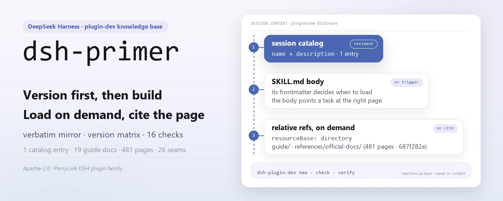
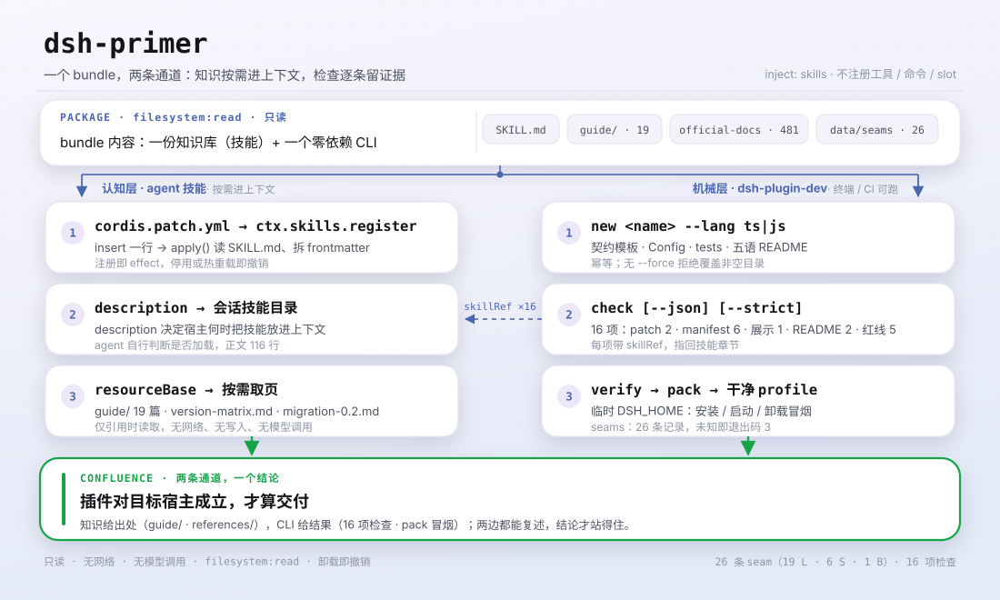

<div align="center">

<picture>
  <source media="(prefers-color-scheme: dark)" srcset="docs/assets/dsh-primer-hero-en-dark.webp">
  
</picture>

# dsh-primer

**कोड लिखने से पहले पूछें कि लक्ष्य कौन-सा संस्करण है — एजेंट को याद की हुई API नहीं, होस्ट लाइन के अनुसार बनाने दें।**

DeepSeek Harness के लिए प्लगइन-डेवलपमेंट ज्ञान-आधार: आधिकारिक दस्तावेज़ों का शब्दशः मिरर, संस्करण-संगतता मैट्रिक्स, माइग्रेशन seam और परखी हुई गलतियाँ, माँगने पर लोड होने वाली एजेंट स्किल के रूप में — साथ में `dsh-plugin-dev new / check / verify` CLI।

[इंस्टॉल](#तीन-चरणों-में-शुरुआत) · [कॉन्फ़िगरेशन](#कॉन्फ़िगरेशन) · [FAQ](#faq) · [简体中文](README.md) · [English](README.en.md) · [Español](README.es.md) · [Português](README.pt.md) · [हिन्दी](README.hi.md)

[](LICENSE)
[](#संगतता)
[](https://www.npmjs.com/package/dsh-primer)
[](https://github.com/PerryLink/dsh-primer/actions/workflows/verify.yml)
[](#संगतता)

[](https://github.com/PerryLink/dsh-primer/stargazers)
[](https://www.npmjs.com/package/dsh-primer)
[](https://dshfind.com/plugins/PerryLink/dsh-primer?ref=badge)
[](https://securityscorecards.dev/viewer/?uri=github.com/PerryLink/dsh-primer)
[](https://dsh.market/)

```sh
dsh plugin --profile <name> add dsh-primer
```

</div>

<sub>सामुदायिक प्लगइन, DeepSeek से असंबद्ध। कैनोनिकल रिपॉज़िटरी: <https://github.com/PerryLink/dsh-primer>।</sub>

## यह क्या है

`dsh-primer` वह सब कुछ एक इंस्टॉल-योग्य bundle में पैक करता है जो DSH प्लगइन डेवलपमेंट को चाहिए: एक ज्ञान-आधार जो `dsh-primer` एजेंट स्किल के रूप में रजिस्टर होता है (हर सत्र की स्किल सूची में दिखता है और माँगने पर कार्यप्रवाह चरण, आधिकारिक दस्तावेज़ तथा सामुदायिक गहन-पठन संदर्भ में लाता है), और शून्य रनटाइम-निर्भरता वाला `dsh-plugin-dev` CLI, जो उस ज्ञान के ऊपर तीन यांत्रिक परतें जोड़ता है।

समुदाय द्वारा अनुरक्षित, **आधिकारिक DeepSeek उत्पाद नहीं**। DeepSeek Harness डेवलपर पूर्वावलोकन में है और लगातार असंगत बदलाव भेजता है; संदेह हो तो `references/official-docs/` की आधिकारिक दस्तावेज़ ही सत्य का स्रोत है।

सिर्फ़ आधिकारिक दस्तावेज़ क्यों नहीं पढ़ें? क्योंकि वे उस व्यक्ति के लिए लिखे गए हैं जिसे पहले से पता है कि कौन-सा पृष्ठ खोलना है, और DSH हर 1.7–2.8 दिन में असंगत बदलावों के साथ एक prerelease भेजता है। यह प्लगइन उन तीन अंतरालों को भरता है जो सबसे ज़्यादा समय लेते हैं:

| अंतराल | यह प्लगइन क्या जोड़ता है |
|---|---|
| **"मैं किस DSH के लिए बना रहा हूँ?"** | एक [संस्करण मैट्रिक्स](guide/version-matrix.md): वे पाँच मान जो स्वयं को "latest" कहते हैं, उप-पैकेजों के जमे हुए `latest` टैग, असंगत-बदलाव seam, और `peerDependencies` रेंज कैसे चुनें। **कोई स्थिर लाइन नहीं है।** |
| **"यह संस्करण क्या तोड़ता है?"** | एक [माइग्रेशन गाइड](guide/migration-0.2.md) जो `0.1.6-alpha.2` → `0.2.1-alpha.2` को उद्धरण-योग्य seam के रूप में व्यवस्थित करता है, हर एक में लक्षण *और* समाधान तथा आधिकारिक स्रोत — जिसमें डेटा-हानि का एक जोखिम और एक ऐसा बदलाव शामिल है जो मॉडल अनुरोध बनने से पहले ही prompt विफल कर देता है। |
| **"मेरा प्लगइन सचमुच सही है?"** | एक [शून्य-निर्भरता CLI](SKILL.md) (`dsh-plugin-dev new / check / verify`) और आधिकारिक दस्तावेज़ों का [शब्दशः ऑफ़लाइन मिरर](references/official-docs/), ताकि एजेंट अनुमान न लगाए बल्कि सटीक पृष्ठ उद्धृत करे। |

<picture>
  <source media="(prefers-color-scheme: dark)" srcset="docs/assets/dsh-primer-flow-v5-dark.svg">
  
</picture>

## तीन चरणों में शुरुआत

1. **इंस्टॉल करें** (तीन में से एक चैनल):

   ```sh
   # npm चैनल (प्रकाशित संस्करण — यहीं से शुरू करें)
   dsh plugin --profile web add dsh-primer
   # git चैनल (नवीनतम main): dist/ रेपो में नहीं है, इसलिए pnpm को इस पैकेज का prepare build अनुमति देना होगा
   dsh plugin --profile web add github:PerryLink/dsh-primer#<sha>
   # tarball चैनल: इस रेपो में pnpm pack के बाद
   dsh plugin --profile web add ./dsh-primer-<version>.tgz
   ```

2. **पुनः आरंभ करें और पुष्टि करें कि पंक्ति माउंट हुई**:

   ```sh
   dsh --profile web --dump-config | grep -A3 'id: dsh-primer'
   ```

   ```text
   - id: dsh-primer
     name: dsh-primer
   ```

   सत्र की स्किल सूची में `dsh-primer` दिखना चाहिए; स्किल का मुख्य भाग पैकेज का `SKILL.md` है, और उसके सापेक्ष संदर्भ निर्देशिका-प्रकार के `resourceBase` से `guide/` और `references/` में हल होते हैं।

3. **60 सेकंड में सिद्ध करें** (या एजेंट से कहें: *"dsh-primer स्किल से मेरे लिए एक … प्लगइन बनाओ।"*):

   ```sh
   npx dsh-primer new hello-plugin                  # TS प्लगइन रेपो का ढाँचा
   cd hello-plugin && npx dsh-primer check --json   # 16 स्थिर जाँचें
   npx dsh-primer verify                            # पैक + स्वच्छ प्रोफ़ाइल स्मोक
   ```

**अनइंस्टॉल**: `dsh plugin --profile web remove dsh-primer` (या प्रोफ़ाइल patch से वह पंक्ति हटा दें)। रजिस्ट्रेशन एक Cordis effect है, इसलिए हटाने पर बिना अवशेष के उलट जाता है।

> पहली इंस्टॉल के लिए npm चैनल चुनें। git चैनल स्रोत लाता है और `dist/` रेपो में नहीं है, इसलिए pnpm को इस पैकेज का `prepare` build चलाना पड़ता है, जिसके लिए प्रोफ़ाइल के `allowBuilds` में पैकेज को अनुमति देनी होती है। यह git इंस्टॉल की प्रलेखित कीमत है, कोई दोष नहीं, पर पहला अनुभव ख़राब बनाता है।

<details>
<summary>DSH Desktop मार्केट से इंस्टॉल करें</summary>

सभी PerryLink प्लगइन DSH Desktop के अंतर्निहित मार्केट में देखे जा सकते हैं: **मार्केट → स्रोत → स्रोत जोड़ें → चिपकाएँ** `https://perrylink-dsh-catalog.perrylink.workers.dev/catalog-source.json` **→ चुनें**। इंस्टॉल अब भी मार्केट के npm-पहचान सत्यापन और आपकी पुष्टि से गुज़रता है। 1024 स्टोर चैनल: `npm i -g dsh1024`, फिर `dsh1024 plugin --profile web add dsh-primer`।

</details>

## मुख्य क्षमताएँ

`dsh-primer` DSH प्लगइन-डेवलपमेंट ज्ञान-आधार और एक CLI टूलचेन है, जो एक इंस्टॉल-योग्य bundle में पैक है। ज्ञान-आधार `dsh-primer` एजेंट स्किल के रूप में रजिस्टर होता है (हर सत्र की सूची में दिखता है और माँगने पर कार्यप्रवाह चरण, आधिकारिक दस्तावेज़ तथा सामुदायिक गहन-पठन लाता है); `dsh-plugin-dev` CLI उसके ऊपर तीन यांत्रिक परतें जोड़ता है।

- **प्लगइन अनुबंध और कठोर नियम** — effect/disposer, `next()` कॉल करने वाले waterfall listener, होस्ट के स्वामित्व वाले सत्र इवेंट, मॉडल-दृश्य ⟺ लॉग में दर्ज, Schemastery कॉन्फ़िग, UI और प्रदर्शन नियम।
- **आधिकारिक दस्तावेज़ों का शब्दशः मिरर** — `references/official-docs/`: आधिकारिक रेपो दस्तावेज़ों की बाइट-दर-बाइट प्रति (EN + ZH), अंतिम सत्यापित स्नैपशॉट पर upstream के समान, उन पृष्ठों सहित जो दस्तावेज़ साइट तक कभी नहीं पहुँचते।
- **संस्करण-अनुकूलन मैट्रिक्स** — [guide/version-matrix.md](guide/version-matrix.md): पाँच "latest" मान, उप-पैकेजों के जमे हुए `latest` टैग, चार असंगत-बदलाव seam, peer रेंज का चयन, सत्र-प्रारूप वंशावली V0→V4, और `0.2.1-alpha.2` में आए 19 असंगत बदलाव।
- **माइग्रेशन गाइड** — [guide/migration-0.2.md](guide/migration-0.2.md): `0.1.6-alpha.2` से `0.2.1-alpha.1` तक हर असंगत बदलाव (सत्र प्रारूप V4, settings का पुनर्निर्माण, invariant हटाना, `readBytes`, नए slot, सेवानिवृत्त `plugin` संदेश स्रोत), हर एक के आधिकारिक स्रोत और 12-मद चेकलिस्ट के साथ।
- **Cordis प्राइमर और आधिकारिक स्किल का सार** — Cordis की पाँच अवधारणाएँ और तंत्र की समयरेखा; [references/official-plugin-dev-skill.md](references/official-plugin-dev-skill.md) आधिकारिक `cordis-plugin-development` के निषेध, प्रदर्शन-मेटाडेटा सूची और UI/प्रदर्शन नियमों का सार देता है।
- **सत्यापित bug सूची** — [guide/unfixed-issues.md](guide/unfixed-issues.md): 22 अनसुलझे + 11 नए सत्यापित, हर एक में `path:line`, बचने का उपाय और सुधार कमिट, साथ में डिज़ाइन-बनाम-bug तालिका और स्पष्ट "पुनरुत्पादन नहीं हो सका" अनुभाग।
- **30+ वास्तविक गलतियाँ** मूल कारण और समाधान के साथ (cordis की दोहरी प्रतियाँ, tsconfig का त्रिक, मल्टी-फ़्रेम zstd सत्र, Windows junction, पुराना npm `latest`, `file:` इंस्टॉल जो प्रति लोड करता है, लाइव patch लेखन…)।
- **सामुदायिक गहन-पठन** — 114 सामुदायिक रेपो संग्रहीत (15 गहराई से पढ़े), और पूरी स्रोत सूची जहाँ हर तथ्य अपने मूल से जुड़ता है।
- **CLI टूलचेन** — `dsh-plugin-dev new / check / verify`: DSH प्लगइन का ढाँचा, स्थिर जाँच (प्रदर्शन मेटाडेटा और मल्टी-patch manifest सहित) और पैक-सत्यापन; हर जाँच उस स्किल अनुभाग से जुड़ती है जिसे वह लागू करती है।
- **परिवार टूलचेन रूटिंग और मिरर-स्कोप निर्णय** — [guide/family-toolchain.md](guide/family-toolchain.md) बताता है कि कौन-सा प्रश्न किस उपकरण का है, `dsh-plugin-doctor` की पूरी 33-जाँच तालिका इस रेपो की 16 जाँचों के साथ; [references/mirror-scope-decision.md](references/mirror-scope-decision.md) दर्ज करता है कि "80% आकार बचाने के लिए शून्य-संदर्भ सामग्री हटाना" पुनर्मापन में क्यों टिका नहीं।
- **अपनाने के स्तर (ग़ैर-आधिकारिक)** — [guide/standards.md](guide/standards.md): DSH-ENTRY / DSH-FLOW / DSH-BOOST मॉडल, गहराई × प्रमाण तालिका, हर स्तर क्या **नहीं** दावा करता, और आगे बढ़ने का मार्ग। GB / GB-T / GB-Z तुलना केवल एक उपमा है; प्रमाणन ग्रेड A–D इनसे स्वतंत्र हैं।

### सतहें

| सतह | प्रकार | टिप्पणी |
|---|---|---|
| `dsh-primer` | skill | `ctx.skills` से रजिस्टर; माँगने पर `SKILL.md` + `./guide/` + `./references/` लोड करता है |
| `dsh-plugin-dev` | bin (CLI) | `new` / `check` / `verify` उप-कमांड; DSH प्लगइन पंक्ति नहीं है |

## ज्ञान-आधार का नक्शा

| पथ | क्या है |
|---|---|
| `SKILL.md` | `dsh-primer` एजेंट स्किल: कठोर नियम + कार्य-प्रकार के अनुसार विकास पथ |
| `package.json` · `cordis.patch.yml` · `index.js` · `locale/` · `icon.svg` | इंस्टॉल-योग्य DSH bundle: `dsh.bundle.patch` manifest, स्किल रजिस्टर करने वाला प्रवेश-बिंदु, और Plugin Manager द्वारा पढ़ा जाने वाला प्रदर्शन मेटाडेटा |
| `guide/plugin-dev-guide.md` | पूर्ण विकास गाइड (10 अध्याय) |
| `guide/version-matrix.md` | संस्करण-अनुकूलन मैट्रिक्स: पाँच "latest", जमे हुए उप-पैकेज टैग, असंगत-बदलाव seam, peer रेंज चयन, सत्र-प्रारूप वंशावली, `0.2.1-alpha.2` के 19 बदलाव |
| `guide/migration-0.2.md` | 0.2 पीढ़ी के असंगत बदलावों की माइग्रेशन गाइड (§0–§12 `0.2.1-alpha.1` तक, §13 में `0.2.1-alpha.2` के 19 seam) |
| `guide/unfixed-issues.md` | स्रोत-सत्यापित bug सूची + master पर सुधर चुकी सूची + डिज़ाइन-बनाम-bug तालिका |
| `guide/quick-reference.md` | एक पृष्ठ की चीटशीट (5 भाषाएँ) |
| `guide/links.md` | चयनित URL सूची: आधिकारिक विकास दस्तावेज़ (साइट ↔ स्थानीय प्रतियाँ) + सामुदायिक दस्तावेज़ लिंक + केवल-रेपो पृष्ठ |
| `guide/when-to-retire-a-plugin.md` | प्लगइन सेवानिवृत्त और फ़्रोज़न करना: मानदंड और एक पोर्टफ़ोलियो ऑडिट के मापे गए आँकड़े (EN + ZH) |
| `guide/choosing-a-plugin.md` | प्लगइन चुनना: हर क्षमता-सतह का अग्रणी कौन है, मापे गए आँकड़ों और सत्यापन-चेतावनियों के साथ (EN + ZH) |
| `guide/family-toolchain.md` | परिवार टूलचेन रूटिंग: प्रश्न → स्वामी → उद्धरण-योग्य आर्टिफ़ैक्ट; `dsh-plugin-doctor` की पूरी 33-जाँच तालिका इस रेपो की 16 जाँचों के साथ |
| `guide/standards.md` | अपनाने के स्तर (ग़ैर-आधिकारिक): DSH-ENTRY / DSH-FLOW / DSH-BOOST मॉडल और दो-अक्ष तालिका (EN + ZH) |
| `references/official-docs/` | आधिकारिक रेपो दस्तावेज़ों की शब्दशः प्रति (EN + ZH); ताज़गी की मुहर `SNAPSHOT.md` में |
| `references/official-plugin-dev-skill.md` | आधिकारिक in-repo प्लगइन-डेवलपमेंट स्किल का सार |
| `references/mirror-scope-decision.md` | मिरर-स्कोप निर्णय का रिकॉर्ड: "शून्य संदर्भ" के आधार पर इसे क्यों नहीं काटा गया (पुनः चलाने योग्य मापन स्क्रिप्ट सहित) |
| `references/*.md` | शोध रिपोर्ट: रेपो दस्तावेज़, वेबसाइट, Cordis, पेपर, सामुदायिक इकोसिस्टम, 114-रेपो संग्रह (15 गहराई से पढ़े) |
| `scripts/` | इडेम्पोटेंट डाउनलोड स्क्रिप्ट + अखंडता जाँच + विषय-स्नैपशॉट जनरेटर + इस README का चित्र जनरेटर |
| `bin/` · `src/cli/` · `dist/` | `dsh-plugin-dev` CLI: स्कैफ़ोल्डर, चेकर, सत्यापनकर्ता (TypeScript, tsdown-बंडल) |
| `templates/` | TS + JS स्कैफ़ोल्ड खाँचे: अनुबंध टेम्पलेट, Config, tests, `cordis.patch.yml`, locale मेटाडेटा, आइकन, पाँच-भाषा README |
| `downloads/` | कच्चे स्नैपशॉट — `scripts/` से बने, रेपो में नहीं |
| `data/` | `facts.json` (स्वयं के बारे में कहे गए आँकड़ों का एकमात्र घर), `seams/index.json` (क्वेरी-योग्य seam सूची), `standards.json` |

## CLI टूलचेन

bundle में शून्य रनटाइम-निर्भरता वाला `dsh-plugin-dev` CLI आता है (`bin/` → tsdown से बना `dist/dsh-plugin-dev.js`)। हर जाँच उस स्किल अनुभाग को उद्धृत करती है जिसे वह लागू करती है, इसलिए एजेंट हाथ से ऑडिट जारी रख सकता है।

```sh
dsh-plugin-dev new <name> [--lang ts|js] [--dir <path>] [--force] [--git]
dsh-plugin-dev check [--cwd <dir>] [--json] [--strict]
dsh-plugin-dev verify [--cwd <dir>] [--dsh <bin>] [--pnpm <bin>]
dsh-plugin-dev seams <query> | --since <version>   # क्या यह API मेरे लक्ष्य होस्ट में है?
```

| उप-कमांड | क्या करता है |
|---|---|
| `new <name>` | TS या JS प्लगइन रेपो का ढाँचा बनाता है: `src/index.ts` अनुबंध टेम्पलेट, Schemastery Config, tests, tsdown/vitest, टिप्पणी सहित `cordis.patch.yml`, पाँच-भाषा README। इडेम्पोटेंट; `--force` के बिना ग़ैर-ख़ाली लक्ष्य अस्वीकार करता है। |
| `check` | स्थिर जाँच: `cordis.patch.yml` की वैधता, `package.json` मेटाडेटा (`dsh.bundle.patch` संकेत, peer निर्भरता, engines, फ़ाइल सूची), पाँच README की संगति, इंजीनियरिंग रेड-लाइन पैटर्न। CI-उपभोग्य JSON देता है। |
| `verify` | `pnpm pack` के बाद bundle को स्वच्छ mkdtemp `DSH_HOME` प्रोफ़ाइल में इंस्टॉल/आरंभ/अनइंस्टॉल स्मोक करता है (`verify:self-contained` के अनुरूप)। विफलता पर लॉग की पूँछ और सुझाव देता है। |

### upstream रोडमैप

`dsh-plugin-dev` आधिकारिक प्लगइन-डेवलपमेंट CLI (नियोजित मद C12) का upstream उम्मीदवार है: स्कैफ़ोल्डर/चेकर/सत्यापनकर्ता यांत्रिक परतें हैं, जबकि `SKILL.md` + `guide/` संज्ञानात्मक परत बने रहते हैं।

## उदाहरण

ये प्लगइन के वास्तविक प्रवेश-बिंदु हैं; एक बार इंस्टॉल करें, फिर एक चलाएँ।

### विस्तृत उदाहरण

**कमांड**

```sh
dsh-plugin-dev seams L3
```

**आउटपुट**

```text
1 seam(s):

L3  webRuntime service replaced by webStartup
    kind        service-renamed
    lands in    0.2.1-alpha.2
    confidence  documented
    official    docs/upgrade-guide/v0.2.1-alpha.1/web-listener-trust-config/guide.md
    removed     service webRuntime; row web-runtime; ctx.webRuntime.lanAddresses; wildcard --host
    instead     webStartup (row web-startup), concrete host literals
    detectable  yes — inspect: src/**/*.ts, cordis.patch.yml
```

*Observed from `src/cli/commands/seams.ts:54; data/seams/index.json:44`*

### विफलता शाखा

**इनपुट**

```text
node bin/dsh-plugin-dev.js seams no-such-seam-xyz
```

**आउटपुट**

```text
no seam or capability matches "no-such-seam-xyz". This is an absence of evidence in the knowledge base, not evidence that the API is absent from your target host — check references/official-docs/ before concluding either way.
```

*Observed from `src/cli/lib/seams.ts:122-130; src/cli/commands/seams.ts:87-92; tests/seams.test.ts:88-90`*

### संक्षिप्त उदाहरण

`dsh-plugin-dev check --json` · `dsh-plugin-dev seams L3`

## कॉन्फ़िगरेशन

स्किल bundle कोई Schemastery `Config` नहीं देता — वह ज्ञान-आधार को बिना किसी समायोज्य कुंजी के एजेंट स्किल के रूप में रजिस्टर करता है, और `cordis.patch.yml` केवल अपनी पंक्ति `insert` करता है। सब कुछ `dsh-plugin-dev` CLI पर है और flag या `DSH_PLUGIN_DEV_*` environment variable से पढ़ा जाता है।

| कुंजी | Flag | Env | डिफ़ॉल्ट |
|---|---|---|---|
| `DSH_PLUGIN_DEV_TEMPLATES` | — | `DSH_PLUGIN_DEV_TEMPLATES` | `<package>/templates` |
| `--dsh` | `--dsh` | `DSH_PLUGIN_DEV_DSH` | `dsh` |
| `--pnpm` | `--pnpm` | `DSH_PLUGIN_DEV_PNPM` | `pnpm` |
| `--timeout` | `--timeout` | `DSH_PLUGIN_DEV_TIMEOUT` | `300000` ms |
| `--smoke-timeout` | `--smoke-timeout` | `DSH_PLUGIN_DEV_SMOKE_TIMEOUT` | `120000` ms |

बंद करने के लिए: प्रोफ़ाइल patch से पंक्ति हटाएँ, या `dsh plugin --profile web remove dsh-primer` चलाएँ।

<details>
<summary>पूरा patch फ़ाइल (cordis.patch.yml, 9 पंक्तियाँ)</summary>

```yaml
# dsh-primer bundle layer: register the packaged knowledge base as an agent skill.
# This file is the `dsh.bundle.patch` layer (see package.json#dsh.bundle.patch).
# Layer semantics: a YAML array of row verbs; `insert` adds plugin rows to the
# composed config. Later layers override a row by `id` (whole-config replacement).
- insert:
    # `id`: stable row identifier used by later layers to override this row.
    - id: dsh-primer
      # `name`: the module the loader imports; resolves to this package's entry (package.json#main → index.js).
      name: dsh-primer
```

</details>

## FAQ

<details>
<summary>क्या ज्ञान-आधार चुपचाप पुराने दस्तावेज़ परोसेगा?</summary>

नहीं। मिरर अपना स्रोत कमिट, स्रोत टैग, सिंक समय और पृष्ठ-संख्या `references/official-docs/SNAPSHOT.md` में पिन करता है; `.github/workflows/docs-drift.yml` हर हफ़्ते upstream `master` के tip की उस कमिट से तुलना करता है और बदलाव होने पर बदली फ़ाइलों के नाम के साथ issue खोलता है। रीफ़्रेश मानवीय कार्य ही रहता है (`scripts/sync-official-docs.ps1`)। `data/facts.json` उन आँकड़ों का एकमात्र घर है जो यह परियोजना स्वयं के बारे में कहती है, और `check:facts` उससे मेल न खाने वाली बातों को अस्वीकार करता है।

</details>

<details>
<summary>क्या इसे इंस्टॉल करने से मेरी प्रोफ़ाइल या दूसरे प्लगइन बदलते हैं?</summary>

नहीं। bundle patch केवल अपनी पंक्ति (`id: dsh-primer`) `insert` करता है और कभी किसी अंतर्निहित पंक्ति का `config` अधिलिखित नहीं करता। `apply()` में प्लगइन केवल `ctx.skills` से एक स्किल रजिस्टर करता है, जो `ctx.effect()` में लिपटा है, इसलिए रोकने या हॉट-रीलोड पर वह उलट जाता है। यह कोई टूल, कमांड, क्लाइंट slot कुंजी या `webServer` उपसर्ग रजिस्टर नहीं करता, और `agent/pre-step` जैसे क्रम-संवेदी इवेंट नहीं सुनता।

</details>

<details>
<summary>क्या यह नेटवर्क अनुरोध या मॉडल कॉल करता है?</summary>

नहीं। रनटाइम पर यह केवल अपने पैक किए गए `guide/` और `references/` पढ़ता है: कोई नेटवर्क अनुरोध नहीं, कोई लेखन नहीं, कोई मॉडल कॉल नहीं; `package.json#dshWorkshop.permissions` केवल `filesystem:read` घोषित करता है। नेटवर्क केवल तब लगता है जब आप `downloads/` में कच्चे स्नैपशॉट बनाने के लिए `scripts/download-*.ps1` चलाते हैं।

</details>

<details>
<summary>पाँच README और ज्ञान-आधार के आँकड़े कैसे तालमेल में रहते हैं?</summary>

CI में चार द्वार चलते हैं: `check:readmes` पाँच भाषाओं की अनुभाग-संरचना और कॉन्फ़िग कुंजियाँ तुलना करता है, `check:parity` प्रति-अनुभाग ब्लॉक-संख्या तुलना करता है, `check:facts` स्वयं कहे गए आँकड़ों को `data/facts.json` से सत्यापित करता है, और `check:ps1-bom` PowerShell स्क्रिप्ट का UTF-8 BOM बनाए रखता है। `scripts/verify-kit.ps1` महत्वपूर्ण पथ और सापेक्ष लिंक स्कैन जोड़ता है।

</details>

## सुरक्षा सीमाएँ

- **केवल-पढ़ने वाला ज्ञान-आधार।** bundle केवल अपनी फ़ाइलें पढ़ता है; कभी लिखता नहीं, कभी नेटवर्क नहीं छूता और कभी मॉडल नहीं बुलाता।
- **आधिकारिक दस्तावेज़ शब्दशः प्रतियाँ हैं।** `references/official-docs/` यहाँ कभी संपादित नहीं होता; समस्याएँ upstream को बताएँ और केवल `scripts/sync-official-docs.ps1` से पुनः सिंक करें।
- **वितरण सीमाएँ।** पैक की गई तृतीय-पक्ष सामग्री अपना upstream लाइसेंस बनाए रखती है; देखें [NOTICE.md](NOTICE.md) (जैसे `downloads/` केवल स्थानीय है और `awesome-dsh-plugins` का पुनर्वितरण नहीं हो सकता)।

## अनुमतियाँ और डेटा

- **अनुमतियाँ**: `package.json#dshWorkshop.permissions` केवल `filesystem:read` घोषित करता है; `apply()` पैक किए गए `SKILL.md` को पढ़ता है, और स्किल-भाग के सापेक्ष संदर्भ निर्देशिका-प्रकार के `resourceBase` से पैकेज के `guide/` और `references/` में हल होते हैं।
- **डेटा**: केवल-पढ़ना — न workspace में लिखता है, न प्रोफ़ाइल के बाहर; कोई टेलीमेट्री नहीं और PerryLink को कोई डेटा नहीं भेजता। होस्ट के अपने सत्र/लॉग का प्रतिधारण होस्ट के नियंत्रण में रहता है।

## ज्ञात सीमाएँ

- **आधिकारिक दस्तावेज़ एक स्नैपशॉट हैं।** upstream बदलने पर `scripts/sync-official-docs.ps1` से पुनः सिंक करें; ताज़गी की मुहर और कमिट हैश `references/official-docs/SNAPSHOT.md` में हैं।
- **`downloads/` बनता है, रेपो में नहीं रखा जाता।** कच्चे स्नैपशॉट (सामुदायिक रेपो संग्रह, Discussions, लेख) उपयोग से पहले `scripts/download-*.ps1` से बनाने पड़ते हैं।
- **`awesome-dsh-plugins` की सामग्री केवल स्थानीय है।** उसका upstream आंतरिक-उपयोग की शर्त घोषित करता है, इसलिए वह रेपो के साथ पुनर्वितरित नहीं होती।

## अन्य DSH प्लगइनों के साथ इंटरऑपरेबिलिटी

यह प्लगइन दूसरे प्लगइनों में **हस्तक्षेप नहीं** करता:

- **इसकी एकमात्र निर्भरता `skills` सेवा है।** `ctx.skills` से एक स्किल रजिस्टर करता है, कोई होस्ट कार्यान्वयन import नहीं करता और कोई सेवा-कुंजी नहीं देता।
- **कोई टूल या कमांड टकराव नहीं।** कोई टूल या कमांड रजिस्टर नहीं करता, इसलिए कोई नंगा नाम नहीं रखता।
- **कोई slot या HTTP रूट टकराव नहीं।** कोई क्लाइंट slot कुंजी या `webServer` उपसर्ग रजिस्टर नहीं करता।
- **कोई patch-परत टकराव नहीं।** bundle patch केवल अपनी पंक्ति `insert` करता है और कभी अंतर्निहित पंक्ति का `config` अधिलिखित नहीं करता।
- **कोई साझा इवेंट listener नहीं।** कोई क्रम-संवेदी इवेंट नहीं सुनता, इसलिए ऐसी कोई waterfall श्रृंखला नहीं जिसे छोटा किया जा सके।
- **रजिस्ट्रेशन एक effect है।** `ctx.effect(() => ctx.skills.register(...))` सब कुछ देता है और रोकने या हॉट-रीलोड पर उलट जाता है।

## संगतता

| सतह | स्थिति |
|---|---|
| Harness | `engines.dsh` = `>=0.2.1-0 <0.3.0`। वर्तमान होस्ट लाइन: npm `latest` = `next` = `0.2.1-rc.2`, `alpha` = `0.2.1-alpha.5`, नवीनतम टैग = `dsh-v0.2.1-rc.2`; **कोई स्थिर लाइन नहीं** — सभी 31 npm संस्करण और सभी 26 GitHub Release prerelease हैं। आधिकारिक-दस्तावेज़ मिरर उसी कमिट पर पिन है (`687f282e…`, 2026-10-18 को सिंक, 481 md पृष्ठ / 238 EN-ZH जोड़े)। |
| Node | `>=24.9.0` |
| प्लेटफ़ॉर्म | जहाँ DSH चले (शुद्ध ESM bundle; कोई नेटिव कोड नहीं, कोई नेटवर्क नहीं) |
| मॉडल | कोई भी (मॉडल के साथ कोई अंतःक्रिया नहीं: होस्ट स्किल-भाग को संदर्भ में डालता है) |

## रिलीज़ चैनल

सभी चैनल इस रेपो या npm से हल होते हैं, इसलिए एक टैग सब तक पहुँचता है:

| चैनल | सत्य का स्रोत | कैसे अपडेट होता है |
|---|---|---|
| npm (`dsh-primer`) | इस रेपो का `package.json` | `v*` टैग पर `.github/workflows/release.yml`: `verify-kit` द्वार → CHANGELOG अनुभाग जाँच → `npm publish --provenance` (संस्करण पहले से हो तो छोड़ दिया जाता है) |
| GitHub Release | वही टैग | वही workflow टैग से इडेम्पोटेंट रूप से बनाता है |
| खोज बैज (npm संस्करण, dshfind, OpenSSF, DSH Market) | लाइव क्वेरी | प्रकाशित करने को कुछ नहीं — हर रेंडर पर npm/registry पढ़ते हैं |
| DSH Desktop Market / dsh1024 | npm | मार्केट npm पैकेज ही इंस्टॉल करता है, इसलिए प्रकाशित संस्करण तुरंत इंस्टॉल-योग्य है; प्रति-संस्करण सबमिशन नहीं |

## इकोसिस्टम और गुणवत्ता

- [npm पैकेज पृष्ठ](https://www.npmjs.com/package/dsh-primer) (प्रकाशित संस्करण और डाउनलोड)
- [dshfind प्लगइन पृष्ठ](https://dshfind.com/plugins/PerryLink/dsh-primer) (इंस्टॉल और रैंकिंग)
- [OpenSSF Scorecard रिपोर्ट](https://securityscorecards.dev/viewer/?uri=github.com/PerryLink/dsh-primer) ([.github/workflows/scorecard.yml](.github/workflows/scorecard.yml) से संचालित)
- [dsh-plugin-doctor सत्यापन रिपोर्ट](https://github.com/PerryLink/dsh-plugin-doctor#verified-徽章) (इस रेपो की 16 जाँचों के साथ तुलना [guide/family-toolchain.md](guide/family-toolchain.md) में है)
- [DSH Market](https://dsh.market/) (सूचीबद्ध)
- **1024 स्टोर चैनल**: `npm i -g dsh1024`, फिर `dsh1024 plugin --profile web add dsh-primer` ([deepseek1024.com](https://deepseek1024.com) की इंस्टॉल रैंकिंग में गिना जाता है)
- [दस्तावेज़ साइट](https://perrylink.github.io/dsh-primer/): हर अध्याय अपने पृष्ठ पर, और मशीन-पठनीय [llms.txt](https://perrylink.github.io/dsh-primer/llms.txt)

## ज्ञान-आधार ताज़ा रखना

```sh
pwsh -File scripts/sync-official-docs.ps1                     # स्थानीय checkout से शब्दशः दस्तावेज़ प्रति
pwsh -File scripts/download-sources.ps1                       # आधिकारिक साइट/दस्तावेज़, Cordis, पेपर
pwsh -File scripts/download-community-repos.ps1               # सामुदायिक रेपो (codeload tarball)
pwsh -File scripts/download-community-articles.ps1            # zh/en/HN सामुदायिक लेख
pwsh -File scripts/archive-discussions.ps1                    # आधिकारिक Discussions ($env:GH_TOKEN चाहिए)
pwsh -File scripts/gen-topic-snapshot.ps1 -OutDir <dir>       # dsh-plugin विषय की गणना
pwsh -File scripts/verify-kit.ps1 -Checkout <checkout>        # महत्वपूर्ण पथ + लिंक स्कैन + दस्तावेज़ ड्रिफ़्ट
```

## डेवलपमेंट

स्किल bundle (`index.js`) शुद्ध ESM है, कोई build चरण नहीं; `dsh-plugin-dev` CLI TypeScript है जो tsdown से बनता है। द्वार:

```sh
pnpm install --frozen-lockfile
pnpm run typecheck && pnpm run typecheck:ci
pnpm test
pnpm run build
pnpm run verify:artifacts        # स्व-जाँच + स्कैफ़ोल्ड स्मोक (बिना नेटवर्क)
pnpm run verify:self-contained   # पैक + स्वच्छ प्रोफ़ाइल इंस्टॉल/आरंभ/अनइंस्टॉल स्मोक
pnpm run check:readmes           # पाँच README एक ही अनुभाग-संरचना और कॉन्फ़िग कुंजियाँ साझा करते हैं
pnpm run check:parity            # पाँच README में प्रति-अनुभाग समान ब्लॉक-संख्या
pnpm run check:facts             # स्वयं कहे गए आँकड़े data/facts.json से मेल खाते हैं
pnpm run check:ps1-bom           # PowerShell स्क्रिप्ट अपना UTF-8 BOM बनाए रखें
pnpm pack
pwsh -File scripts/verify-kit.ps1   # महत्वपूर्ण पथ + लिंक स्कैन (+ -Checkout <checkout> के साथ दस्तावेज़ ड्रिफ़्ट)
```

README के चित्र [`scripts/gen-readme-assets.py`](scripts/gen-readme-assets.py) से बनते हैं (hero के लिए Pillow, आरेख के लिए हाथ से लिखा SVG); यह इडेम्पोटेंट है और `docs/assets/dsh-primer-hero-{zh,en}-{light,dark}.webp` तथा `docs/assets/dsh-primer-flow-v5-{light,dark}.svg` फिर से लिखता है।

विषय: `dsh`, `deepseek-harness`, `dsh-plugin`, `cordis`, `agent-skill`, `plugin-development`, `knowledge-base`, `cli`, `scaffold`, `checker`

## परिवार और आभार

यह परियोजना [PerryLink](https://github.com/PerryLink) के DeepSeek Harness प्लगइन परिवार का हिस्सा है (सभी Apache-2.0)। अगर यह प्लगइन आपके काम आए, तो **एक star दें** — इससे कोई सुविधा खुलती नहीं, पर अगला व्यक्ति इसे जल्दी ढूँढ लेता है।

- [@PerryLink](https://github.com/PerryLink) — निर्माता और अनुरक्षक: ज्ञान-आधार की सामग्री, इंस्टॉल-योग्य bundle रूपांतरण, इकोसिस्टम सबमिशन और सामुदायिक इंजीनियरिंग।
- [@Yisa-yi](https://github.com/Yisa-yi) — **प्रोडक्ट मैनेजर**। पूरे डिज़ाइन-चाप में भागीदार: इसे "इंस्टॉल-योग्य bundle + माँगने पर रजिस्टर होने वाली एजेंट स्किल" के रूप में देने का निर्णय, 10-अध्याय गाइड की सूचना-संरचना, "हर तथ्य अपने मूल से जुड़े" का नियम, और संज्ञानात्मक परत (`SKILL.md` + `guide/`) तथा यांत्रिक परत (`dsh-plugin-dev new / check / verify`) का अलगाव। `guide/unfixed-issues.md` का प्रमाण-मानक और `guide/when-to-retire-a-plugin.md` के फ़्रीज़/सेवानिवृत्ति मानदंड भी इन्होंने तय किए।
- दैनिक अनुरक्षण में DeepSeek Harness एजेंट सहायता करते हैं (उनका GitHub खाता नहीं है; पारदर्शिता के लिए यहाँ सूचीबद्ध, योगदानकर्ता के रूप में नहीं)।

<details>
<summary>सभी प्लगइन दिखाएँ</summary>

| प्लगइन | स्थिति |
|---|---|
| **[dsh-aqua-input-check](https://github.com/PerryLink/dsh-aqua-input-check)** |  |
| **[dsh-archive-check](https://github.com/PerryLink/dsh-archive-check)** |  |
| **[dsh-auto-review](https://github.com/PerryLink/dsh-auto-review)** |  |
| **[dsh-autotier](https://github.com/PerryLink/dsh-autotier)** | 🧊 फ़्रोज़न — रेपो README देखें |
| **[dsh-bid-ca-precheck](https://github.com/PerryLink/dsh-bid-ca-precheck)** |  |
| **[dsh-bid-qual-check](https://github.com/PerryLink/dsh-bid-qual-check)** |  |
| **[dsh-cert-mcp](https://github.com/PerryLink/dsh-cert-mcp)** | 🧊 फ़्रोज़न — रेपो README देखें |
| **[dsh-checkpoint-rewind](https://github.com/PerryLink/dsh-checkpoint-rewind)** |  |
| **[dsh-click](https://github.com/PerryLink/dsh-click)** |  |
| **[dsh-composer-history](https://github.com/PerryLink/dsh-composer-history)** |  |
| **[dsh-contract-stance](https://github.com/PerryLink/dsh-contract-stance)** |  |
| **[dsh-customs-doc-check](https://github.com/PerryLink/dsh-customs-doc-check)** |  |
| **[dsh-data-quality](https://github.com/PerryLink/dsh-data-quality)** | 🧊 फ़्रोज़न — रेपो README देखें |
| **[dsh-demurrage-ledger](https://github.com/PerryLink/dsh-demurrage-ledger)** |  |
| **[dsh-doublecheck](https://github.com/PerryLink/dsh-doublecheck)** |  |
| **[dsh-drill-script-check](https://github.com/PerryLink/dsh-drill-script-check)** |  |
| **[dsh-eia-guide-check](https://github.com/PerryLink/dsh-eia-guide-check)** |  |
| **[dsh-emergency-plan](https://github.com/PerryLink/dsh-emergency-plan)** |  |
| **[dsh-essay-rubric-check](https://github.com/PerryLink/dsh-essay-rubric-check)** |  |
| **[dsh-evidence-check](https://github.com/PerryLink/dsh-evidence-check)** |  |
| **[dsh-export-ctl-check](https://github.com/PerryLink/dsh-export-ctl-check)** |  |
| **[dsh-fast](https://github.com/PerryLink/dsh-fast)** |  |
| **[dsh-fmea-table-check](https://github.com/PerryLink/dsh-fmea-table-check)** |  |
| **[dsh-forecast-penalty](https://github.com/PerryLink/dsh-forecast-penalty)** |  |
| **[dsh-fund-research](https://github.com/PerryLink/dsh-fund-research)** |  |
| **[dsh-github](https://github.com/PerryLink/dsh-github)** |  |
| **[dsh-gongwen-flow-check](https://github.com/PerryLink/dsh-gongwen-flow-check)** |  |
| **[dsh-gongwen-word-check](https://github.com/PerryLink/dsh-gongwen-word-check)** |  |
| **[dsh-guard-plan-qc](https://github.com/PerryLink/dsh-guard-plan-qc)** |  |
| **[dsh-hazchem-check](https://github.com/PerryLink/dsh-hazchem-check)** |  |
| **[dsh-hazplan-check](https://github.com/PerryLink/dsh-hazplan-check)** |  |
| **[dsh-hidden-risk-map](https://github.com/PerryLink/dsh-hidden-risk-map)** |  |
| **[dsh-hs-classify](https://github.com/PerryLink/dsh-hs-classify)** |  |
| **[dsh-icd-rule-check](https://github.com/PerryLink/dsh-icd-rule-check)** |  |
| **[dsh-industry-research](https://github.com/PerryLink/dsh-industry-research)** |  |
| **[dsh-lawcite-adapter](https://github.com/PerryLink/dsh-lawcite-adapter)** |  |
| **[dsh-laya](https://github.com/PerryLink/dsh-laya)** |  |
| **[dsh-lc-doc-check](https://github.com/PerryLink/dsh-lc-doc-check)** |  |
| **[dsh-learning-gap-check](https://github.com/PerryLink/dsh-learning-gap-check)** |  |
| **[dsh-library](https://github.com/PerryLink/dsh-library)** |  |
| **[dsh-local-ai](https://github.com/PerryLink/dsh-local-ai)** |  |
| **[dsh-lsp-actions](https://github.com/PerryLink/dsh-lsp-actions)** |  |
| **[dsh-mask](https://github.com/PerryLink/dsh-mask)** |  |
| **[dsh-mcp-panel](https://github.com/PerryLink/dsh-mcp-panel)** |  |
| **[dsh-medrec-qc](https://github.com/PerryLink/dsh-medrec-qc)** |  |
| **[dsh-memento](https://github.com/PerryLink/dsh-memento)** | 🧊 फ़्रोज़न — रेपो README देखें |
| **[dsh-nsfc-form-check](https://github.com/PerryLink/dsh-nsfc-form-check)** |  |
| **[dsh-nurse-record-check](https://github.com/PerryLink/dsh-nurse-record-check)** |  |
| **[dsh-observe](https://github.com/PerryLink/dsh-observe)** |  |
| **[dsh-origin-rvc-check](https://github.com/PerryLink/dsh-origin-rvc-check)** |  |
| **[dsh-ota-review-check](https://github.com/PerryLink/dsh-ota-review-check)** |  |
| **[dsh-output-styles](https://github.com/PerryLink/dsh-output-styles)** |  |
| **[dsh-paper-doc-adapter](https://github.com/PerryLink/dsh-paper-doc-adapter)** |  |
| **[dsh-permission-rules](https://github.com/PerryLink/dsh-permission-rules)** |  |
| **[dsh-permit-report-check](https://github.com/PerryLink/dsh-permit-report-check)** |  |
| **[dsh-pipeline-check](https://github.com/PerryLink/dsh-pipeline-check)** |  |
| **[dsh-pleading-draft](https://github.com/PerryLink/dsh-pleading-draft)** |  |
| **[dsh-plugin-doctor](https://github.com/PerryLink/dsh-plugin-doctor)** | 🚫 रिटायर्ड (रेपो संग्रहीत) |
| **[dsh-primer](https://github.com/PerryLink/dsh-primer)** |  |
| **[dsh-plugin-kit](https://github.com/PerryLink/dsh-plugin-kit)** | 🚫 रिटायर्ड (रेपो संग्रहीत) |
| **[dsh-plugin-upgrade](https://github.com/PerryLink/dsh-plugin-upgrade)** | 🚫 रिटायर्ड (रेपो संग्रहीत) |
| **[dsh-policy-brief-draft](https://github.com/PerryLink/dsh-policy-brief-draft)** |  |
| **[dsh-power-loss-split](https://github.com/PerryLink/dsh-power-loss-split)** |  |
| **[dsh-power-ticket-check](https://github.com/PerryLink/dsh-power-ticket-check)** |  |
| **[dsh-ppap-check](https://github.com/PerryLink/dsh-ppap-check)** |  |
| **[dsh-protest-deadline](https://github.com/PerryLink/dsh-protest-deadline)** |  |
| **[dsh-railway-window](https://github.com/PerryLink/dsh-railway-window)** |  |
| **[dsh-repair-order-qc](https://github.com/PerryLink/dsh-repair-order-qc)** |  |
| **[dsh-research-report](https://github.com/PerryLink/dsh-research-report)** |  |
| **[dsh-review-reply-check](https://github.com/PerryLink/dsh-review-reply-check)** |  |
| **[dsh-rulefile-check](https://github.com/PerryLink/dsh-rulefile-check)** |  |
| **[dsh-safety-brief-check](https://github.com/PerryLink/dsh-safety-brief-check)** |  |
| **[dsh-score](https://github.com/PerryLink/dsh-score)** | 🧊 फ़्रोज़न — रेपो README देखें |
| **[dsh-session-sync](https://github.com/PerryLink/dsh-session-sync)** |  |
| **[dsh-site-log-check](https://github.com/PerryLink/dsh-site-log-check)** |  |
| **[dsh-skill-pack-security](https://github.com/PerryLink/dsh-skill-pack-security)** |  |
| **[dsh-soe-decision-check](https://github.com/PerryLink/dsh-soe-decision-check)** |  |
| **[dsh-soilwater-check](https://github.com/PerryLink/dsh-soilwater-check)** |  |
| **[dsh-sop-sync-check](https://github.com/PerryLink/dsh-sop-sync-check)** |  |
| **[dsh-spc-gbt-adapter](https://github.com/PerryLink/dsh-spc-gbt-adapter)** |  |
| **[dsh-talk](https://github.com/PerryLink/dsh-talk)** |  |
| **[dsh-tender-extract](https://github.com/PerryLink/dsh-tender-extract)** |  |
| **[dsh-tender-matrix](https://github.com/PerryLink/dsh-tender-matrix)** |  |
| **[dsh-test-drive](https://github.com/PerryLink/dsh-test-drive)** |  |
| **[dsh-ticktick](https://github.com/PerryLink/dsh-ticktick)** | 🚫 रिटायर्ड (रेपो संग्रहीत) |
| **[dsh-translate](https://github.com/PerryLink/dsh-translate)** |  |
| **[dsh-warranty-calc](https://github.com/PerryLink/dsh-warranty-calc)** |  |
| **[dsh-budget](https://github.com/PerryLink/dsh-budget)** | 🧊 फ़्रोज़न — रेपो README देखें |
| **[dsh-claude-move](https://github.com/PerryLink/dsh-claude-move)** | 🧊 फ़्रोज़न — रेपो README देखें |
| **[dsh-defend](https://github.com/PerryLink/dsh-defend)** | 🧊 फ़्रोज़न — रेपो README देखें |
| **[dsh-draw](https://github.com/PerryLink/dsh-draw)** | 🧊 फ़्रोज़न — रेपो README देखें |
| **[dsh-reach](https://github.com/PerryLink/dsh-reach)** | 🧊 फ़्रोज़न — रेपो README देखें |
| **[dsh-background-agents](https://github.com/PerryLink/dsh-background-agents)** | 🚫 रिटायर्ड (रेपो संग्रहीत) |
| **[dsh-session-pin](https://github.com/PerryLink/dsh-session-pin)** | 🚫 रिटायर्ड (रेपो संग्रहीत) |
| **[dsh-team-rooms](https://github.com/PerryLink/dsh-team-rooms)** | 🚫 रिटायर्ड (रेपो संग्रहीत) |

</details>

## लाइसेंस

[LICENSE](LICENSE) (Apache License 2.0) © 2026 dsh-primer contributors — हमारा अपना पाठ (`SKILL.md`, `guide/`, `references/`, `scripts/`, यह README) Apache-2.0 है; पैक की गई तृतीय-पक्ष सामग्री [NOTICE.md](NOTICE.md) में दर्ज है।

<p align="center"><sub>Apache-2.0 · सामुदायिक प्लगइन, DeepSeek से असंबद्ध।</sub></p>
