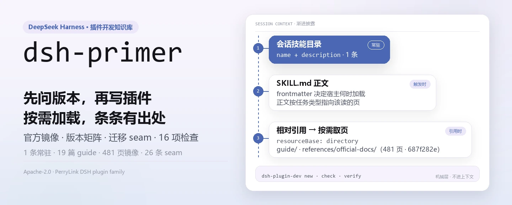
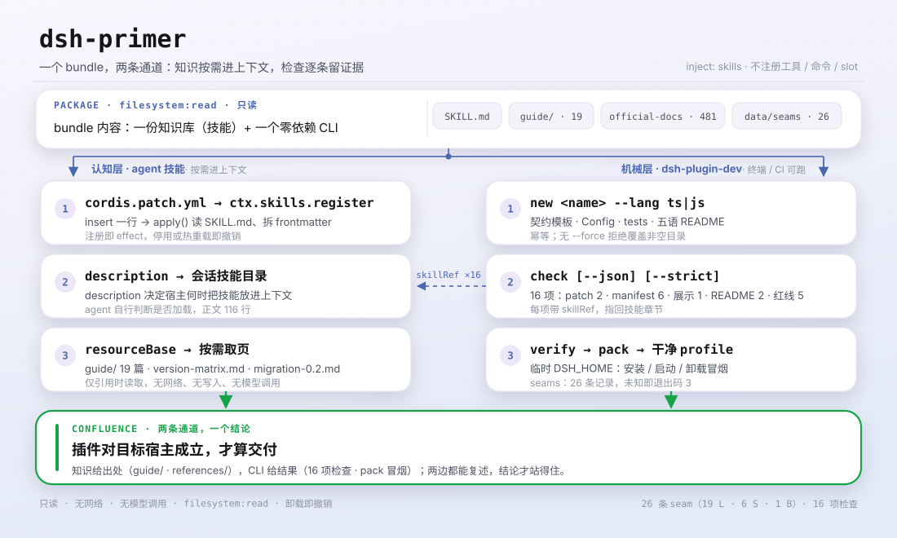

<div align="center">

<picture>
  <source media="(prefers-color-scheme: dark)" srcset="docs/assets/dsh-primer-hero-zh-dark.webp">
  
</picture>

# dsh-primer

**先问清楚版本再动手——让 agent 按目标宿主写插件，而不是背旧 API。**

面向 DeepSeek Harness 的插件开发知识库：官方文档逐字镜像、版本兼容矩阵、迁移 seam 与实战踩坑，装成一项按需加载的 agent 技能；外加 `dsh-plugin-dev new / check / verify` 脚手架与检查 CLI。

[安装](#三步上手) · [配置](#配置) · [FAQ](#faq) · [简体中文](README.md) · [English](README.en.md) · [Español](README.es.md) · [Português](README.pt.md) · [हिन्दी](README.hi.md)

[](LICENSE)
[](#兼容性)
[](https://www.npmjs.com/package/dsh-primer)
[](https://github.com/PerryLink/dsh-primer/actions/workflows/verify.yml)
[](#兼容性)

[](https://github.com/PerryLink/dsh-primer/stargazers)
[](https://www.npmjs.com/package/dsh-primer)
[](https://dshfind.com/plugins/PerryLink/dsh-primer?ref=badge)
[](https://securityscorecards.dev/viewer/?uri=github.com/PerryLink/dsh-primer)
[](https://dsh.market/)

```sh
dsh plugin --profile <name> add dsh-primer
```

</div>

<sub>社区插件，与 DeepSeek 官方无关。唯一仓库：<https://github.com/PerryLink/dsh-primer>。</sub>

## 它是什么

`dsh-primer` 把 DSH 插件开发所需的东西打成一个可安装 bundle：一部分是知识库，注册成 `dsh-primer` agent 技能（每个会话的技能目录里可见，按需把工作流步骤、官方文档与社区深读加载进上下文）；另一部分是零运行时依赖的 `dsh-plugin-dev` CLI，在知识库之上提供三个机械层。

社区维护，**非** DeepSeek 官方产品。DeepSeek Harness 处于开发者预览期并持续发布破坏性变更；有疑问时以 `references/official-docs/` 里的官方文档为准。

为什么不能只读官方文档？因为官方文档是写给"已经知道该翻哪一页"的人的，而 DSH 的发布节奏是每 1.7–2.8 天一个 prerelease，且带破坏性变更。本插件补的正是最耗时间的三处缺口：

| 缺口 | 本插件补什么 |
|---|---|
| **"我到底在对着哪一版开发？"** | [版本矩阵](guide/version-matrix.md)：五个都自称"最新"的值、子包 `latest` 冻结陷阱、破坏性变更断层，以及 `peerDependencies` 区间怎么选。**不存在稳定版**。 |
| **"这一版破坏了什么？"** | [迁移指南](guide/migration-0.2.md)：把 `0.1.6-alpha.2` → `0.2.1-alpha.2` 整理成可引用的 seam，每条含症状*与*修法并附官方出处——包括一处数据丢失风险和一处"模型请求还没发出就失败"的变更。 |
| **"我的插件真的对吗？"** | [零依赖 CLI](SKILL.md)（`dsh-plugin-dev new / check / verify`）+ [官方文档逐字离线镜像](references/official-docs/)，让 agent 能引确切页面而不是靠猜。 |

<picture>
  <source media="(prefers-color-scheme: dark)" srcset="docs/assets/dsh-primer-flow-v5-dark.svg">
  
</picture>

## 三步上手

1. **安装**（三选一）：

   ```sh
   # npm 通道（已发布版本，首选）
   dsh plugin --profile web add dsh-primer
   # git 通道（最新 main）：dist/ 未入库，pnpm 需先 allowlist 本包的 prepare 构建
   dsh plugin --profile web add github:PerryLink/dsh-primer#<sha>
   # tarball 通道：本仓库 pnpm pack 后
   dsh plugin --profile web add ./dsh-primer-<version>.tgz
   ```

2. **重启并确认行已挂载**：

   ```sh
   dsh --profile web --dump-config | grep -A3 'id: dsh-primer'
   ```

   ```text
   - id: dsh-primer
     name: dsh-primer
   ```

   会话技能目录里应出现 `dsh-primer`，技能正文是包内 `SKILL.md`，相对引用经目录型 `resourceBase` 解析到 `guide/` 与 `references/`。

3. **60 秒自证**（或直接对 agent 说"用 dsh-primer 技能帮我做一个 … 插件"）：

   ```sh
   npx dsh-primer new hello-plugin                  # 脚手架生成一个 TS 插件仓库
   cd hello-plugin && npx dsh-primer check --json   # 16 项静态检查
   npx dsh-primer verify                            # 打包 + 干净 profile 冒烟
   ```

**卸载**：`dsh plugin --profile web remove dsh-primer`（或从 profile patch 删掉该行）。技能注册是 Cordis effect，卸载即撤销，不留残留。

> 首次安装请走 npm 通道。git 通道拉的是源码而 `dist/` 未入库，pnpm 必须跑本包的 `prepare` 构建，因此要先把该包加进 profile 的 `allowBuilds`——这是 git 安装的已知门槛，不是缺陷，但作为第一次体验很差。

<details>
<summary>从 DSH Desktop 市场安装</summary>

所有 PerryLink 插件均可在 DSH Desktop 内置市场中浏览：**市场 → 来源 → 添加来源 → 粘贴** `https://perrylink-dsh-catalog.perrylink.workers.dev/catalog-source.json` **→ 选中**。安装仍需通过市场的 npm 身份校验与你的确认。1024 商店渠道：先 `npm i -g dsh1024`，再 `dsh1024 plugin --profile web add dsh-primer`。

</details>

## 核心能力

`dsh-primer` 是 DSH 插件开发知识库加 CLI 工具链，打包为一个可安装 bundle。知识库注册为 `dsh-primer` agent 技能（在每个会话目录可见，按需加载工作流步骤、官方文档与社区深读）；`dsh-plugin-dev` CLI 在其之上提供三个机械层。

- **插件契约与红线** —— effect/disposer、waterfall 必调 `next()`、宿主自有会话事件、模型可见 ⟺ 已记录、Schemastery 配置、UI 与性能规则。
- **官方文档逐字镜像** —— `references/official-docs/`：官方仓库文档（英 + 中）逐字副本，在最近核验快照处与上游逐字节一致，含从不进文档站的页面。
- **版本适配矩阵** —— [guide/version-matrix.md](guide/version-matrix.md)：五个"最新"的区别、子包 `latest` 冻结陷阱、四条破坏性变更断层、peer 区间怎么选、会话格式 V0→V4 谱系，以及 `0.2.1-alpha.2` 落的 19 条破坏性变更。
- **迁移指南** —— [guide/migration-0.2.md](guide/migration-0.2.md)：`0.1.6-alpha.2` → `0.2.1-alpha.1` 的每条破坏性变更（会话格式 V4、settings 重建、不变量移除、`readBytes`、新 slot、退役的 `plugin` 消息源），每条附官方出处与 12 项检查清单。
- **Cordis 入门与官方技能要点** —— Cordis 的五个概念与机制时间线；[references/official-plugin-dev-skill.md](references/official-plugin-dev-skill.md) 提炼官方 `cordis-plugin-development` 的禁则、展示元数据清单与 UI/性能规则。
- **来源可核验的 bug 索引** —— [guide/unfixed-issues.md](guide/unfixed-issues.md)：22 条未修 + 11 条新验证条目，每条带 `path:line`、规避法与修复提交，另有"设计取舍 vs 真 bug"对照表与明确的"无法复现"小节。
- **30+ 个实战踩坑** —— 附根因 + 修法（cordis 双副本、tsconfig 三件套、多帧 zstd 会话、Windows junction、过期 npm `latest`、`file:` 安装加载副本、实时 patch 写入…）。
- **社区深读** —— 归档 114 个社区仓库（15 个深读），每条事实都链回出处的完整来源索引。
- **CLI 工具链** —— `dsh-plugin-dev new / check / verify`：脚手架、静态检查（含展示元数据与多 patch 清单）、打包验证 DSH 插件；每个检查项都链回它强制执行的技能章节。
- **家族工具链路由与镜像范围决策** —— [guide/family-toolchain.md](guide/family-toolchain.md) 说明哪个工具负责哪个问题、`dsh-plugin-doctor` 33 项检查全表与本库 16 项检查的交叉对照；[references/mirror-scope-decision.md](references/mirror-scope-decision.md) 记录为什么"删掉零引用内容以省 80% 体积"经复测不成立。
- **采用分级（非官方）** —— [guide/standards.md](guide/standards.md)：DSH-ENTRY / DSH-FLOW / DSH-BOOST 三层模型、"采用深度 × 证据状态"两轴表、每层**不**声称什么，以及升级路径。GB / GB-T / GB-Z 仅为类比，认证 A–D 与三层正交。

### 表面

| 表面 | 类型 | 说明 |
|---|---|---|
| `dsh-primer` | skill | 经 `ctx.skills` 注册；按需加载 `SKILL.md` + `./guide/` + `./references/` |
| `dsh-plugin-dev` | bin（CLI） | `new` / `check` / `verify` 子命令；不是 DSH 插件行 |

## 知识库地图

| 路径 | 是什么 |
|---|---|
| `SKILL.md` | `dsh-primer` agent 技能：红线 + 按任务类型的开发路径 |
| `package.json` · `cordis.patch.yml` · `index.js` · `locale/` · `icon.svg` | 可安装 DSH bundle：`dsh.bundle.patch` 清单、注册技能的入口，以及 Plugin Manager 读取的展示元数据 |
| `guide/plugin-dev-guide.md` | 完整开发指南（10 章） |
| `guide/version-matrix.md` | 版本适配矩阵：五个"最新"的区别、子包 `latest` 冻结、破坏性变更断层、peer 区间选择、会话格式谱系、`0.2.1-alpha.2` 的 19 条变更 |
| `guide/migration-0.2.md` | 0.2 世代破坏性变更迁移指南（§0–§12 覆盖到 `0.2.1-alpha.1`，§13 覆盖 `0.2.1-alpha.2` 的 19 个 seam） |
| `guide/unfixed-issues.md` | 来源可核验的 bug 索引 + 已修清单 + 设计 vs bug 对照表 |
| `guide/quick-reference.md` | 一页速查表（5 语言） |
| `guide/links.md` | 精选 URL 索引：官方开发文档（站点 ↔ 本地副本）+ 社区文档链接 + 仅仓库内页面 |
| `guide/when-to-retire-a-plugin.md` | 插件退役与冻结：判据与一次组合审计的实测数据（中英双语） |
| `guide/choosing-a-plugin.md` | 插件选型：每个能力面该用哪个，含实测数字与核验警示（中英双语） |
| `guide/family-toolchain.md` | 家族工具链路由：问题 → 所有者 → 可引用产物；`dsh-plugin-doctor` 33 项检查全表，与本库 16 项检查交叉对照 |
| `guide/standards.md` | 采用分级（非官方）：DSH-ENTRY / DSH-FLOW / DSH-BOOST 三层与两轴表（中英双语） |
| `references/official-docs/` | 官方仓库文档逐字副本（英 + 中），新鲜度戳见 `SNAPSHOT.md` |
| `references/official-plugin-dev-skill.md` | 官方自带插件开发技能的提炼 |
| `references/mirror-scope-decision.md` | 镜像范围决策记录：为什么不按"零引用"裁剪（附可复跑的测量脚本） |
| `references/*.md` | 调研报告：仓库文档、网站、Cordis、论文、社区生态、114 仓库归档（15 个深读） |
| `scripts/` | 幂等下载脚本 + 完整性检查器 + 话题快照生成器 + 本 README 的配图生成脚本 |
| `bin/` · `src/cli/` · `dist/` | `dsh-plugin-dev` CLI：脚手架、检查器、验证器（TypeScript，tsdown 打包） |
| `templates/` | TS + JS 脚手架骨架：契约模板、Config、tests、`cordis.patch.yml`、locale 元数据、图标、五语 README |
| `downloads/` | 原始快照 —— 由 `scripts/` 生成、不入库 |
| `data/` | `facts.json`（自述数字的唯一出处）、`seams/index.json`（可查询的 seam 索引）、`standards.json` |

## CLI 工具链

bundle 附带零运行时依赖的 `dsh-plugin-dev` CLI（`bin/` → tsdown 打包的 `dist/dsh-plugin-dev.js`）。每个检查项都引用它强制执行的技能章节，agent 可以继续人工审计。

```sh
dsh-plugin-dev new <name> [--lang ts|js] [--dir <path>] [--force] [--git]
dsh-plugin-dev check [--cwd <dir>] [--json] [--strict]
dsh-plugin-dev verify [--cwd <dir>] [--dsh <bin>] [--pnpm <bin>]
dsh-plugin-dev seams <query> | --since <version>   # 这个 API 在我目标宿主里存在吗？
```

| 子命令 | 作用 |
|---|---|
| `new <name>` | 脚手架生成 TS 或 JS 插件仓库：`src/index.ts` 契约模板、Schemastery Config、tests、tsdown/vitest、注释齐全的 `cordis.patch.yml`、五语 README。幂等；无 `--force` 时拒绝覆盖非空目录。 |
| `check` | 静态检查：`cordis.patch.yml` 合法性、`package.json` 元数据（`dsh.bundle.patch` 指向、peer 依赖、engines、files 白名单）、五语 README 一致性、工程红线模式。输出 CI 可消费的 JSON。 |
| `verify` | `pnpm pack` 后装入干净 mkdtemp `DSH_HOME` profile 做安装/启动/卸载冒烟（对齐 `verify:self-contained`）。失败给出日志尾部与建议。 |

### 上游路线图

`dsh-plugin-dev` 是官方插件开发 CLI（规划项 C12）的上游候选：脚手架/检查器/验证器是机械层，`SKILL.md` + `guide/` 仍是认知层。

## 示例

以下为插件真实入口；安装后调用一个即可。

### 详细示例

**命令**

```sh
dsh-plugin-dev seams L3
```

**输出**

```text
1 seam(s):

L3  webRuntime service replaced by webStartup
    kind        service-renamed
    lands in    0.2.1-alpha.2
    confidence  documented
    official    docs/upgrade-guide/v0.2.1-alpha.1/web-listener-trust-config/guide.md
    removed     service webRuntime; row web-runtime; ctx.webRuntime.lanAddresses; wildcard --host
    instead     webStartup (row web-startup), concrete host literals
    detectable  yes — inspect: src/**/*.ts, cordis.patch.yml
```

*Observed from `src/cli/commands/seams.ts:54; data/seams/index.json:44`*

### 失败分支

**输入**

```text
node bin/dsh-plugin-dev.js seams no-such-seam-xyz
```

**输出**

```text
no seam or capability matches "no-such-seam-xyz". This is an absence of evidence in the knowledge base, not evidence that the API is absent from your target host — check references/official-docs/ before concluding either way.
```

*Observed from `src/cli/lib/seams.ts:122-130; src/cli/commands/seams.ts:87-92; tests/seams.test.ts:88-90`*

### 简短示例

`dsh-plugin-dev check --json` · `dsh-plugin-dev seams L3`

## 配置

技能 bundle 不暴露任何 Schemastery `Config` —— 它把知识库注册为 agent 技能，没有可调键；`cordis.patch.yml` 只 `insert` 自己那一行。可调项都在 `dsh-plugin-dev` CLI 上，从 flag 与 `DSH_PLUGIN_DEV_*` 环境变量读取。

| 键 | Flag | 环境变量 | 默认值 |
|---|---|---|---|
| `DSH_PLUGIN_DEV_TEMPLATES` | — | `DSH_PLUGIN_DEV_TEMPLATES` | `<package>/templates` |
| `--dsh` | `--dsh` | `DSH_PLUGIN_DEV_DSH` | `dsh` |
| `--pnpm` | `--pnpm` | `DSH_PLUGIN_DEV_PNPM` | `pnpm` |
| `--timeout` | `--timeout` | `DSH_PLUGIN_DEV_TIMEOUT` | `300000` ms |
| `--smoke-timeout` | `--smoke-timeout` | `DSH_PLUGIN_DEV_SMOKE_TIMEOUT` | `120000` ms |

要停用：从 profile patch 删掉该行，或执行 `dsh plugin --profile web remove dsh-primer`。

<details>
<summary>完整补丁文件（cordis.patch.yml，9 行）</summary>

```yaml
# dsh-primer bundle layer: register the packaged knowledge base as an agent skill.
# This file is the `dsh.bundle.patch` layer (see package.json#dsh.bundle.patch).
# Layer semantics: a YAML array of row verbs; `insert` adds plugin rows to the
# composed config. Later layers override a row by `id` (whole-config replacement).
- insert:
    # `id`: stable row identifier used by later layers to override this row.
    - id: dsh-primer
      # `name`: the module the loader imports; resolves to this package's entry (package.json#main → index.js).
      name: dsh-primer
```

</details>

## FAQ

<details>
<summary>知识库会不会把过期文档当成最新？</summary>

不会静默过期。官方文档镜像的源提交、源 tag、同步时间与页数都钉在 `references/official-docs/SNAPSHOT.md`；`.github/workflows/docs-drift.yml` 每周把上游 `master` 的 tip 与钉住的提交比对，一旦漂移就开 issue 并列出改动的文件，刷新动作留给人跑 `scripts/sync-official-docs.ps1`。`data/facts.json` 是自述数字的唯一出处，`check:facts` 会拦住与它不一致的表述。

</details>

<details>
<summary>装进 profile 会改我的配置或别的插件吗？</summary>

不会。bundle patch 只 `insert` 自己那一行（`id: dsh-primer`），从不覆写内置行的 `config`；插件在 `apply()` 里只经 `ctx.skills` 注册一个技能，注册包在 `ctx.effect()` 里，停止或热重载即撤销。它不注册工具、命令、客户端 slot 或 `webServer` 前缀，也不监听 `agent/pre-step` 这类顺序敏感事件。

</details>

<details>
<summary>它会联网或调用模型吗？</summary>

不会。运行时只读自己打包的 `guide/` 与 `references/`，无网络请求、无写入、无模型调用；`package.json#dshWorkshop.permissions` 只声明 `filesystem:read`。需要联网的只有你自己去跑 `scripts/download-*.ps1` 生成 `downloads/` 里的原始快照。

</details>

<details>
<summary>五语 README 与知识库数字怎么保证不漂？</summary>

四道门禁在 CI 里跑：`check:readmes` 对齐五语章节结构与配置键，`check:parity` 比较逐节块数，`check:facts` 校验自述数字与 `data/facts.json` 一致，`check:ps1-bom` 保证 PowerShell 脚本保留 UTF-8 BOM；`scripts/verify-kit.ps1` 另做关键路径与相对链接扫描。

</details>

## 安全边界

- **只读知识库。** bundle 只读取自身文件；绝不写入、绝不联网、绝不调用模型。
- **官方文档是逐字副本。** `references/official-docs/` 从不在本仓库修改；问题反馈给上游，且只经 `scripts/sync-official-docs.ps1` 重新同步。
- **分发边界。** 打包的第三方内容保留其上游许可；见 [NOTICE.md](NOTICE.md)（如 `downloads/` 仅本地、`awesome-dsh-plugins` 不得再分发）。

## 权限与数据

- **权限**：`package.json#dshWorkshop.permissions` 只声明 `filesystem:read`；插件在 `apply()` 时读取包内 `SKILL.md`，技能正文的相对引用经目录型 `resourceBase` 解析到包内 `guide/` 与 `references/`。
- **数据**：只读——不写 workspace、不写 profile 之外的位置；不装遥测，也不向 PerryLink 发送任何数据。宿主自己的会话/日志保留策略由宿主控制。

## 已知限制

- **官方文档是快照。** 上游变化时用 `scripts/sync-official-docs.ps1` 重新同步；新鲜度戳与提交号引用 `references/official-docs/SNAPSHOT.md`。
- **`downloads/` 由脚本生成、不入库。** 原始快照（社区仓库归档、Discussions、文章）使用前需用 `scripts/download-*.ps1` 生成。
- **`awesome-dsh-plugins` 内容仅本地。** 其上游声明内部使用约束，故不随仓库再分发。

## 与其他 DSH 插件的互操作性

本插件**不干扰**其他插件：

- **唯一依赖是 `skills` 服务。** 只经 `ctx.skills` 注册一个技能，不 import 宿主实现，也不提供任何服务键。
- **无工具/命令冲突。** 不注册任何工具或命令，因此不占用任何裸名。
- **无 slot 与 HTTP 路由冲突。** 不注册客户端 slot key，也不注册任何 `webServer` 前缀。
- **无 patch 层冲突。** 组合包 patch 只 `insert` 自己那一行，从不覆写内置行的 `config`。
- **无共享事件监听。** 不监听顺序敏感事件，因此不存在 waterfall 链条被短路的问题。
- **注册即 effect。** `ctx.effect(() => ctx.skills.register(...))`，停止或热重载即撤销贡献。

## 兼容性

| 维度 | 状态 |
|---|---|
| Harness | `engines.dsh` = `>=0.2.1-0 <0.3.0`。当前宿主线：npm `latest` = `next` = `0.2.1-rc.2`、`alpha` = `0.2.1-alpha.5`，最新 tag = `dsh-v0.2.1-rc.2`；**不存在稳定版**——31 个 npm 版本与 26 个 GitHub Release 全是 prerelease。官方文档镜像钉在同一提交（`687f282e…`，2026-10-18 同步，481 篇 md / 238 对中英双语）。 |
| Node | `>=24.9.0` |
| 平台 | 任何 DSH 可运行处（纯 ESM bundle；无原生代码、无网络） |
| 模型 | 任意（不调用模型：技能正文由宿主注入上下文） |

## 发布渠道

所有渠道都从本仓库或 npm 解析，因此**推一个 tag 就能到所有渠道**：

| 渠道 | 真源 | 更新方式 |
|---|---|---|
| npm（`dsh-primer`） | 本仓库的 `package.json` | `v*` tag 触发 `.github/workflows/release.yml`：`verify-kit` 门禁 → 校验 CHANGELOG 有该版本段 → `npm publish --provenance`（版本已存在则跳过） |
| GitHub Release | 同一个 tag | 同一 workflow 幂等创建 |
| 展示徽章（npm 版本、dshfind、OpenSSF、DSH Market） | 实时查询 | 无需发布——每次渲染都读 npm/registry |
| DSH Desktop Market / dsh1024 | npm | 市场装的就是 npm 包，发布即可安装，无需逐版本投稿 |

## 生态与质量

- [npm 包页](https://www.npmjs.com/package/dsh-primer)（已发布版本与下载量）
- [dshfind 插件页](https://dshfind.com/plugins/PerryLink/dsh-primer)（安装量与排名）
- [OpenSSF Scorecard 报告](https://securityscorecards.dev/viewer/?uri=github.com/PerryLink/dsh-primer)（由 [.github/workflows/scorecard.yml](.github/workflows/scorecard.yml) 驱动）
- [dsh-plugin-doctor 验证报告](https://github.com/PerryLink/dsh-plugin-doctor#verified-徽章)（家族检查清单与本库 16 项检查交叉对照见 [guide/family-toolchain.md](guide/family-toolchain.md)）
- [DSH Market](https://dsh.market/)（已上架）
- **1024 商店渠道**：先 `npm i -g dsh1024`，再 `dsh1024 plugin --profile web add dsh-primer`（计入 [deepseek1024.com](https://deepseek1024.com) 安装排行）
- [文档站](https://perrylink.github.io/dsh-primer/)：每章独立成页，另有机读的 [llms.txt](https://perrylink.github.io/dsh-primer/llms.txt)

## 保持知识库新鲜

```sh
pwsh -File scripts/sync-official-docs.ps1                     # 从本地 checkout 取逐字文档副本
pwsh -File scripts/download-sources.ps1                       # 官方站点/文档、Cordis、论文
pwsh -File scripts/download-community-repos.ps1               # 社区仓库（codeload tarballs）
pwsh -File scripts/download-community-articles.ps1            # zh/en/HN 社区文章
pwsh -File scripts/archive-discussions.ps1                    # 官方 Discussions（需 $env:GH_TOKEN）
pwsh -File scripts/gen-topic-snapshot.ps1 -OutDir <dir>       # dsh-plugin 话题普查
pwsh -File scripts/verify-kit.ps1 -Checkout <checkout>        # 关键路径 + 链接扫描 + 文档漂移
```

## 开发

技能 bundle（`index.js`）是纯 ESM、无构建步骤；`dsh-plugin-dev` CLI 是 TypeScript，经 tsdown 构建。门禁：

```sh
pnpm install --frozen-lockfile
pnpm run typecheck && pnpm run typecheck:ci
pnpm test
pnpm run build
pnpm run verify:artifacts        # 自检 + 脚手架冒烟（无网络）
pnpm run verify:self-contained   # 打包 + 干净 profile 安装/启动/卸载冒烟
pnpm run check:readmes           # 五语 README 章节结构与配置键一致
pnpm run check:parity            # 五语 README 逐节块数一致
pnpm run check:facts             # 自述数字与 data/facts.json 一致
pnpm run check:ps1-bom           # PowerShell 脚本保留 UTF-8 BOM
pnpm pack
pwsh -File scripts/verify-kit.ps1   # 关键路径 + 链接扫描（加 -Checkout <checkout> 做文档漂移）
```

配图由 [`scripts/gen-readme-assets.py`](scripts/gen-readme-assets.py) 程序化生成（Pillow 画 hero、手写 SVG 画结构图），可重复执行、幂等覆盖 `docs/assets/dsh-primer-hero-{zh,en}-{light,dark}.webp` 与 `docs/assets/dsh-primer-flow-v5-{light,dark}.svg`。

Topics：`dsh`, `deepseek-harness`, `dsh-plugin`, `cordis`, `agent-skill`, `plugin-development`, `knowledge-base`, `cli`, `scaffold`, `checker`

## 家族与致谢

本项目是 [PerryLink](https://github.com/PerryLink) 维护的 DeepSeek Harness 插件家族成员（全部 Apache-2.0）。如果这个插件帮到了你，**给个 star**——它不解锁任何功能，但会让下一个人更容易找到它。

- [@PerryLink](https://github.com/PerryLink) —— 创建者与维护者：知识库内容、可安装 bundle 改造、生态提交与社区工程。
- [@Yisa-yi](https://github.com/Yisa-yi) —— **产品经理**。全流程参与设计：确定以「可安装 bundle + 按需注册 agent skill」的形态交付、10 章开发指南的信息架构、「每条事实必须链接出处」的纪律，以及把认知层（`SKILL.md` + `guide/`）与机械层（`dsh-plugin-dev new / check / verify`）分开的分层设计；也定了 `guide/unfixed-issues.md` 的证据标准与 `guide/when-to-retire-a-plugin.md` 的冻结/退役判据。
- 日常维护由 DeepSeek Harness agents 辅助（它们无 GitHub 账号，为透明起见列于此，不作贡献者）。

<details>
<summary>展开全部插件</summary>

| 插件 | 状态 |
|---|---|
| **[dsh-aqua-input-check](https://github.com/PerryLink/dsh-aqua-input-check)** |  |
| **[dsh-archive-check](https://github.com/PerryLink/dsh-archive-check)** |  |
| **[dsh-auto-review](https://github.com/PerryLink/dsh-auto-review)** |  |
| **[dsh-autotier](https://github.com/PerryLink/dsh-autotier)** | 🧊 已冻结 — 见仓库 README |
| **[dsh-bid-ca-precheck](https://github.com/PerryLink/dsh-bid-ca-precheck)** |  |
| **[dsh-bid-qual-check](https://github.com/PerryLink/dsh-bid-qual-check)** |  |
| **[dsh-cert-mcp](https://github.com/PerryLink/dsh-cert-mcp)** | 🧊 已冻结 — 见仓库 README |
| **[dsh-checkpoint-rewind](https://github.com/PerryLink/dsh-checkpoint-rewind)** |  |
| **[dsh-click](https://github.com/PerryLink/dsh-click)** |  |
| **[dsh-composer-history](https://github.com/PerryLink/dsh-composer-history)** |  |
| **[dsh-contract-stance](https://github.com/PerryLink/dsh-contract-stance)** |  |
| **[dsh-customs-doc-check](https://github.com/PerryLink/dsh-customs-doc-check)** |  |
| **[dsh-data-quality](https://github.com/PerryLink/dsh-data-quality)** | 🧊 已冻结 — 见仓库 README |
| **[dsh-demurrage-ledger](https://github.com/PerryLink/dsh-demurrage-ledger)** |  |
| **[dsh-doublecheck](https://github.com/PerryLink/dsh-doublecheck)** |  |
| **[dsh-drill-script-check](https://github.com/PerryLink/dsh-drill-script-check)** |  |
| **[dsh-eia-guide-check](https://github.com/PerryLink/dsh-eia-guide-check)** |  |
| **[dsh-emergency-plan](https://github.com/PerryLink/dsh-emergency-plan)** |  |
| **[dsh-essay-rubric-check](https://github.com/PerryLink/dsh-essay-rubric-check)** |  |
| **[dsh-evidence-check](https://github.com/PerryLink/dsh-evidence-check)** |  |
| **[dsh-export-ctl-check](https://github.com/PerryLink/dsh-export-ctl-check)** |  |
| **[dsh-fast](https://github.com/PerryLink/dsh-fast)** |  |
| **[dsh-fmea-table-check](https://github.com/PerryLink/dsh-fmea-table-check)** |  |
| **[dsh-forecast-penalty](https://github.com/PerryLink/dsh-forecast-penalty)** |  |
| **[dsh-fund-research](https://github.com/PerryLink/dsh-fund-research)** |  |
| **[dsh-github](https://github.com/PerryLink/dsh-github)** |  |
| **[dsh-gongwen-flow-check](https://github.com/PerryLink/dsh-gongwen-flow-check)** |  |
| **[dsh-gongwen-word-check](https://github.com/PerryLink/dsh-gongwen-word-check)** |  |
| **[dsh-guard-plan-qc](https://github.com/PerryLink/dsh-guard-plan-qc)** |  |
| **[dsh-hazchem-check](https://github.com/PerryLink/dsh-hazchem-check)** |  |
| **[dsh-hazplan-check](https://github.com/PerryLink/dsh-hazplan-check)** |  |
| **[dsh-hidden-risk-map](https://github.com/PerryLink/dsh-hidden-risk-map)** |  |
| **[dsh-hs-classify](https://github.com/PerryLink/dsh-hs-classify)** |  |
| **[dsh-icd-rule-check](https://github.com/PerryLink/dsh-icd-rule-check)** |  |
| **[dsh-industry-research](https://github.com/PerryLink/dsh-industry-research)** |  |
| **[dsh-lawcite-adapter](https://github.com/PerryLink/dsh-lawcite-adapter)** |  |
| **[dsh-laya](https://github.com/PerryLink/dsh-laya)** |  |
| **[dsh-lc-doc-check](https://github.com/PerryLink/dsh-lc-doc-check)** |  |
| **[dsh-learning-gap-check](https://github.com/PerryLink/dsh-learning-gap-check)** |  |
| **[dsh-library](https://github.com/PerryLink/dsh-library)** |  |
| **[dsh-local-ai](https://github.com/PerryLink/dsh-local-ai)** |  |
| **[dsh-lsp-actions](https://github.com/PerryLink/dsh-lsp-actions)** |  |
| **[dsh-mask](https://github.com/PerryLink/dsh-mask)** |  |
| **[dsh-mcp-panel](https://github.com/PerryLink/dsh-mcp-panel)** |  |
| **[dsh-medrec-qc](https://github.com/PerryLink/dsh-medrec-qc)** |  |
| **[dsh-memento](https://github.com/PerryLink/dsh-memento)** | 🧊 已冻结 — 见仓库 README |
| **[dsh-nsfc-form-check](https://github.com/PerryLink/dsh-nsfc-form-check)** |  |
| **[dsh-nurse-record-check](https://github.com/PerryLink/dsh-nurse-record-check)** |  |
| **[dsh-observe](https://github.com/PerryLink/dsh-observe)** |  |
| **[dsh-origin-rvc-check](https://github.com/PerryLink/dsh-origin-rvc-check)** |  |
| **[dsh-ota-review-check](https://github.com/PerryLink/dsh-ota-review-check)** |  |
| **[dsh-output-styles](https://github.com/PerryLink/dsh-output-styles)** |  |
| **[dsh-paper-doc-adapter](https://github.com/PerryLink/dsh-paper-doc-adapter)** |  |
| **[dsh-permission-rules](https://github.com/PerryLink/dsh-permission-rules)** |  |
| **[dsh-permit-report-check](https://github.com/PerryLink/dsh-permit-report-check)** |  |
| **[dsh-pipeline-check](https://github.com/PerryLink/dsh-pipeline-check)** |  |
| **[dsh-pleading-draft](https://github.com/PerryLink/dsh-pleading-draft)** |  |
| **[dsh-plugin-doctor](https://github.com/PerryLink/dsh-plugin-doctor)** | 🚫 已退役（仓库已归档） |
| **[dsh-primer](https://github.com/PerryLink/dsh-primer)** |  |
| **[dsh-plugin-kit](https://github.com/PerryLink/dsh-plugin-kit)** | 🚫 已退役（仓库已归档） |
| **[dsh-plugin-upgrade](https://github.com/PerryLink/dsh-plugin-upgrade)** | 🚫 已退役（仓库已归档） |
| **[dsh-policy-brief-draft](https://github.com/PerryLink/dsh-policy-brief-draft)** |  |
| **[dsh-power-loss-split](https://github.com/PerryLink/dsh-power-loss-split)** |  |
| **[dsh-power-ticket-check](https://github.com/PerryLink/dsh-power-ticket-check)** |  |
| **[dsh-ppap-check](https://github.com/PerryLink/dsh-ppap-check)** |  |
| **[dsh-protest-deadline](https://github.com/PerryLink/dsh-protest-deadline)** |  |
| **[dsh-railway-window](https://github.com/PerryLink/dsh-railway-window)** |  |
| **[dsh-repair-order-qc](https://github.com/PerryLink/dsh-repair-order-qc)** |  |
| **[dsh-research-report](https://github.com/PerryLink/dsh-research-report)** |  |
| **[dsh-review-reply-check](https://github.com/PerryLink/dsh-review-reply-check)** |  |
| **[dsh-rulefile-check](https://github.com/PerryLink/dsh-rulefile-check)** |  |
| **[dsh-safety-brief-check](https://github.com/PerryLink/dsh-safety-brief-check)** |  |
| **[dsh-score](https://github.com/PerryLink/dsh-score)** | 🧊 已冻结 — 见仓库 README |
| **[dsh-session-sync](https://github.com/PerryLink/dsh-session-sync)** |  |
| **[dsh-site-log-check](https://github.com/PerryLink/dsh-site-log-check)** |  |
| **[dsh-skill-pack-security](https://github.com/PerryLink/dsh-skill-pack-security)** |  |
| **[dsh-soe-decision-check](https://github.com/PerryLink/dsh-soe-decision-check)** |  |
| **[dsh-soilwater-check](https://github.com/PerryLink/dsh-soilwater-check)** |  |
| **[dsh-sop-sync-check](https://github.com/PerryLink/dsh-sop-sync-check)** |  |
| **[dsh-spc-gbt-adapter](https://github.com/PerryLink/dsh-spc-gbt-adapter)** |  |
| **[dsh-talk](https://github.com/PerryLink/dsh-talk)** |  |
| **[dsh-tender-extract](https://github.com/PerryLink/dsh-tender-extract)** |  |
| **[dsh-tender-matrix](https://github.com/PerryLink/dsh-tender-matrix)** |  |
| **[dsh-test-drive](https://github.com/PerryLink/dsh-test-drive)** |  |
| **[dsh-ticktick](https://github.com/PerryLink/dsh-ticktick)** | 🚫 已退役（仓库已归档） |
| **[dsh-translate](https://github.com/PerryLink/dsh-translate)** |  |
| **[dsh-warranty-calc](https://github.com/PerryLink/dsh-warranty-calc)** |  |
| **[dsh-budget](https://github.com/PerryLink/dsh-budget)** | 🧊 已冻结 — 见仓库 README |
| **[dsh-claude-move](https://github.com/PerryLink/dsh-claude-move)** | 🧊 已冻结 — 见仓库 README |
| **[dsh-defend](https://github.com/PerryLink/dsh-defend)** | 🧊 已冻结 — 见仓库 README |
| **[dsh-draw](https://github.com/PerryLink/dsh-draw)** | 🧊 已冻结 — 见仓库 README |
| **[dsh-reach](https://github.com/PerryLink/dsh-reach)** | 🧊 已冻结 — 见仓库 README |
| **[dsh-background-agents](https://github.com/PerryLink/dsh-background-agents)** | 🚫 已退役（仓库已归档） |
| **[dsh-session-pin](https://github.com/PerryLink/dsh-session-pin)** | 🚫 已退役（仓库已归档） |
| **[dsh-team-rooms](https://github.com/PerryLink/dsh-team-rooms)** | 🚫 已退役（仓库已归档） |

</details>

## License

[LICENSE](LICENSE)（Apache License 2.0）© 2026 dsh-primer contributors —— 自有文本（`SKILL.md`、`guide/`、`references/`、`scripts/`、本 README）按 Apache-2.0；打包的第三方内容见 [NOTICE.md](NOTICE.md)。

<p align="center"><sub>Apache-2.0 · 社区插件，与 DeepSeek 无关。</sub></p>

## 工具链与上游（事实，2026-11）

- 本仓是旧版开发 skill / CLI；现役检查在 `dsh-standards`，指南在 `dsh-plugin-guide`，生成器在 `dsh-plugin-start`。
- 上游：`dsh-plugin-hub` main 已合入版本感知的 npm 元数据校验（[`4f3a560`](https://github.com/dshplugin/dsh-plugin-hub/commit/4f3a560)，2026-11-09）；范围仅安装侧 npm 元数据，不运行 ENTRY，也不构成背书。
