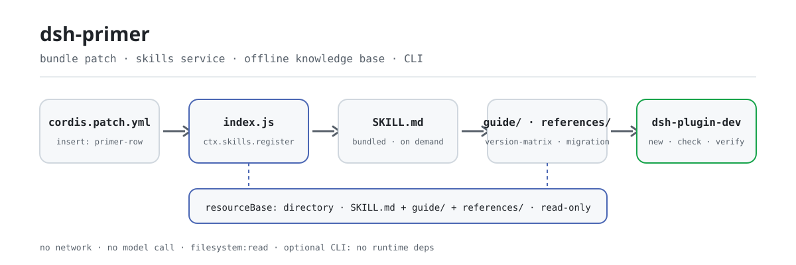

<div align="center">

<picture>
  <source media="(prefers-color-scheme: dark)" srcset="docs/assets/dsh-primer-flow-dark.svg">
  
</picture>

# dsh-primer

**Pergunte primeiro a qual versão você está mirando: faça o agente construir contra a linha do host, não contra uma API lembrada.**

A base de conhecimento de desenvolvimento de plugins para o DeepSeek Harness: espelho literal da documentação oficial, matriz de compatibilidade de versões, seams de migração e armadilhas testadas, instalada como skill de agente sob demanda; além do CLI `dsh-plugin-dev new / check / verify`.

[Instalar](#instalação-em-três-passos) · [Configuração](#configuração) · [FAQ](#faq) · [简体中文](README.md) · [English](README.en.md) · [Español](README.es.md) · [Português](README.pt.md) · [हिन्दी](README.hi.md)

[](LICENSE)
[](#compatibilidade)
[](https://www.npmjs.com/package/dsh-primer)
[](https://github.com/PerryLink/dsh-primer/actions/workflows/verify.yml)
[](#compatibilidade)

[](https://github.com/PerryLink/dsh-primer/stargazers)
[](https://www.npmjs.com/package/dsh-primer)
[](https://dshfind.com/plugins/PerryLink/dsh-primer?ref=badge)
[](https://securityscorecards.dev/viewer/?uri=github.com/PerryLink/dsh-primer)
[](https://dsh.market/)

```sh
dsh plugin --profile <name> add dsh-primer
```

</div>

<sub>Plugin da comunidade, sem afiliação com a DeepSeek. Repositório canônico: <https://github.com/PerryLink/dsh-primer>.</sub>

## O que é

O `dsh-primer` empacota tudo o que o desenvolvimento de plugins do DSH precisa num único bundle instalável: uma base de conhecimento registrada como a skill de agente `dsh-primer` (visível no catálogo de toda sessão, carregando sob demanda os passos de trabalho, a documentação oficial e as leituras da comunidade) e o CLI `dsh-plugin-dev`, sem dependências em tempo de execução, que acrescenta três camadas mecânicas sobre esse conhecimento.

Mantido pela comunidade, **não** é um produto oficial da DeepSeek. O DeepSeek Harness está em prévia para desenvolvedores e continua publicando mudanças incompatíveis; em caso de dúvida, a documentação oficial em `references/official-docs/` é a fonte da verdade.

Por que não basta ler a documentação oficial? Porque ela é escrita para quem já sabe qual página abrir, e o DSH publica um prerelease a cada 1,7–2,8 dias com mudanças incompatíveis. Este plugin cobre as três lacunas que mais custam tempo:

| Lacuna | O que este plugin acrescenta |
|---|---|
| **"Contra qual DSH eu estou desenvolvendo?"** | Uma [matriz de versões](guide/version-matrix.md): os cinco valores que se chamam "latest", as tags `latest` congeladas dos subpacotes, os seams de mudança incompatível e como escolher um intervalo de `peerDependencies`. **Não existe linha estável.** |
| **"O que esta versão quebra?"** | Um [guia de migração](guide/migration-0.2.md) que organiza `0.1.6-alpha.2` → `0.2.1-alpha.2` como seams citáveis, cada um com sintoma *e* correção e sua fonte oficial, incluindo um risco de perda de dados e uma mudança que faz os prompts falharem antes de a requisição ao modelo ser montada. |
| **"Meu plugin está realmente correto?"** | Um [CLI sem dependências](SKILL.md) (`dsh-plugin-dev new / check / verify`) mais um [espelho literal offline](references/official-docs/) da documentação oficial, para que o agente cite a página exata em vez de adivinhar. |

## Instalação em três passos

1. **Instalar** (um de três canais):

   ```sh
   # canal npm (versões publicadas: comece por aqui)
   dsh plugin --profile web add dsh-primer
   # canal git (main mais recente): dist/ não está no repositório, o pnpm precisa permitir o build prepare deste pacote
   dsh plugin --profile web add github:PerryLink/dsh-primer#<sha>
   # canal tarball: após pnpm pack neste repositório
   dsh plugin --profile web add ./dsh-primer-<version>.tgz
   ```

2. **Reiniciar e confirmar que a linha foi montada**:

   ```sh
   dsh --profile web --dump-config | grep -A3 'id: dsh-primer'
   ```

   ```text
   - id: dsh-primer
     name: dsh-primer
   ```

   O catálogo de skills da sessão deve listar `dsh-primer`; o corpo da skill é o `SKILL.md` do pacote, e suas referências relativas são resolvidas por um `resourceBase` de diretório para `guide/` e `references/`.

3. **Prove em 60 segundos** (ou peça ao agente: *"Use a skill dsh-primer para construir um plugin de …"*):

   ```sh
   npx dsh-primer new hello-plugin                  # gera um repositório de plugin TS
   cd hello-plugin && npx dsh-primer check --json   # 16 verificações estáticas
   npx dsh-primer verify                            # empacotamento + smoke em perfil limpo
   ```

**Desinstalar**: `dsh plugin --profile web remove dsh-primer` (ou apague a linha do patch do perfil). O registro é um efeito do Cordis, então desinstalar desfaz tudo sem resíduos.

> Para a primeira instalação use o canal npm. O canal git traz o código-fonte e `dist/` não está no repositório, então o pnpm precisa executar o build `prepare` deste pacote, o que exige permitir o pacote em `allowBuilds` do perfil. É um custo documentado das instalações git, não um defeito, mas proporciona uma péssima primeira experiência.

<details>
<summary>Instalar pelo mercado do DSH Desktop</summary>

Todos os plugins da PerryLink podem ser navegados no mercado embutido do DSH Desktop: **Mercado → Fontes → adicionar fonte → colar** `https://perrylink-dsh-catalog.perrylink.workers.dev/catalog-source.json` **→ selecionar**. A instalação continua passando pela verificação de identidade npm do mercado e pela sua confirmação. No canal da loja 1024: `npm i -g dsh1024` e depois `dsh1024 plugin --profile web add dsh-primer`.

</details>

## Capacidades principais

O `dsh-primer` é a base de conhecimento de desenvolvimento de plugins do DSH mais uma cadeia de ferramentas CLI, empacotada como um único bundle instalável. A base registra-se como a skill de agente `dsh-primer` (visível no catálogo de toda sessão, carregando sob demanda os passos de trabalho, a documentação oficial e as leituras da comunidade); o CLI `dsh-plugin-dev` acrescenta três camadas mecânicas em cima.

- **Contrato de plugin e regras duras** — effects/disposers, listeners waterfall que precisam chamar `next()`, eventos de sessão de propriedade do host, visível-para-o-modelo ⟺ registrado, configuração Schemastery, regras de UI e desempenho.
- **Espelho literal da documentação oficial** — `references/official-docs/`: cópia byte a byte dos documentos do repositório oficial (EN + ZH), idêntica ao upstream no último snapshot verificado, incluindo as páginas que nunca chegam ao site de documentação.
- **Matriz de adaptação de versões** — [guide/version-matrix.md](guide/version-matrix.md): os cinco valores "latest", as tags `latest` congeladas dos subpacotes, os quatro seams de mudança incompatível, como escolher o intervalo peer, a linhagem do formato de sessão V0→V4 e as 19 mudanças incompatíveis de `0.2.1-alpha.2`.
- **Guia de migração** — [guide/migration-0.2.md](guide/migration-0.2.md): cada mudança incompatível de `0.1.6-alpha.2` a `0.2.1-alpha.1` (formato de sessão V4, reconstrução de settings, remoção de invariantes, `readBytes`, slots novos, a fonte de mensagem `plugin` aposentada), cada uma com sua fonte oficial e uma lista de 12 verificações.
- **Primer do Cordis e a skill oficial, destilada** — os cinco conceitos do Cordis e a linha do tempo de mecanismos; [references/official-plugin-dev-skill.md](references/official-plugin-dev-skill.md) destila as proibições de `cordis-plugin-development`, a lista de metadados de apresentação e as regras de UI/desempenho.
- **Índice de bugs verificados** — [guide/unfixed-issues.md](guide/unfixed-issues.md): 22 não corrigidos + 11 recém-verificados, cada um com `path:line`, contorno e commit de correção, mais uma tabela projeto-vs-bug e uma seção explícita de "não reproduzível".
- **Mais de 30 armadilhas reais** com causa raiz e correção (cópias duplas do cordis, o trio de tsconfig, sessões zstd multiframe, junctions do Windows, `latest` desatualizado no npm, instalações `file:` carregando uma cópia, gravações de patch em tempo real…).
- **Leituras da comunidade** — 114 repositórios da comunidade arquivados (15 analisados a fundo), mais um índice de fontes em que cada fato liga à sua origem.
- **Cadeia de ferramentas CLI** — `dsh-plugin-dev new / check / verify`: andaime, verificação estática (incluindo metadados de apresentação e manifestos multi-patch) e verificação de empacotamento de plugins DSH; cada verificação liga à seção da skill que aplica.
- **Roteamento da cadeia de ferramentas da família e decisão de escopo do espelho** — [guide/family-toolchain.md](guide/family-toolchain.md) diz qual ferramenta responde a cada pergunta, com a tabela completa de 33 verificações do `dsh-plugin-doctor` cruzada com as 16 deste repositório; [references/mirror-scope-decision.md](references/mirror-scope-decision.md) registra por que "apagar o conteúdo sem referências para economizar 80% do tamanho" não sobreviveu à remedição.
- **Níveis de adoção (não oficiais)** — [guide/standards.md](guide/standards.md): o modelo DSH-ENTRY / DSH-FLOW / DSH-BOOST, a tabela profundidade × evidência, o que cada nível **não** afirma e como subir. A comparação GB / GB-T / GB-Z é apenas uma analogia; as notas de certificação A–D são ortogonais.

### Superfícies

| Superfície | Tipo | Notas |
|---|---|---|
| `dsh-primer` | skill | Registrada via `ctx.skills`; carrega `SKILL.md` + `./guide/` + `./references/` sob demanda |
| `dsh-plugin-dev` | bin (CLI) | Subcomandos `new` / `check` / `verify`; não é uma linha de plugin DSH |

## Mapa da base de conhecimento

| Caminho | O que é |
|---|---|
| `SKILL.md` | A skill de agente `dsh-primer`: regras duras + caminhos de desenvolvimento por tipo de tarefa |
| `package.json` · `cordis.patch.yml` · `index.js` · `locale/` · `icon.svg` | O bundle DSH instalável: manifesto `dsh.bundle.patch`, entrada que registra a skill e metadados de apresentação lidos pelo Plugin Manager |
| `guide/plugin-dev-guide.md` | O guia de desenvolvimento completo (10 capítulos) |
| `guide/version-matrix.md` | Matriz de adaptação de versões: os cinco "latest", tags `latest` congeladas, seams de mudança incompatível, escolha de intervalo peer, linhagem do formato de sessão, as 19 mudanças de `0.2.1-alpha.2` |
| `guide/migration-0.2.md` | Guia de migração de mudanças incompatíveis da geração 0.2 (§0–§12 até `0.2.1-alpha.1`, §13 com os 19 seams de `0.2.1-alpha.2`) |
| `guide/unfixed-issues.md` | Índice de bugs verificado em fontes + lista corrigida no master + tabela projeto-vs-bug |
| `guide/quick-reference.md` | Folha de consulta de uma página (5 idiomas) |
| `guide/links.md` | Índice de URLs curado: documentação oficial de desenvolvimento (site ↔ cópias locais) + links da comunidade + páginas só do repositório |
| `guide/when-to-retire-a-plugin.md` | Aposentar e congelar plugins: os critérios e os dados medidos de uma auditoria de portfólio (EN + ZH) |
| `guide/choosing-a-plugin.md` | Escolher plugin: quem lidera cada superfície de capacidade, com os números medidos e as ressalvas de verificação (EN + ZH) |
| `guide/family-toolchain.md` | Roteamento da cadeia de ferramentas da família: pergunta → dono → artefato citável; a tabela completa de 33 verificações do `dsh-plugin-doctor` cruzada com as 16 deste repositório |
| `guide/standards.md` | Níveis de adoção (não oficiais): o modelo DSH-ENTRY / DSH-FLOW / DSH-BOOST e a tabela de dois eixos (EN + ZH) |
| `references/official-docs/` | Cópia literal dos documentos do repositório oficial (EN + ZH); o selo de atualidade fica em `SNAPSHOT.md` |
| `references/official-plugin-dev-skill.md` | Skill oficial de desenvolvimento de plugins, destilada |
| `references/mirror-scope-decision.md` | Registro da decisão de escopo do espelho: por que ele não é cortado por "zero referências" (com um script de medição reexecutável) |
| `references/*.md` | Relatórios de pesquisa: documentos do repositório, site, Cordis, o paper, ecossistema da comunidade, arquivo de 114 repositórios (15 analisados a fundo) |
| `scripts/` | Scripts de download idempotentes + verificador de integridade + gerador de snapshot de tópicos + o gerador de imagens deste README |
| `bin/` · `src/cli/` · `dist/` | O CLI `dsh-plugin-dev`: andaime, verificador, validador (TypeScript, empacotado com tsdown) |
| `templates/` | Esqueletos de andaime TS + JS: modelo de contrato, Config, tests, `cordis.patch.yml`, metadados de locale, ícone, READMEs em cinco idiomas |
| `downloads/` | Snapshots brutos — gerados por `scripts/`, não versionados |
| `data/` | `facts.json` (o único lar dos números autoafirmados), `seams/index.json` (índice de seams consultável), `standards.json` |

## Cadeia de ferramentas CLI

O bundle inclui o CLI `dsh-plugin-dev`, sem dependências em tempo de execução (`bin/` → `dist/dsh-plugin-dev.js` empacotado com tsdown). Cada verificação cita a seção da skill que aplica, então um agente pode continuar auditando à mão.

```sh
dsh-plugin-dev new <name> [--lang ts|js] [--dir <path>] [--force] [--git]
dsh-plugin-dev check [--cwd <dir>] [--json] [--strict]
dsh-plugin-dev verify [--cwd <dir>] [--dsh <bin>] [--pnpm <bin>]
dsh-plugin-dev seams <query> | --since <version>   # esta API existe no meu host alvo?
```

| Subcomando | O que faz |
|---|---|
| `new <name>` | Gera um repositório de plugin TS ou JS: modelo de contrato `src/index.ts`, Config do Schemastery, tests, tsdown/vitest, `cordis.patch.yml` comentado e READMEs em cinco idiomas. Idempotente; recusa destinos não vazios sem `--force`. |
| `check` | Verificações estáticas: validade do `cordis.patch.yml`, metadados do `package.json` (ponteiro `dsh.bundle.patch`, peer deps, engines, lista de arquivos), consistência dos cinco READMEs e padrões de linha vermelha. Emite JSON consumível por CI. |
| `verify` | `pnpm pack` e depois instala/inicia/desinstala o bundle num perfil `DSH_HOME` limpo em mkdtemp (alinhado com `verify:self-contained`). Falhas mostram a cauda do log e sugestões. |

### Roteiro upstream

O `dsh-plugin-dev` é candidato upstream do CLI oficial de desenvolvimento de plugins (item planejado C12): o andaime, o verificador e o validador são as camadas mecânicas, enquanto `SKILL.md` + `guide/` continuam sendo a camada cognitiva.

## Exemplos

Estes são os pontos de entrada reais do plugin; instale uma vez e chame um.

### Exemplo detalhado

**Comando**

```sh
dsh-plugin-dev seams L3
```

**Saída**

```text
1 seam(s):

L3  webRuntime service replaced by webStartup
    kind        service-renamed
    lands in    0.2.1-alpha.2
    confidence  documented
    official    docs/upgrade-guide/v0.2.1-alpha.1/web-listener-trust-config/guide.md
    removed     service webRuntime; row web-runtime; ctx.webRuntime.lanAddresses; wildcard --host
    instead     webStartup (row web-startup), concrete host literals
    detectable  yes — inspect: src/**/*.ts, cordis.patch.yml
```

*Observed from `src/cli/commands/seams.ts:54; data/seams/index.json:44`*

### Ramo de falha

**Entrada**

```text
node bin/dsh-plugin-dev.js seams no-such-seam-xyz
```

**Saída**

```text
no seam or capability matches "no-such-seam-xyz". This is an absence of evidence in the knowledge base, not evidence that the API is absent from your target host — check references/official-docs/ before concluding either way.
```

*Observed from `src/cli/lib/seams.ts:122-130; src/cli/commands/seams.ts:87-92; tests/seams.test.ts:88-90`*

### Exemplos curtos

`dsh-plugin-dev check --json` · `dsh-plugin-dev seams L3`

## Configuração

O bundle da skill não expõe nenhum `Config` do Schemastery: registra a base de conhecimento como skill de agente sem chaves ajustáveis, e o `cordis.patch.yml` apenas insere a própria linha. Tudo o que é ajustável fica no CLI `dsh-plugin-dev` e é lido de uma flag ou de uma variável de ambiente `DSH_PLUGIN_DEV_*`.

| Chave | Flag | Ambiente | Padrão |
|---|---|---|---|
| `DSH_PLUGIN_DEV_TEMPLATES` | — | `DSH_PLUGIN_DEV_TEMPLATES` | `<package>/templates` |
| `--dsh` | `--dsh` | `DSH_PLUGIN_DEV_DSH` | `dsh` |
| `--pnpm` | `--pnpm` | `DSH_PLUGIN_DEV_PNPM` | `pnpm` |
| `--timeout` | `--timeout` | `DSH_PLUGIN_DEV_TIMEOUT` | `300000` ms |
| `--smoke-timeout` | `--smoke-timeout` | `DSH_PLUGIN_DEV_SMOKE_TIMEOUT` | `120000` ms |

Para desativar: apague a linha do patch do perfil, ou execute `dsh plugin --profile web remove dsh-primer`.

<details>
<summary>Arquivo de patch completo (cordis.patch.yml, 9 linhas)</summary>

```yaml
# dsh-primer bundle layer: register the packaged knowledge base as an agent skill.
# This file is the `dsh.bundle.patch` layer (see package.json#dsh.bundle.patch).
# Layer semantics: a YAML array of row verbs; `insert` adds plugin rows to the
# composed config. Later layers override a row by `id` (whole-config replacement).
- insert:
    # `id`: stable row identifier used by later layers to override this row.
    - id: dsh-primer
      # `name`: the module the loader imports; resolves to this package's entry (package.json#main → index.js).
      name: dsh-primer
```

</details>

## FAQ

<details>
<summary>A base de conhecimento vai me servir documentação desatualizada sem avisar?</summary>

Não. O espelho fixa seu commit de origem, tag, hora de sincronização e número de páginas em `references/official-docs/SNAPSHOT.md`; `.github/workflows/docs-drift.yml` compara toda semana a ponta do `master` upstream com esse commit e abre uma issue nomeando os arquivos alterados quando há deriva. A atualização continua sendo uma ação humana (`scripts/sync-official-docs.ps1`). `data/facts.json` é o único lar dos números que este projeto afirma sobre si mesmo, e `check:facts` recusa a prosa que não concorda com ele.

</details>

<details>
<summary>Instalá-lo muda meu perfil ou outros plugins?</summary>

Não. O patch do bundle apenas `insert` a própria linha (`id: dsh-primer`) e nunca sobrescreve o `config` de uma linha embutida. Em `apply()` o plugin registra somente uma skill via `ctx.skills`, envolvida em `ctx.effect()`, então parar ou recarregar a quente desfaz tudo. Ele não registra ferramentas, comandos, chaves de slot de cliente nem prefixos `webServer`, e não escuta nenhum evento sensível à ordem como `agent/pre-step`.

</details>

<details>
<summary>Ele faz requisições de rede ou chama um modelo?</summary>

Não. Em tempo de execução ele só lê o próprio `guide/` e `references/` empacotados: sem requisições de rede, sem gravações e sem chamadas ao modelo; `package.json#dshWorkshop.permissions` declara apenas `filesystem:read`. A única rede é você executando `scripts/download-*.ps1` para gerar os snapshots brutos em `downloads/`.

</details>

<details>
<summary>Como os cinco READMEs e os números da base se mantêm sincronizados?</summary>

Quatro portões rodam na CI: `check:readmes` compara a estrutura de seções e as chaves de configuração entre os cinco idiomas, `check:parity` compara o número de blocos por seção, `check:facts` valida os números autoafirmados contra `data/facts.json`, e `check:ps1-bom` mantém o BOM UTF-8 dos scripts PowerShell. `scripts/verify-kit.ps1` acrescenta uma varredura de caminhos críticos e links relativos.

</details>

## Limites de segurança

- **Base de conhecimento somente leitura.** O bundle só lê seus próprios arquivos; nunca escreve, nunca acessa a rede e nunca invoca um modelo.
- **A documentação oficial são cópias literais.** `references/official-docs/` nunca é editado aqui; reporte os problemas ao upstream e ressincronize apenas com `scripts/sync-official-docs.ps1`.
- **Limites de distribuição.** O conteúdo de terceiros empacotado mantém sua licença upstream; veja [NOTICE.md](NOTICE.md) (por exemplo `downloads/` é apenas local e `awesome-dsh-plugins` não deve ser redistribuído).

## Permissões e dados

- **Permissões**: `package.json#dshWorkshop.permissions` declara apenas `filesystem:read`; `apply()` lê o `SKILL.md` empacotado, e as referências relativas do corpo da skill são resolvidas por um `resourceBase` de diretório para `guide/` e `references/` do pacote.
- **Dados**: somente leitura — não escreve no workspace nem fora do perfil; não inclui telemetria e não envia dados à PerryLink. A retenção das sessões e logs do host permanece sob controle do host.

## Limitações conhecidas

- **A documentação oficial é um snapshot.** Ressincronize com `scripts/sync-official-docs.ps1` quando o upstream se mover; o selo de atualidade e o hash do commit ficam em `references/official-docs/SNAPSHOT.md`.
- **`downloads/` é gerado, não versionado.** Os snapshots brutos (arquivos de repositórios da comunidade, Discussions, artigos) precisam ser gerados com `scripts/download-*.ps1` antes de usar.
- **O conteúdo de `awesome-dsh-plugins` é apenas local.** Seu upstream declara uma restrição de uso interno, então ele não é redistribuído com o repositório.

## Interoperabilidade com outros plugins DSH

Este plugin **não** interfere em outros plugins:

- **Sua única dependência é o serviço `skills`.** Registra uma skill via `ctx.skills`, não importa nenhuma implementação do host e não fornece nenhuma chave de serviço.
- **Sem colisão de ferramentas ou comandos.** Não registra ferramentas nem comandos, então não ocupa nenhum nome nu.
- **Sem colisão de slots ou de rotas HTTP.** Não registra chaves de slot de cliente nem qualquer prefixo `webServer`.
- **Sem colisão de camadas de patch.** O patch do bundle apenas `insert` a própria linha e nunca sobrescreve o `config` de uma linha embutida.
- **Sem listeners de eventos compartilhados.** Não escuta nenhum evento sensível à ordem, então não há cadeia waterfall que possa curto-circuitar.
- **O registro é um efeito.** `ctx.effect(() => ctx.skills.register(...))` fornece tudo e parar ou recarregar a quente desfaz.

## Compatibilidade

| Superfície | Estado |
|---|---|
| Harness | `engines.dsh` = `>=0.2.1-0 <0.3.0`. Linha atual do host: npm `latest` = `next` = `0.2.1-rc.2`, `alpha` = `0.2.1-alpha.5`, tag mais recente = `dsh-v0.2.1-rc.2`; **não existe linha estável** — as 31 versões do npm e as 26 releases do GitHub são prereleases. O espelho da documentação oficial está fixado no mesmo commit (`687f282e…`, sincronizado em 2026-10-18, 481 páginas md / 238 pares EN-ZH). |
| Node | `>=24.9.0` |
| Plataformas | Onde o DSH rodar (bundle ESM puro; sem código nativo, sem rede) |
| Modelo | Qualquer (sem interação com modelos: o host injeta o corpo da skill no contexto) |

## Canais de publicação

Todos os canais resolvem a partir deste repositório ou do npm, então uma tag chega a todos:

| Canal | Fonte da verdade | Como atualiza |
|---|---|---|
| npm (`dsh-primer`) | o `package.json` deste repositório | `.github/workflows/release.yml` com uma tag `v*`: portão `verify-kit` → verificação da seção do CHANGELOG → `npm publish --provenance` (pulado quando a versão já existe) |
| GitHub Release | a mesma tag | o mesmo workflow a cria de forma idempotente a partir da tag |
| Selos de descoberta (versão npm, dshfind, OpenSSF, DSH Market) | consultas ao vivo | não há nada a publicar: leem o npm/o registry em cada render |
| DSH Desktop Market / dsh1024 | npm | o mercado instala o pacote npm, então uma versão publicada é instalável na hora; sem envio por versão |

## Ecossistema e qualidade

- [Página do pacote npm](https://www.npmjs.com/package/dsh-primer) (versões publicadas e downloads)
- [Página do plugin no dshfind](https://dshfind.com/plugins/PerryLink/dsh-primer) (instalações e ranking)
- [Relatório OpenSSF Scorecard](https://securityscorecards.dev/viewer/?uri=github.com/PerryLink/dsh-primer) (impulsionado por [.github/workflows/scorecard.yml](.github/workflows/scorecard.yml))
- [Relatório de verificação do dsh-plugin-doctor](https://github.com/PerryLink/dsh-plugin-doctor#verified-徽章) (o cruzamento com as 16 verificações deste repositório está em [guide/family-toolchain.md](guide/family-toolchain.md))
- [DSH Market](https://dsh.market/) (listado)
- **Canal da loja 1024**: `npm i -g dsh1024` e depois `dsh1024 plugin --profile web add dsh-primer` (conta para o ranking de instalações do [deepseek1024.com](https://deepseek1024.com))
- [Site de documentação](https://perrylink.github.io/dsh-primer/): cada capítulo em sua própria página, mais um [llms.txt](https://perrylink.github.io/dsh-primer/llms.txt) legível por máquina

## Manter a base atualizada

```sh
pwsh -File scripts/sync-official-docs.ps1                     # cópia literal da documentação a partir de um checkout local
pwsh -File scripts/download-sources.ps1                       # site/documentação oficial, Cordis, paper
pwsh -File scripts/download-community-repos.ps1               # repositórios da comunidade (tarballs do codeload)
pwsh -File scripts/download-community-articles.ps1            # artigos zh/en/HN da comunidade
pwsh -File scripts/archive-discussions.ps1                    # Discussions oficiais (precisa de $env:GH_TOKEN)
pwsh -File scripts/gen-topic-snapshot.ps1 -OutDir <dir>       # censo do tópico dsh-plugin
pwsh -File scripts/verify-kit.ps1 -Checkout <checkout>        # caminhos críticos + varredura de links + deriva de docs
```

## Desenvolvimento

O bundle da skill (`index.js`) é ESM puro sem etapa de build; o CLI `dsh-plugin-dev` é TypeScript construído pelo tsdown. Portões:

```sh
pnpm install --frozen-lockfile
pnpm run typecheck && pnpm run typecheck:ci
pnpm test
pnpm run build
pnpm run verify:artifacts        # autoverificação + smoke de andaime (sem rede)
pnpm run verify:self-contained   # empacotamento + smoke de instalação/início/desinstalação em perfil limpo
pnpm run check:readmes           # os cinco READMEs compartilham estrutura de seções e chaves
pnpm run check:parity            # os cinco READMEs têm os mesmos blocos por seção
pnpm run check:facts             # os números autoafirmados coincidem com data/facts.json
pnpm run check:ps1-bom           # os scripts PowerShell mantêm o BOM UTF-8
pnpm pack
pwsh -File scripts/verify-kit.ps1   # caminhos críticos + varredura de links (+ deriva de docs com -Checkout <checkout>)
```

As imagens do README são geradas por [`scripts/gen-readme-assets.py`](scripts/gen-readme-assets.py) (Python + Pillow); é idempotente e reescreve `docs/assets/dsh-primer-flow-{light,dark}.svg`.

Tópicos: `dsh`, `deepseek-harness`, `dsh-plugin`, `cordis`, `agent-skill`, `plugin-development`, `knowledge-base`, `cli`, `scaffold`, `checker`

## Família e agradecimentos

Este projeto faz parte da família de plugins do DeepSeek Harness da [PerryLink](https://github.com/PerryLink) (todos Apache-2.0). Se este plugin ajudar você, **dê uma estrela**: nada é liberado por isso, mas faz a próxima pessoa encontrá-lo antes.

- [@PerryLink](https://github.com/PerryLink) — criador e mantenedor: conteúdo da base de conhecimento, a transformação em bundle instalável, envios ao ecossistema e engenharia de comunidade.
- [@Yisa-yi](https://github.com/Yisa-yi) — **product manager**. Participou de todo o arco de design: a decisão de entregá-lo como bundle instalável que registra uma skill de agente sob demanda, a arquitetura de informação do guia de 10 capítulos, a regra de "cada fato liga à sua origem" e a separação entre a camada cognitiva (`SKILL.md` + `guide/`) e a camada mecânica (`dsh-plugin-dev new / check / verify`). Também definiu o padrão de evidência de `guide/unfixed-issues.md` e os critérios de congelamento/aposentadoria de `guide/when-to-retire-a-plugin.md`.
- A manutenção diária conta com a ajuda de agentes do DeepSeek Harness (eles não têm conta no GitHub e são listados aqui por transparência, não como contribuidores).

<details>
<summary>Expandir todos os plugins</summary>

| Plugin | Status |
|---|---|
| **[dsh-aqua-input-check](https://github.com/PerryLink/dsh-aqua-input-check)** |  |
| **[dsh-archive-check](https://github.com/PerryLink/dsh-archive-check)** |  |
| **[dsh-auto-review](https://github.com/PerryLink/dsh-auto-review)** |  |
| **[dsh-autotier](https://github.com/PerryLink/dsh-autotier)** | 🧊 CONGELADO — ver o README do repo |
| **[dsh-bid-ca-precheck](https://github.com/PerryLink/dsh-bid-ca-precheck)** |  |
| **[dsh-bid-qual-check](https://github.com/PerryLink/dsh-bid-qual-check)** |  |
| **[dsh-cert-mcp](https://github.com/PerryLink/dsh-cert-mcp)** | 🧊 CONGELADO — ver o README do repo |
| **[dsh-checkpoint-rewind](https://github.com/PerryLink/dsh-checkpoint-rewind)** |  |
| **[dsh-click](https://github.com/PerryLink/dsh-click)** |  |
| **[dsh-composer-history](https://github.com/PerryLink/dsh-composer-history)** |  |
| **[dsh-contract-stance](https://github.com/PerryLink/dsh-contract-stance)** |  |
| **[dsh-customs-doc-check](https://github.com/PerryLink/dsh-customs-doc-check)** |  |
| **[dsh-data-quality](https://github.com/PerryLink/dsh-data-quality)** | 🧊 CONGELADO — ver o README do repo |
| **[dsh-demurrage-ledger](https://github.com/PerryLink/dsh-demurrage-ledger)** |  |
| **[dsh-doublecheck](https://github.com/PerryLink/dsh-doublecheck)** |  |
| **[dsh-drill-script-check](https://github.com/PerryLink/dsh-drill-script-check)** |  |
| **[dsh-eia-guide-check](https://github.com/PerryLink/dsh-eia-guide-check)** |  |
| **[dsh-emergency-plan](https://github.com/PerryLink/dsh-emergency-plan)** |  |
| **[dsh-essay-rubric-check](https://github.com/PerryLink/dsh-essay-rubric-check)** |  |
| **[dsh-evidence-check](https://github.com/PerryLink/dsh-evidence-check)** |  |
| **[dsh-export-ctl-check](https://github.com/PerryLink/dsh-export-ctl-check)** |  |
| **[dsh-fast](https://github.com/PerryLink/dsh-fast)** |  |
| **[dsh-fmea-table-check](https://github.com/PerryLink/dsh-fmea-table-check)** |  |
| **[dsh-forecast-penalty](https://github.com/PerryLink/dsh-forecast-penalty)** |  |
| **[dsh-fund-research](https://github.com/PerryLink/dsh-fund-research)** |  |
| **[dsh-github](https://github.com/PerryLink/dsh-github)** |  |
| **[dsh-gongwen-flow-check](https://github.com/PerryLink/dsh-gongwen-flow-check)** |  |
| **[dsh-gongwen-word-check](https://github.com/PerryLink/dsh-gongwen-word-check)** |  |
| **[dsh-guard-plan-qc](https://github.com/PerryLink/dsh-guard-plan-qc)** |  |
| **[dsh-hazchem-check](https://github.com/PerryLink/dsh-hazchem-check)** |  |
| **[dsh-hazplan-check](https://github.com/PerryLink/dsh-hazplan-check)** |  |
| **[dsh-hidden-risk-map](https://github.com/PerryLink/dsh-hidden-risk-map)** |  |
| **[dsh-hs-classify](https://github.com/PerryLink/dsh-hs-classify)** |  |
| **[dsh-icd-rule-check](https://github.com/PerryLink/dsh-icd-rule-check)** |  |
| **[dsh-industry-research](https://github.com/PerryLink/dsh-industry-research)** |  |
| **[dsh-lawcite-adapter](https://github.com/PerryLink/dsh-lawcite-adapter)** |  |
| **[dsh-laya](https://github.com/PerryLink/dsh-laya)** |  |
| **[dsh-lc-doc-check](https://github.com/PerryLink/dsh-lc-doc-check)** |  |
| **[dsh-learning-gap-check](https://github.com/PerryLink/dsh-learning-gap-check)** |  |
| **[dsh-library](https://github.com/PerryLink/dsh-library)** |  |
| **[dsh-local-ai](https://github.com/PerryLink/dsh-local-ai)** |  |
| **[dsh-lsp-actions](https://github.com/PerryLink/dsh-lsp-actions)** |  |
| **[dsh-mask](https://github.com/PerryLink/dsh-mask)** |  |
| **[dsh-mcp-panel](https://github.com/PerryLink/dsh-mcp-panel)** |  |
| **[dsh-medrec-qc](https://github.com/PerryLink/dsh-medrec-qc)** |  |
| **[dsh-memento](https://github.com/PerryLink/dsh-memento)** | 🧊 CONGELADO — ver o README do repo |
| **[dsh-nsfc-form-check](https://github.com/PerryLink/dsh-nsfc-form-check)** |  |
| **[dsh-nurse-record-check](https://github.com/PerryLink/dsh-nurse-record-check)** |  |
| **[dsh-observe](https://github.com/PerryLink/dsh-observe)** |  |
| **[dsh-origin-rvc-check](https://github.com/PerryLink/dsh-origin-rvc-check)** |  |
| **[dsh-ota-review-check](https://github.com/PerryLink/dsh-ota-review-check)** |  |
| **[dsh-output-styles](https://github.com/PerryLink/dsh-output-styles)** |  |
| **[dsh-paper-doc-adapter](https://github.com/PerryLink/dsh-paper-doc-adapter)** |  |
| **[dsh-permission-rules](https://github.com/PerryLink/dsh-permission-rules)** |  |
| **[dsh-permit-report-check](https://github.com/PerryLink/dsh-permit-report-check)** |  |
| **[dsh-pipeline-check](https://github.com/PerryLink/dsh-pipeline-check)** |  |
| **[dsh-pleading-draft](https://github.com/PerryLink/dsh-pleading-draft)** |  |
| **[dsh-plugin-doctor](https://github.com/PerryLink/dsh-plugin-doctor)** | 🚫 APOSENTADO (repo arquivado) |
| **[dsh-primer](https://github.com/PerryLink/dsh-primer)** |  |
| **[dsh-plugin-kit](https://github.com/PerryLink/dsh-plugin-kit)** | 🚫 APOSENTADO (repo arquivado) |
| **[dsh-plugin-upgrade](https://github.com/PerryLink/dsh-plugin-upgrade)** | 🚫 APOSENTADO (repo arquivado) |
| **[dsh-policy-brief-draft](https://github.com/PerryLink/dsh-policy-brief-draft)** |  |
| **[dsh-power-loss-split](https://github.com/PerryLink/dsh-power-loss-split)** |  |
| **[dsh-power-ticket-check](https://github.com/PerryLink/dsh-power-ticket-check)** |  |
| **[dsh-ppap-check](https://github.com/PerryLink/dsh-ppap-check)** |  |
| **[dsh-protest-deadline](https://github.com/PerryLink/dsh-protest-deadline)** |  |
| **[dsh-railway-window](https://github.com/PerryLink/dsh-railway-window)** |  |
| **[dsh-repair-order-qc](https://github.com/PerryLink/dsh-repair-order-qc)** |  |
| **[dsh-research-report](https://github.com/PerryLink/dsh-research-report)** |  |
| **[dsh-review-reply-check](https://github.com/PerryLink/dsh-review-reply-check)** |  |
| **[dsh-rulefile-check](https://github.com/PerryLink/dsh-rulefile-check)** |  |
| **[dsh-safety-brief-check](https://github.com/PerryLink/dsh-safety-brief-check)** |  |
| **[dsh-score](https://github.com/PerryLink/dsh-score)** | 🧊 CONGELADO — ver o README do repo |
| **[dsh-session-sync](https://github.com/PerryLink/dsh-session-sync)** |  |
| **[dsh-site-log-check](https://github.com/PerryLink/dsh-site-log-check)** |  |
| **[dsh-skill-pack-security](https://github.com/PerryLink/dsh-skill-pack-security)** |  |
| **[dsh-soe-decision-check](https://github.com/PerryLink/dsh-soe-decision-check)** |  |
| **[dsh-soilwater-check](https://github.com/PerryLink/dsh-soilwater-check)** |  |
| **[dsh-sop-sync-check](https://github.com/PerryLink/dsh-sop-sync-check)** |  |
| **[dsh-spc-gbt-adapter](https://github.com/PerryLink/dsh-spc-gbt-adapter)** |  |
| **[dsh-talk](https://github.com/PerryLink/dsh-talk)** |  |
| **[dsh-tender-extract](https://github.com/PerryLink/dsh-tender-extract)** |  |
| **[dsh-tender-matrix](https://github.com/PerryLink/dsh-tender-matrix)** |  |
| **[dsh-test-drive](https://github.com/PerryLink/dsh-test-drive)** |  |
| **[dsh-ticktick](https://github.com/PerryLink/dsh-ticktick)** | 🚫 APOSENTADO (repo arquivado) |
| **[dsh-translate](https://github.com/PerryLink/dsh-translate)** |  |
| **[dsh-warranty-calc](https://github.com/PerryLink/dsh-warranty-calc)** |  |
| **[dsh-budget](https://github.com/PerryLink/dsh-budget)** | 🧊 CONGELADO — ver o README do repo |
| **[dsh-claude-move](https://github.com/PerryLink/dsh-claude-move)** | 🧊 CONGELADO — ver o README do repo |
| **[dsh-defend](https://github.com/PerryLink/dsh-defend)** | 🧊 CONGELADO — ver o README do repo |
| **[dsh-draw](https://github.com/PerryLink/dsh-draw)** | 🧊 CONGELADO — ver o README do repo |
| **[dsh-reach](https://github.com/PerryLink/dsh-reach)** | 🧊 CONGELADO — ver o README do repo |
| **[dsh-background-agents](https://github.com/PerryLink/dsh-background-agents)** | 🚫 APOSENTADO (repo arquivado) |
| **[dsh-session-pin](https://github.com/PerryLink/dsh-session-pin)** | 🚫 APOSENTADO (repo arquivado) |
| **[dsh-team-rooms](https://github.com/PerryLink/dsh-team-rooms)** | 🚫 APOSENTADO (repo arquivado) |

</details>

## Licença

[LICENSE](LICENSE) (Apache License 2.0) © 2026 dsh-primer contributors — nosso próprio texto (`SKILL.md`, `guide/`, `references/`, `scripts/`, este README) é Apache-2.0; o conteúdo de terceiros empacotado está documentado em [NOTICE.md](NOTICE.md).

<p align="center"><sub>Apache-2.0 · Plugin da comunidade, sem afiliação com a DeepSeek.</sub></p>
